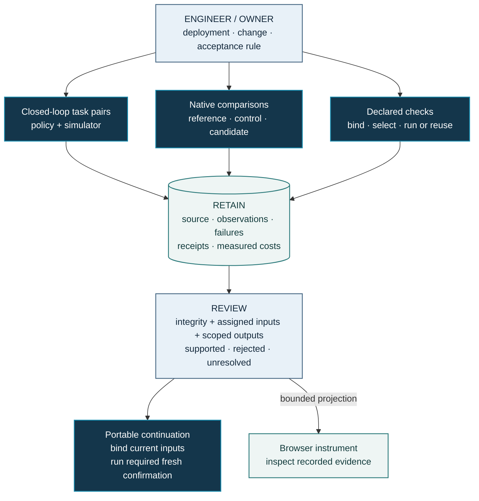
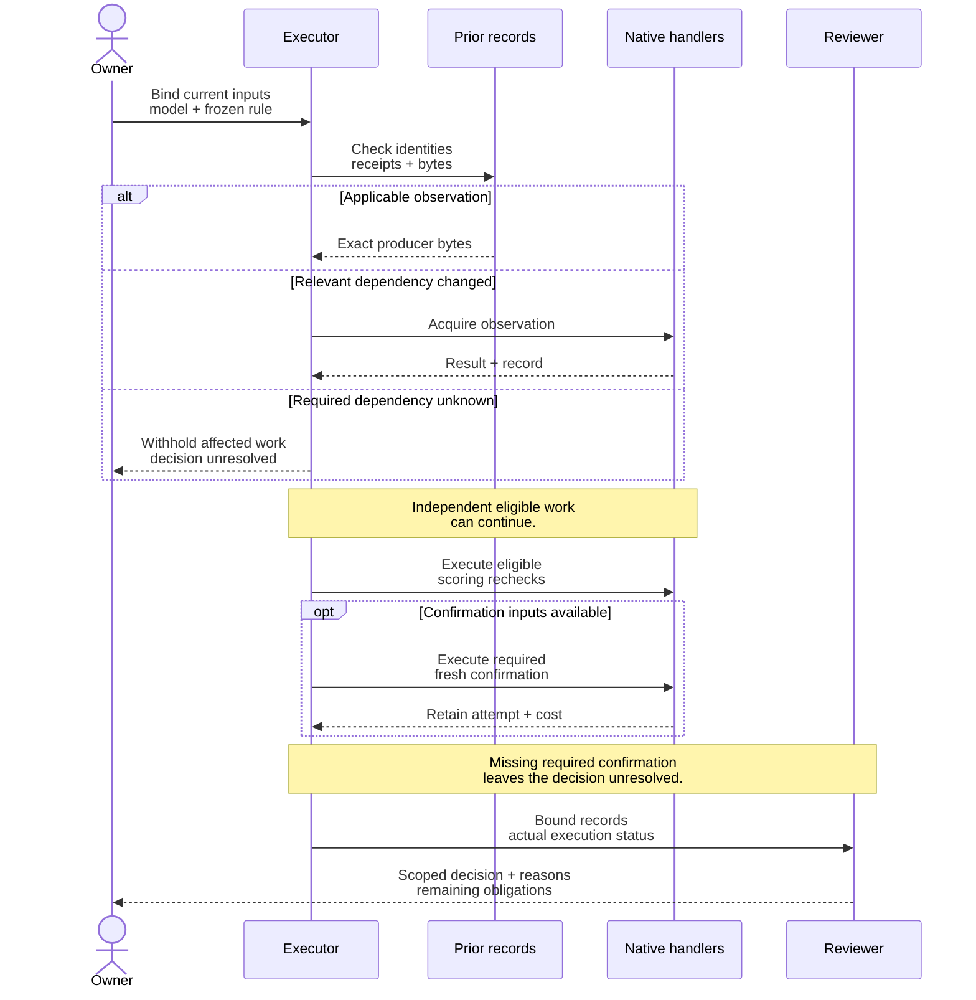
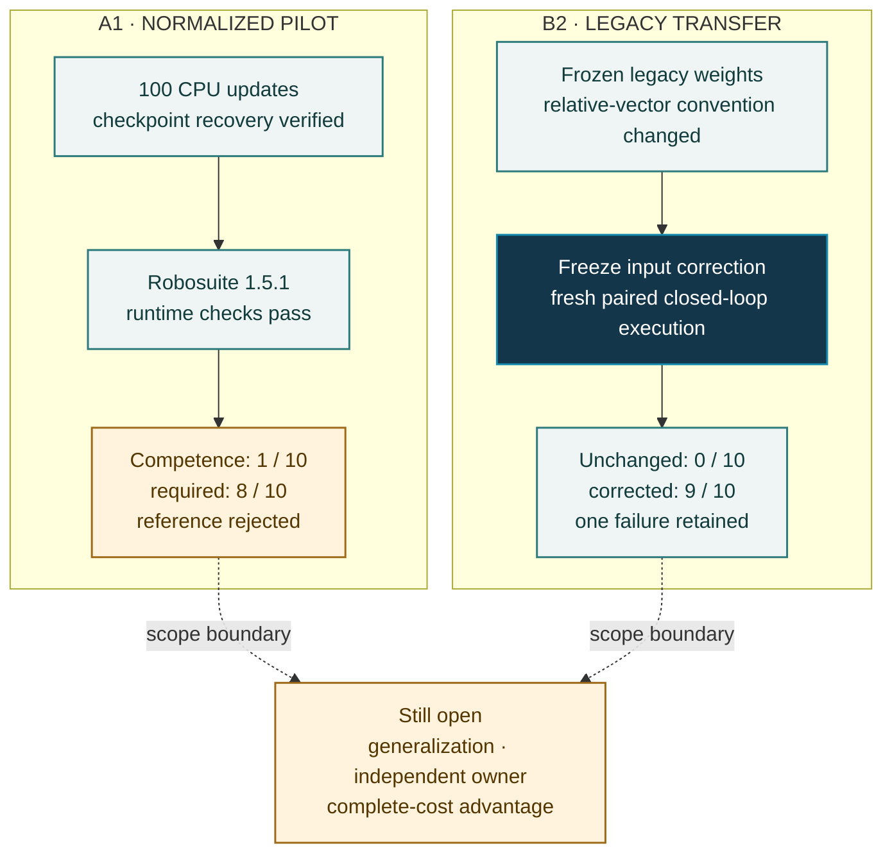
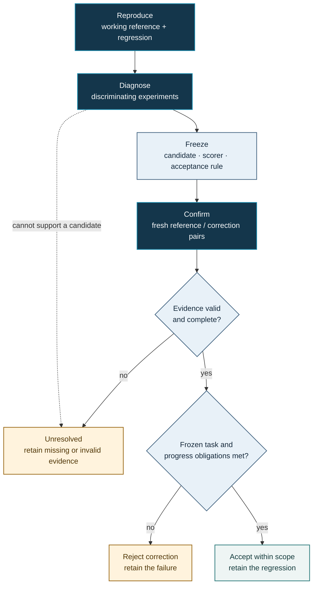

# Nisayon

**Qualification under change for physical AI.**

A robot policy can fail after a calibration update, a delayed observation or a
reset, even when its learned weights are unchanged. Recovering the task requires
more than a successful rerun: the correction must address the failure, preserve
task progress and survive fresh confirmation.

Nisayon is an experiment engine for that work. Given a working deployment, a
changed deployment and a failed task, it binds the relevant source and inputs,
executes bounded experiments, tests a frozen correction on fresh conditions and
retains the regression. When the evidence cannot support a decision, the result
stays unresolved.

The central question is **what must be checked again after this particular
change?** Current software can track declared dependencies, preserve applicable
observations, rerun affected checks and require fresh confirmation. A reviewer
can inspect a pinned portable packet without executing its producer's code.
Procedures, observations and verdicts have different reuse requirements.

The longer-term research aim is **physical intelligence that acquires and retains
competence without weakening the evidence required to accept a change**. The
[EDPI research direction](docs/EDPI_RESEARCH.md) connects evidence applicability,
experimental economy, cumulative adaptation and the physical consequences of
uncertainty. Each step has its own proof obligation; a better qualification
mechanism has not yet been shown to produce a better learning system.

The implemented system has three execution paths with distinct contracts:

| Path | What runs | What the result can establish |
| --- | --- | --- |
| Closed-loop task experiments | A frozen learned policy in a pinned headless CPU robosuite/MuJoCo runtime, with paired confirmation | Task outcomes for the declared policy, intervention, conditions and simulator |
| Native software qualification | Source-bound reference, control and candidate functions; captured calls and owner-file reads | The declared software obligation in the recorded environment |
| Declared dependency checks | Input acquisition, check selection, partial reuse, scoring and required confirmation | Applicability and a scoped decision under an explicitly reviewed dependency model |

Temporal tests exercise action chunks, late responses, clock uncertainty and
reset state. Native episode capture records LIBERO/LeRobot transitions, terminal
observations and physics/success calls for replay. Finite offline probes select
observations that distinguish declared causes or correction choices. These tools
have separate entry points and acceptance rules; the implementation map below
shows their boundaries.

The browser instrument makes retained evidence inspectable through recorded
scenes and bounded JSON projections. **Ricci has separate exhibit and physical
research paths within Nisayon.** Its authored Motion Study remains a design
artifact. The [Ricci Brain 01 experiment](experiments/ricci_brain01/README.md)
now tests contact/load decisions in a pinned G1 reference simulation, with a
separate evidence adapter. Neither path establishes Ricci dynamics, validated
hardware or a live control connection. Source publication and website deployment
are separate releases.

The intended advantage is the same defensible engineering decision with less
complete work. Setup, failed attempts, rechecks, confirmation and review all
count. The retained comparisons have **not established that advantage**. The
next proof is an independently owned consequential change, followed by an
untouched case using the frozen procedure.

[Try the SDK](docs/QUICKSTART.md) · [Available capabilities](docs/CAPABILITIES.md) ·
[Research direction](docs/EDPI_RESEARCH.md) ·
[Latest qualification experiment](experiments/edpi_finite/README.md) ·
[Open the instrument](https://nisayon.danielwahnich.dev/)

[System map](#the-system-and-the-next-proof) · [Results](#what-the-experiments-found) ·
[Code and review](#inspect-the-work) ·
[Latest progress](#latest-progress) ·
[Contributions](#external-corrections-and-open-decisions) · [Current boundary](#current-evidence-boundary) ·
[Run it](#reproduce) ·
[Experiment records](docs/experiments/README.md) · [Release](docs/RELEASE.md) ·
[Apache-2.0](LICENSE)

## The system and the next proof

The implemented tools bind source and assets, execute bounded experiments,
preserve incomplete attempts, check evidence, and confirm frozen corrections.
Deployment-specific software investigations also run against native upstream
implementations. These are concrete components and experiments; a general
intervention compiler, adaptive selector and reusable deployment product remain
proposed. A separate [finite active qualification study](experiments/edpi_finite/README.md)
now executes a bounded selector and audits its results through the existing SDK;
it is research code, with no demonstrated acquisition advantage. The subsequent
[Phase II probes](experiments/edpi_phase2/README.md) establish measurable physical
and serving-contract differences and strengthen assigned-input verification.
They stop before a new selector because owner-defined correction validity and
complete-cost headroom are still missing.




The diagram connects existing interfaces; it does not imply a general autonomous
dispatch service. Assigned-input checks are protocol-specific: the serving
supplement reconstructs its finite recipe; the production kernel does not infer
arbitrary experimental input semantics. Native episode capture and source-specific upstream studies
also retain their own evidence contracts. The paths have different acceptance rules. A native software verdict does not
grant task acceptance; upstream training studies are separate experiments, not
general SDK backends. Scripted temporal tests cover queues, timing and resets
without learned inference. Prediction-audit research remains separate from
runtime acceptance. The [implementation map](docs/ARCHITECTURE.md#implemented-code-and-data-flow)
and [native qualification flow](docs/NATIVE_QUALIFICATION.md#python-interface)
link these boundaries to code and controls.

The next milestone is one engineer's live choice between a runtime correction,
more training or data, and a different policy. Start with that engineer's
existing stack and competent conventional tools. Freeze the outcome and sampling
rules, confirm the selected correction on fresh task conditions, and measure
setup, failed attempts, diagnosis, confirmation, adoption, review and maintenance.
Equal or lower conventional cost at matched quality rejects the value claim
on that case. A separate untouched incident must then establish repeat use.

The current owner gate remains open: no participating owner case is admitted
for the prospective matched comparison. Existing interest and upstream adoption
are distinct from enrollment, permitted evidence and a live decision. Initial
intake has a four-engineering-hour ceiling. The
[owner protocol](docs/OWNER_COMPARISON.md) and
[9 November research assessment](docs/FRONTIER_REVIEW_2026-11-09.md) specify the
competent baseline, complete costs and conditions that would reject expansion.

## What survives a change

Reuse is a claim about a particular observation and its dependencies. The
engine binds current inputs before execution and verifies the exact bytes it
later reviews. A changed calibration invalidates its dependent observations;
an unrelated change can preserve them. A scoring-only change can reuse an
applicable observation while requiring a new score. Missing dependencies withhold
affected work. Required confirmation still runs.



The owner supplies dependency completeness and trusted handlers. Digests establish
byte identity, not physical truth. A coherent output for an unassigned input can
still fail the promised experiment. The [serving-reader correction](experiments/edpi_phase2/README.md#failures-remain-part-of-the-result)
checks that separate premise without changing the qualification kernel. Actions that change a trajectory require fresh
closed-loop execution; observations from the old future cannot answer that
counterfactual. The [applicability contract](docs/EVIDENCE_APPLICABILITY.md),
[executor](src/nisayon/qualification/checks.py),
[portable continuation](docs/PORTABLE_REVIEW.md) and
[dependency explanation](docs/CHECK_EXPLANATION.md) expose these rules.

On 23 November, an independent regression found that reused JSON was decoded
and serialized again, changing its bytes and breaking later review and export.
The [narrow correction](docs/experiments/results/evidence-reuse-2026-11-23/README.md)
preserves already verified producer bytes. All eight failing reuse cases now
pass; calibration invalidation, tamper reacquisition and unknown-input refusal
remain effective. This repaired continuation and reviewability. It did not
demonstrate a false task acceptance or a cost saving.

## Inspect the work

The review path follows the claim from implementation to evidence. Current
software tests, historical experiment outcomes and untested product proposals
have distinct scopes.

| Question | Start here |
|---|---|
| What runs, and where are its boundaries? | [Implemented modules and data flow](docs/ARCHITECTURE.md#implemented-code-and-data-flow), followed by the proposed architecture. |
| What makes a correction acceptable? | [Fresh-confirmation obligation](docs/evaluation/CONFIRMATION_OBLIGATION.md), [assessment code](src/nisayon/evaluation/confirmation.py) and [failure paths](tests/evaluation/). |
| What did the comparisons actually show? | [Results below](#what-the-experiments-found), [complete experiment index](docs/experiments/README.md), and each result's protocol, retained failures and reproduction commands. |
| Can this checkout reproduce the software checks? | [Development setup](docs/DEVELOPMENT.md), [locked dependencies](uv.lock) and [Linux/macOS checks](.github/workflows/ci.yml). Optional-stack and private-store skips remain explicit. |
| What did the current repository review verify? | [23 November source and diagram reconciliation](docs/experiments/results/source-refresh-2026-11-23/README.md), [native SDK comparison](docs/experiments/results/native-sdk-2026-10-23/README.md), and [earlier clean-clone checks](docs/experiments/results/main-refresh-2026-10-16/README.md). |
| What remains unproved? | [Current research decision](docs/FRONTIER_REVIEW_2026-11-16.md) and [next value test](#what-would-justify-the-next-experiment). |

## Latest progress

**27 November — trace recovery decisions to actual control.** The
[Ricci investigation](experiments/ricci_brain02/README.md) audits all 202 retained
episodes and executes 34 new native trials. Eight nominal reruns complete;
eleven historical trajectories reproduce exactly in the pinned environment.
The action/time study exposes a task-phase arithmetic boundary. An independent
solver also finds feasible witnesses for all nine terminal QPs in three censored
contact cases, while the original numerical gate correctly rejects their earlier
solutions. These findings narrow the next controller investigation; they do not
establish a recovery gain. A [read-only scientific inspection contract](experiments/ricci_brain02/OBSERVABILITY.md)
now binds actual observations, decisions, commands, clocks and model identities
for laboratory integration. Candidate promotion and fresh confirmation remain open.

**26 November — physical dependencies, serving contracts and a corrected reader.**
The [Phase II evidence](experiments/edpi_phase2/README.md) reproduces a
robosuite inertia/fluid mechanism and retains the failed XML identity check that
led to a compiled-model-copy correction. A separate LeRobot serving study runs
324 native software cases: the original validator accepts 20/108 requests,
a generated-placeholder-only proposal 24/108, and a broader optional-visual
proposal 36/108. All match their frozen contracts. No learned policy or physical
task is executed in that serving study.

Challenging those results found a defect in our own reader: it accepted seven
misleading input/type mutations, including a native-rejected NaN state in a
record labeled accepted. The supplement checks all 1,170 assigned input arrays,
refuses those mutations and preserves every original outcome. The original
reader and failures remain reproducible. **167 selected regression tests pass**;
portable readback also agrees outside Git under optimized Python. These checks
support the declared software evidence. Owner acceptance, fresh 32-pair task
confirmation, comparative selection value and complete-cost savings remain open.
[Reproduce the observations and counterexamples](experiments/edpi_phase2/REPRODUCE.md).

**26 November — reproduced evidence and a limit on active selection.** The
[bounded EDPI study](experiments/edpi_finite/README.md) reproduces the frozen-policy
cube result: 0/10 unchanged versus 9/10 corrected, with all twenty retained
numerical traces matching the exposed historical conditions. Its new four-case
qualification campaign retains 264 executions across seven methods and three
budgets. The decision-directed selector ties cost-aware static, coverage and
uncertainty selection; no comparative advantage is established. A subsequent
[symmetry proof](experiments/edpi_finite/SYMMETRY.md) shows why those rules must
agree under this acquisition model. The source, raw observations, independent
model-relative auditor, retained audit defects and reproduction commands are
published together. The [architecture direction](docs/EDPI_RESEARCH.md) keeps
cumulative learning and embodiment research behind their unmet evidence gates.

**24 November — Ricci's first reproducible physical decision experiment.**
The local CPU campaign completed 202 episodes after passing an 8/8 nominal gate.
Baseline and candidate each completed 17/28 held-out cases; the candidate does
not advance. Privileged information rescued one compound-fault case, exposing a
specific action/timing question. All 84 pre-decision comparisons matched; eight
selected success, failure and censored traces passed physics and sensor replay.
The work remains a reference simulation, with contact-solver sensitivity and
protective-terminal behavior unresolved. [Ricci architecture and reproduction](experiments/ricci_brain01/README.md) ·
[Results and next engineering decision](work/experiments/ricci-brain-01-2026-11-24/RESULTS.md).

**23 November — preserve valid evidence through reuse and source changes.**
The check executor now preserves the exact bytes of reused observations through
inspection, export, import and continued execution. The unchanged independent
regression went from eight failures and three passes to **11 passes**. A
three-case comparison against competent dependency-aware native checks reaches
the same decisions after the correction. The native comparator was faster in
these exposed scalar cases; no production or complete-cost saving is claimed.
[Failure, controls and comparison](docs/experiments/results/evidence-reuse-2026-11-23/README.md).

A separate **native FSDP qualification** retested a source-ownership correction
against Accelerate's newer loader, including ignored parameters and buffers.
Two real CPU/Gloo ranks passed the candidate's 20 development and eight fresh
confirmation conditions per rank. The base and a late-clear control fail the
owned-source lifetime obligation; borrowed inputs and tensor values stay intact.
The old candidate fails on mixed state, so its earlier evidence cannot simply
transfer. GPU memory, full model preparation and training remain unqualified.
[Source-bound result and offline verifier](docs/experiments/results/fsdp-source-transition-2026-11-23/README.md).

**19 November — LeRobot shutdown correction merged.** The final upstream
Full Tests job executed all four SIGINT/SIGTERM regressions successfully; the
owner-loop correction and tests remain in the audited upstream source. This is
a shutdown result, separate from LongWAM model qualification.
[Contribution audit](docs/contributions/retrospective-2026-11-23.md).

**16 November — review actual evidence and explain recorded reuse.** Read-only
[summary](docs/CHECK_SUMMARY.md), [measurement reassessment](docs/CHECK_MEASUREMENTS.md)
and [dependency explanation](docs/CHECK_EXPLANATION.md) interfaces operate on a
digest-pinned check packet. The reader refuses nonzero JSON numbers that underflow
to zero. A finite differential study checks 64 four-node graphs and 236 SDK
executions against an independently written full calculation. These results do
not establish complete real-world dependencies or a selective-execution advantage.
[Retained qualification](docs/experiments/results/source-refresh-2026-11-16/README.md).

The **23 November source update** passed **2,841 Python tests with 80 explicit skips** and
**622 frontend tests**, strict TypeScript and production build. All 18 public
Mermaid diagrams rendered in light and dark themes. The
[23 November validation record](docs/experiments/results/source-refresh-2026-11-23/README.md)
separates these local checks from historical experiments and unrun hosted CI. The
integrated browser supports the three bounded JSON projections; its older native
ZIP reader has a narrower contract. Later Ricci UI work has its own reference and visual acceptance records; this
Phase II publication does not incorporate uncommitted UI work. Earlier progress remains in the
[dated journal](docs/PROGRESS.md).

## External corrections and open decisions

The [23 November retrospective](docs/contributions/retrospective-2026-11-23.md)
reconciles **58 attributable PR records**: 15 in Nisayon, 20 Daniel-authored
external PRs and 23 other-author PRs with linked review, qualification or adopted
issue reports. These are contribution records, not 58 independent discoveries.
The ledger keeps author identity, exact revisions, tests, maintainer decisions
and lasting upstream use separate. Private, deleted, inaccessible and unknown-account
work remain coverage limits.

The strongest outcomes are retained fixes with executable failure evidence:
LeRobot's shutdown path, N-SCORE's binary sequential test, and the integrated
LongWAM corrections. GR00T's constant-statistics correction was incorporated
outside its original PR. Conversely, a merged PR can leave a reviewed defect
unchanged; the vla.cpp framing recommendation remains unadopted. Merge count
alone does not measure contribution value.

| Contribution | Verified disposition at the audit | Evidence boundary |
| --- | --- | --- |
| [LeRobot #5295](https://github.com/huggingface/lerobot/pull/5295) · signal shutdown | Merged 19 November; owner-loop fix and four regressions retained | All four cases executed in final Full Tests. No model-validation claim. |
| [N-SCORE #5](https://github.com/dasnyder5/nscore/pull/5) · binary sequential evidence | Merged; corrected discordance calculation retained | 284/4096 to 4/4096 exact null rejections in the constructed six-pair case; 95 native tests. The paper's continuous test is separate. |
| [LeRobot #5008](https://github.com/huggingface/lerobot/pull/5008) · LongWAM integration | Merged; scoped processor/model corrections retained | Source-bound integration and native qualification; owner-reported task results retain their own provenance. |
| [GR00T #796](https://github.com/NVIDIA/Isaac-GR00T/pull/796) · constant statistics | Closed; maintainer-linked internal adoption | Daniel supplied qualification on another author's patch. Later upstream extensions were not rerun in this audit. |
| [Accelerate #4447](https://github.com/huggingface/accelerate/pull/4447) · owned FSDP source lifetime | Closed during a contribution-process transition; maintainer invited an update | Current-source CPU proof is local. Full integration and GPU claims remain open; no new submission is implied. |

The immediate contribution recommendation is to finish the existing Accelerate
review path with the narrow source-transition evidence, after its remaining
integration gate. The [audit](docs/contributions/retrospective-2026-11-23.md)
records why competing or already-owned issues were not selected. Upstream
adoption and correspondence do not enroll an owner in Nisayon's prospective
value comparison.

A finding from Nisayon's evaluation work was adopted in **arisole-eval 0.1.3**.
A constructed case had 30 seed-matched episode pairs but only one fully labelled
pair. The old gate counted all 30 toward its evidence threshold and returned
`REVIEW`/0. The maintainer reproduced the issue and shipped a correction; the
published release returns `INSUFFICIENT_DATA`/2 under defaults and passes all
12 retained controls.

The [case note](docs/contributions/arisole-label-coverage.md) links the executable
reproducer, proposed patch, maintainer response and release verification,
including three upstream tests left unqualified by missing configurations.
This is external adoption of a bounded software correction; robot performance
and comparative cost remain separate, unproved claims.

Later checks verified Arisole 0.1.4's 32 original tests against its source and
wheel, plus the 12 retained controls. Version 0.1.5 adds identity inference and
CLI overrides. A [new qualification](docs/experiments/results/identity-inference-001/README.md)
finds that incomplete labels can establish a whole-run identity. A local
one-module correction changes 34/56 passing controls to 56/56 and preserves all
38 original tests. The patch has not been adopted upstream; this remains software
evidence, with task outcomes and comparative value unproved.

| Boundary | Retained result | External status and limit |
|---|---|---|
| Terminal observations | [LeRobot](docs/experiments/results/terminal-observation-followthrough-001/README.md): same native CPU suite changes from 40 passes/eight failures to 48 passes. | [PR #4943](https://github.com/huggingface/lerobot/pull/4943) open. A contributor's Windows fixture correction was incorporated; another contributor reports the same contrast on Thor, CPU only, without raw logs. No robot-task result. |
| Terminal action dispatch | [EXPO-FT](docs/experiments/results/terminal-dispatch-001/README.md): 8/24 to 24/24 selected native/source controls, continuing outputs preserved. | [PR #2](https://github.com/pd-perry/expo-ft/pull/2) open. Real sampler threads with explicit policy/environment doubles; no full training qualification. |
| Replay identity and clock | [Retriever](docs/experiments/results/replay-identity-001/README.md): five to eight of eight session round-trips; restored clock reproduces a timing-sensitive decision. | [PR #3](https://github.com/openretriever/retriever/pull/3) open. Broader testing retains three shared optional-dependency failures; no clean full-suite or physical qualification. |
| Sequential binary evidence | [N-SCORE](docs/experiments/results/sequential-confirmation-001/README.md): reverse test rejects 284/4096 exact null paths at alpha .05; corrected test rejects 4/4096 and passes 95 native tests. | [PR #5](https://github.com/dasnyder5/nscore/pull/5) merged; the correction remains upstream at the 23 November audit. Constructed six-pair IID Bernoulli(1/2) paths, not robot trials or a new statistical method. No runtime integration or measured savings. |
| Async client identity | [vla.cpp](docs/experiments/results/native-routing-001/README.md): distinct binary envelopes collide and replace another client's pending request. Length framing passes all five transport controls and preserves same-client replacement. | [Report on PR #34](https://github.com/VinRobotics/vla.cpp/pull/34#issuecomment-6210116834) retained. The PR merged, but the framing correction remains unadopted at the 23 November audit. Extracted native transport and unchanged queue; full server, inference and robot tasks unqualified. |

Nisayon's own [cost correction](docs/experiments/results/cost-retention-001/README.md)
also preserves a measured prefix when its parent measurement is missing, while
rejecting invalid ancestry or units. Fifteen controls improve from seven passes
to fifteen; the historical D05 outcome stays unchanged. The
[public delivery](docs/experiments/results/cost-publication-001/README.md) includes
explicit accounting status in text reports. Correct accounting still leaves
unmeasured labor, provider charges and maintenance unknown.

## What the experiments found

**No decision or efficiency advantage has been demonstrated.** Both comparisons
are retained, including failed, invalid, unsupported and unresolved assignments.

| Development comparison | Accepted A / B | Runs per arm | Trial time A / B |
|---|---:|---:|---:|
| [Scripted diagnostic procedures, ten incidents](docs/experiments/MATCHED_COMPARISON.md) | 6/10 / 6/10 | 569 | 881.95 s / 926.20 s |
| [Live model, three paired repetitions of one known incident](docs/experiments/BOUNDED_AGENT_COMPARISON.md) | 3/3 / 3/3 | 210 | 422.27 s / 435.16 s |

A is the competent conventional workflow; B has the same information and
opportunities plus Nisayon checks. In the scripted comparison B's extra checks
changed no decision. In the bounded model comparison both arms used
`gpt-6-astra`, medium reasoning, with equal budgets. B requested no optional
audit; both still used the common execution and mandatory confirmation service.
Three repetitions of one known incident are not three independent incidents.

Each accepted repair passed 32/32 fresh reference/candidate pairs. No false
acceptance was detected under the shared checker. D05 remains rejected under
the original absolute progress rule, D06 unsupported, D08 invalid and D10
unresolved. These are simulator development results, not evidence of physical
safety, general causal identification, unseen-fault performance or customer savings.

B measured about 5% and 3% more trial time in the respective schedules. These
times include nested execution and checking once; shared preparation and failed
development attempts are reported separately. Human effort, provider charges
and energy remain unknown. The [trace and cost analysis](docs/experiments/UNUSED_AUDIT.md)
explains why free diagnosis still cannot meet a 2× total-cost target with these
fixed confirmation schedules. A broader three-arm screen remains a proposal in
the [research plan](docs/RESEARCH_PLAN.md).

## Current evidence boundary

The [Phase II physical and serving probes](experiments/edpi_phase2/README.md)
add mechanism and input-contract evidence, with their own retained failures.
Their task confirmation and owner-value gates are open. They do not extend the
A1, B2, LongWAM or Ricci outcomes below beyond those experiments' declared scope.

The A1 experiment asked whether an actively normalized policy could be
bound to a compatible task runtime and then evaluated without confusing training,
runtime, competence and repair claims. The bounded offline pilot completed all
100 assigned CPU optimizer updates. Its normalization reached the learner exactly,
its parameters changed, and its checkpoint state reloads within the measured cap.
That establishes a training operation, not a competent policy.

On 9 October, the isolated robosuite 1.5.1 runtime passed its declared compatibility
checks. The exact checkpoint then completed **1 of 10** development tasks against
the frozen **8 of 10** requirement. All episodes completed without an execution
failure. The checkpoint is rejected as the working reference for repair experiments
in this runtime. Producer mapping, recording and checkpoint-serialization failures
remain retained alongside their tested corrections; 1,106 software tests passed
at that qualification revision.
Full historical trajectory fidelity remains a separate limitation, and this
assessment is single-lane and non-independent. See the
[runtime execution record](docs/experiments/results/a1-runtime-001/README.md) and
[current handoff](docs/SESSION_HANDOFF.md).

A separate [policy-transfer experiment](docs/experiments/results/b2-semantic-transfer-001/README.md)
found a semantic change hidden by identical observation dimensions: robosuite
reversed the gripper/cube relative-position vector between versions. A correction
limited to the exact legacy checkpoint's input convention completed **9/10** fresh
paired conditions, versus **0/10** unchanged. All twenty episodes completed,
captured initial conditions matched, and weights stayed fixed. One condition
still failed. The result qualifies this corrected reference and a bounded repair;
it does not establish superior diagnosis or complete engineering cost. All
1,130 software tests passed at that revision. Execution and assessment remain single-lane.

The [portable evidence reader](docs/experiments/TRANSFER_EVIDENCE.md) recomputes
that paired result and checks the recorded network inputs from the sealed raw
packet. It runs without the simulator stack and makes no new task-success claim.




The later [controller-target probe](docs/experiments/results/decision-case-001/README.md)
retained six executions across three exposed condition pairs. The observed
differences crossed no confirmation predicate and changed no repair decision.
Neither controller convention was selected. The report preserves the timing
of the corrected admission rule and the limits of this small negative result.

The [confirmation evidence adapter](docs/experiments/results/confirmation-engine-001/README.md)
makes the existing cost and outcome records usable for further analysis. It
retains all 26 assigned trials, including six that never reached confirmation,
and all 660 scheduled pairs. D05's executed prefixes and progress failure remain
visible. The adapter verifies the retained raw evidence, preserves measurements
in their original units and reports missing or invalid inputs explicitly. Its
read-only export changes no historical decision or confirmation stopping rule.

The [temporal software experiment](docs/experiments/results/temporal-integration-001/README.md)
accounts for all 230 role assignments and three separate interrupted prefixes.
The source-bound audit verifies complete owner coverage and identical events
and assessments on all 35 declared conventional/selected pairs. The reference
distinguishes activation context, individual sends, exact clock arithmetic and
the identity actually admitted to the queue. Contradictory clock declarations
remain unresolved in either order; a refused delivery cannot overwrite a queued
action's provenance. Both frozen usefulness criteria and later retrospective
readings remain explicit. No advantage over the conventional remedy is
established. The
[combined freshness check](docs/experiments/results/temporal-integration-001/COMBINED_DEADLINE.md)
preserves a fresh queued action when an overdue response arrives, then checks
age again at dispatch. Both comparators receive it and tie on all six exposed
controls. The [closeout record](docs/experiments/results/temporal-integration-001/CLOSEOUT.md)
retains the corrected readings, original failures, known costs and supported
scope. These software results do not establish robot task success.

The [external processor decision](docs/experiments/results/external-decision-001/README.md)
uses one public LeRobot report, pinned processor code and the retained SmolVLA
configuration/statistics bytes. The shipped files skip both required exact-key
transforms; suffix matching repairs only action and chooses among three datasets by
store order. An explicit override transforms state and action and preserves legitimate
visual identity, but its deployment binding remains unresolved because the retained
artifact has no dataset selector and the state statistics are only a reporter
transcription. All 18 arm executions agree with the separate reference and eight
controls pass. The A/B tie establishes no value advantage: A's outcomes are constants
on the same executor and witnesses used by B. No model, simulator or robot ran.

## How a correction earns acceptance




Changing an action requires recomputing its affected future state and
observations. Replaying observations from the old trajectory cannot establish
what the intervention would do. Nisayon therefore executes each supported
intervention as a full closed-loop rerun; partial continuation is unsupported.

The evaluator checks source and configuration identity, acquisition timing,
reset evidence, candidate scope, confirmation freshness and task progress.
Stopping the robot fails the progress obligation. A completed process, a valid
measurement and an accepted repair are distinct results. The
[contract](docs/evaluation/CONFIRMATION_OBLIGATION.md) and
[adversarial controls](docs/evaluation/CONTROLS.md) make those distinctions executable.

The finite probe tool remains separate from the closed-loop task path. An
experimental bridge now exercises native software checks. A declared choice
can be resolved while its cause remains uncertain, including a zero-probe case
when every supplied hypothesis has the same label. Neither case skips fresh
confirmation: the tool always reports `task_confirmation: not_assessed`.

## Reproduce

### Check the source and retained scores

Install Python 3.12, Git, [uv](https://docs.astral.sh/uv/) and
[ripgrep](https://github.com/BurntSushi/ripgrep#installation). Workspace search
uses the `rg` executable. On macOS, `brew install ripgrep` supplies it; on
Debian or Ubuntu, use `sudo apt-get install ripgrep`. In a new checkout, run:

```sh
uv sync --frozen
make check
uv run --frozen python -m nisayon.evaluation score \
  docs/experiments/results/development-ablation-001/comparison-ledger.json \
  --root docs/experiments/results/development-ablation-001
uv run --frozen python -m nisayon.evaluation score \
  docs/experiments/results/bounded-agent-comparison-001/comparison-ledger.json \
  --root docs/experiments/results/bounded-agent-comparison-001
```

Those commands re-score the retained compact evidence. They do not execute
physics or independently reconstruct every raw store. Exact historical source,
protocol identities and reproduction limits are in the [release notes](docs/RELEASE.md).
Keep retained experiment environments intact. In the existing research
workspace, use their direct executables or `UV_NO_SYNC=1`; do not synchronize
them to reproduce these examples.

To export the complete confirmation evidence and reproduce its cost partition
from the existing local raw stores, use a new output directory:

```sh
uv run --frozen nisayon run --label confirmation-evidence-export -- \
  python -m nisayon.engine.confirmation_view --out artifacts/confirmation-export
```

This command executes no simulator trajectories. It needs the original raw
stores and the pinned metadata commit `14e7805643dfe32252f2b46926512807d56c0035`
in the original research checkout; that private commit is not part of public Git
history. `--raw-base` specifies the raw-store location. A public clone alone
cannot regenerate this historical export.
The [adapter report](docs/experiments/results/confirmation-engine-001/README.md)
describes its pinned inputs, output manifest, deterministic pair iterator and
recovery checks. Statistical consumption is retrospective: the exposed records
do not establish the sampling assumptions of a new decision contract.

### Distinguish a declared correction choice

This example needs only Python's standard library. From the prepared checkout,
choose a new output path:

```sh
PYTHONDONTWRITEBYTECODE=1 .venv/bin/python -B -S \
  scripts/experiments/probe_decisions.py \
  --out artifacts/decision-probe-example.json
```

The output compares full identification, decision-labelled selection and a
competent conventional calculation on the same constructed inputs. It keeps
cause status, decision status and task confirmation separate. The
[record](docs/experiments/results/decision-probes-001/README.md) documents the
12-hypothesis/16-probe limit, strict error-bound separation and all 45 controls.
The example executes no policy, simulator or physical probe.

### Exercise a late response after reset

This small example runs six remedies on the same frozen software schedule and
applies the separate temporal reference. Use a fresh output directory:

```sh
uv run --frozen python -m nisayon.engine.temporal_experiment workflow \
  --suite docs/experiments/temporal-late-reset.example.json \
  --out artifacts/temporal-late-reset-example
```

The output separates process completion, retained evidence, temporal predicates
and software dispatch coverage. Robot task outcome remains unmeasured. The
[interface](docs/experiments/TEMPORAL_INTERFACE.md) documents complete and
interrupted inspection and the exact historical source reproduction.

### Run five simulator trajectories

The example executes two references, a sign regression, a correction and action
suppression on a known condition. Install the optional stack in a separate new
environment, and use a new output directory:

```sh
uv sync --frozen --extra simulation
uv run --frozen python -m nisayon.engine.first_case \
  --output artifacts/release-example --assets artifacts/assets --explore-only
uv run --frozen python -m nisayon.engine.integrate \
  --bundle artifacts/release-example/bundle.json \
  --artifact-root artifacts/release-example \
  --output artifacts/release-example-evaluation
```

The adapter downloads the pinned policy once, verifies its SHA-256, and reuses
it. Read the [asset identity and upstream terms](docs/experiments/ASSETS.md)
before obtaining the checkpoint; weights and training data are not distributed
here. The measured stack is Python 3.12.13, robomimic 0.3.0, robosuite 1.4.1,
MuJoCo 3.2.7, Torch 2.5.1 and NumPy 1.26.4 on macOS arm64. Other environments
need qualification. This adapter does not reproduce the original model-zoo study.

The small example should reproduce task completion for reference and correction,
failure for regression and suppression, and rejection of deliberately invalid
replay. Its correction stays **unresolved for acceptance** because exploration
does not supply fresh confirmation. It cannot replace the retained scored result.
The [first joint experiment](docs/experiments/LIFT_PROTOCOL_V3.md) documents the
larger, already completed fresh confirmation; its spent seeds must not be reused
as new confirmation.

## What would justify the next experiment

The scripted comparison exposed a fixed selector that already knew its remedy.
Replacing it with a live model gave both arms a more direct procedure, but the
optional audit still changed no decision. That is a sharper account of the
limitation, with the original negative results preserved.

Another comparison needs an ambiguous engineering decision that ordinary
telemetry cannot already resolve equally cheaply, and enough avoidable work
for the extra experiment to earn its cost. The
[trace analysis](docs/experiments/UNUSED_AUDIT.md) sets out that requirement.
Repeating the same known repair would add runs without answering it.

Confirmation accounts for about 81–88% of measured diagnosis-plus-confirmation
time in the retained comparisons. The later N-SCORE investigation therefore
qualified a released stopping method before considering integration. Changing
the confirmation schedule could change those conditional cost ceilings; it
requires a prospective protocol at matched quality and error control. A passing
software screen alone establishes neither task reliability nor a cost saving.

The [current owner procedure](docs/OWNER_COMPARISON.md) prioritizes a live
integration decision with substantial setup, adaptation or review work. It
preserves the [current research decision](docs/FRONTIER_REVIEW_2026-11-09.md): experiments
must be able to alter a real correction choice. The finite
probe module makes that distinction explicit, under supplied model and label
premises. Its next useful test is an independently owned incident with a live
choice, followed by a separate untouched reuse case. Charge preparation and
adaptation to that reuse; a useful first correction alone cannot establish a
repeatable advantage.

## Read and contribute

| To inspect | Start here |
|---|---|
| Measurements, failures and corrections | [Experiment records](docs/experiments/README.md) |
| Current execution boundary and exact restart gate | [Session handoff](docs/SESSION_HANDOFF.md) |
| Implemented boundaries and proposed extensions | [Architecture](docs/ARCHITECTURE.md) |
| Installation, tests and command records | [Development](docs/DEVELOPMENT.md) |
| Exact historical sources and reproduction limits | [Research release](docs/RELEASE.md) |
| A concrete defect or contribution | [Contribution guide](CONTRIBUTING.md) |

Reports preserve the state known when they were written. The release notes
identify subsequent corrections; the original records remain available.

Licensed under [Apache-2.0](LICENSE). Copyright 2026 Daniel Wahnich.
[Licensing scope and third-party assets](docs/LICENSING.md) distinguish the
released source from separately obtained dependencies and policy weights.

We let experiments overturn our explanations. We preserve failures and
uncertainty. We accept an improvement only when fresh, valid tests support it.

*Nisayon — ניסיון — experience; an attempt. Built by Daniel Wahnich.*
