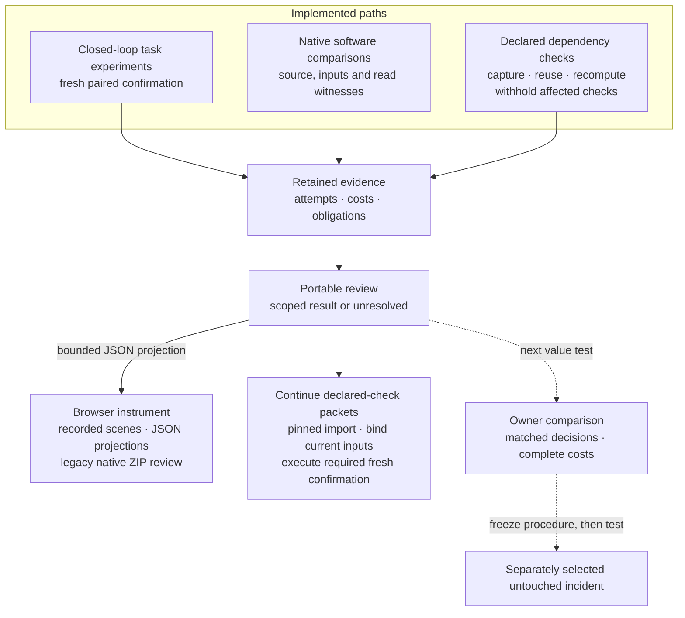
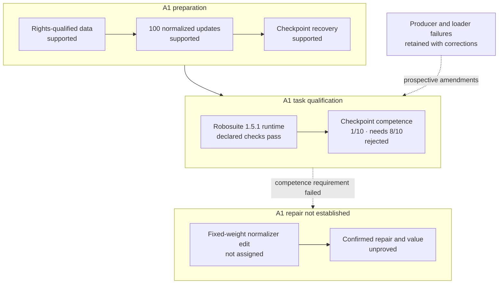
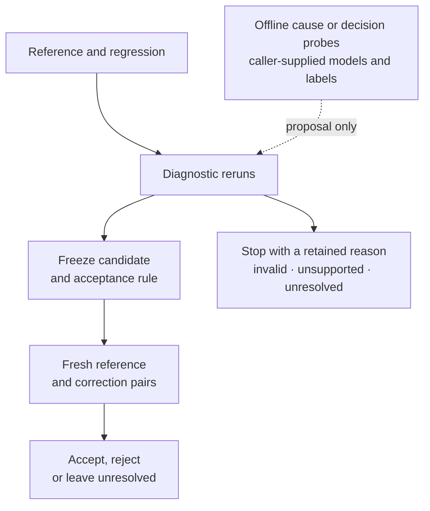

# Nisayon

**Qualification under change for physical AI.**

Nisayon is building an experiment engine for physical AI: given a working
deployment, a changed deployment and a failed task, determine what to change,
what must be tested, and which earlier evidence still applies. Test a selected
correction on fresh conditions and retain the regression. The intended advantage is a
better deployment decision with less complete engineering work. That advantage
has not yet been demonstrated.

A robot policy can fail after a deployment change while its learned weights
stay fixed. An observation arrives late, an action changes meaning, or recurrent
state survives a reset. Each suggests a different correction. A successful
rerun alone does not tell us whether that correction deserves acceptance.

Nisayon executes bounded experiments, checks the evidence and tests a frozen
correction on fresh conditions. It keeps failed attempts and returns unresolved
when the observations cannot support a decision. The established Lift case runs
one frozen robomimic BC-RNN policy in a headless CPU robosuite/MuJoCo simulator.
A separate line qualified a robosuite 1.5.1 runtime, rejected its normalized pilot
checkpoint at 1/10 task success, and confirmed a narrowly scoped input-convention
correction for a legacy policy at 9/10 versus 0/10 unchanged. These systems and
their claims remain separate.

A separate software harness exercises action chunks, late responses, clock
uncertainty and resets with scripted inputs. It runs queue and lifecycle code,
including a pinned historical LeRobot reset defect and its fix. It does not run
robot dynamics or learned inference.

A bounded offline tool now selects observations that distinguish either causes
or declared correction choices. Several causes can remain possible while
agreeing on one choice. The tool preserves that uncertainty; its answer still
needs a valid correction and fresh task confirmation.

For native software changes, the Python SDK and `nisayon-qualify` bind source,
data and environment identities, run reference/control/candidate functions, and
retain call and owner-file read witnesses. Another machine can inspect the
evidence without executing owner code. Reusing a procedure, reusing observations
and carrying forward a verdict are separate decisions.

The current-source check executor binds declared input snapshots, explains which
checks a change invalidates, and can preserve independent work while another
input remains unknown. A digest-pinned portable packet can continue in a new
workspace. Current inputs are bound again and required confirmation executes;
importing evidence never grants acceptance. The
[calibration example](examples/qualification/executable_checks/README.md) makes
that path executable, including stale-input refusal and an adverse correction.

Current source also captures bounded LIBERO/LeRobot episodes, preserves terminal
observations and checks recorded physics and success calls in replay. The
[native episode guide](docs/NATIVE_EXECUTION.md) separates these checks from
learned task repair and deployment acceptance. A
[bounded investigation worker](docs/ENGAGEMENT_INVESTIGATIONS.md) can propose
follow-up work from retained upstream evidence; experiments and public responses
still require separate review.

[Try the SDK](docs/QUICKSTART.md) · [Available capabilities](docs/CAPABILITIES.md) ·
[Current research assessment](docs/FRONTIER_REVIEW_2026-11-16.md) ·
[Open the instrument](https://nisayon.danielwahnich.dev/)

[System map](#the-system-and-the-next-proof) · [Results](#what-the-experiments-found) ·
[Code and review](#inspect-the-work) ·
[Latest progress](#latest-progress) ·
[Contributions](#external-corrections-and-open-decisions) · [Current boundary](#current-evidence-boundary) ·
[Run it](#reproduce) ·
[Experiment records](docs/experiments/README.md) · [Release](docs/RELEASE.md) ·
[Apache-2.0](LICENSE)

## The system and the next proof

The implemented tools bind source and assets, execute bounded experiments,
preserve incomplete attempts, check evidence, and confirm frozen corrections.
Deployment-specific software investigations also run against native upstream
implementations. These are concrete components and experiments; a general
intervention compiler, adaptive selector and reusable deployment product remain
proposed.



The diagram connects existing interfaces; it does not imply a general autonomous
dispatch service. Native episode capture and source-specific upstream studies
also retain their own evidence contracts. The paths have different acceptance rules. A native software verdict does not
grant task acceptance; upstream training studies are separate experiments, not
general SDK backends. Scripted temporal tests cover queues, timing and resets
without learned inference. Prediction-audit research remains separate from
runtime acceptance. The [implementation map](docs/ARCHITECTURE.md#implemented-code-and-data-flow)
and [native qualification flow](docs/NATIVE_QUALIFICATION.md#python-interface)
link these boundaries to code and controls.

The next milestone is one engineer's live choice between a runtime correction,
more training or data, and a different policy. Start with that engineer's
existing stack and competent conventional tools. Freeze the outcome and sampling
rules, confirm the selected correction on fresh task conditions, and measure
setup, failed attempts, diagnosis, confirmation, adoption, review and maintenance.
Equal or lower conventional cost at matched quality rejects the value claim
on that case. A separate untouched incident must then establish repeat use.

The current owner gate remains open: no participating owner case is admitted
for the prospective matched comparison. Existing interest and upstream adoption
are distinct from enrollment, permitted evidence and a live decision. Initial
intake has a four-engineering-hour ceiling. The
[owner protocol](docs/OWNER_COMPARISON.md) and
[9 November research assessment](docs/FRONTIER_REVIEW_2026-11-09.md) specify the
competent baseline, complete costs and conditions that would reject expansion.

## Inspect the work

The review path follows the claim from implementation to evidence. Current
software tests, historical experiment outcomes and untested product proposals
have distinct scopes.

| Question | Start here |
|---|---|
| What runs, and where are its boundaries? | [Implemented modules and data flow](docs/ARCHITECTURE.md#implemented-code-and-data-flow), followed by the proposed architecture. |
| What makes a correction acceptable? | [Fresh-confirmation obligation](docs/evaluation/CONFIRMATION_OBLIGATION.md), [assessment code](src/nisayon/evaluation/confirmation.py) and [failure paths](tests/evaluation/). |
| What did the comparisons actually show? | [Results below](#what-the-experiments-found), [complete experiment index](docs/experiments/README.md), and each result's protocol, retained failures and reproduction commands. |
| Can this checkout reproduce the software checks? | [Development setup](docs/DEVELOPMENT.md), [locked dependencies](uv.lock) and [Linux/macOS checks](.github/workflows/ci.yml). Optional-stack and private-store skips remain explicit. |
| What did the current repository review verify? | [16 November source and diagram reconciliation](docs/experiments/results/source-refresh-2026-11-16/README.md), [native SDK comparison](docs/experiments/results/native-sdk-2026-10-23/README.md), and [earlier clean-clone checks](docs/experiments/results/main-refresh-2026-10-16/README.md). |
| What remains unproved? | [Current research decision](docs/FRONTIER_REVIEW_2026-11-16.md) and [next value test](#what-would-justify-the-next-experiment). |

## Latest progress

**16 November — review actual evidence and explain recorded reuse.** Three
read-only interfaces now operate on one digest-pinned check packet: a bounded
[summary](docs/CHECK_SUMMARY.md), a [measurement reassessment](docs/CHECK_MEASUREMENTS.md)
that compares the complete saved claim, and a [dependency explanation](docs/CHECK_EXPLANATION.md)
that distinguishes planned work from attempted work. They execute no owner code.
A saved JSON projection remains unsigned display data; verification requires the
original packet and its recorded checker. Deployment remains unresolved.

The JSON reader now refuses a nonzero number that would underflow to zero.
The 32 regression controls went from 21 failures and 11 passes on the old reader
to 32 passes. The current engine qualification completed **2,830 Python tests
with 80 explicit skips**. Optional robotics stacks and the original private raw
store remain outside that run. These are software checks, not new robot results.

A finite differential study also matched declared incremental results to an
independently written full calculation across 64 four-node graphs and 236 SDK
executions. It establishes neither complete dependencies in real deployments nor
a cost advantage over conventional tools. The
[16 November source record](docs/experiments/results/source-refresh-2026-11-16/README.md)
retains source pins, failures, reproduction and remaining gates.

The browser source now accepts check-summary JSON with optional measurement
and dependency-explanation companions. Its combined frontend passes **622 tests**,
TypeScript and production build. Its native ZIP reader still has a separate, narrower format boundary.
The [review guide](docs/PORTABLE_REVIEW.md#connect-the-instrument) distinguishes
local display, Python recomputation and scientific acceptance. The website is a
separately deployed build.

Earlier experiments, integration work and upstream outcomes remain in the
[dated progress journal](docs/PROGRESS.md). Historical task results and adverse
findings are also retained below.

## External corrections and open decisions

Upstream states below belong to their linked dated records; this is not a live
issue queue. Repository qualification does not recheck every external project.

The five pull requests linked in the table were checked on 24 October and
were open on that date. Results and adoption claims stay bound to their retained revisions;
this status read did not rerun the experiments.

On 17 October, XPolicyLab's maintainer confirmed and merged the Cartesian pose
correction. The Long-WAM, DreamZero, Tether and OpenWAM contributions are
recorded in the latest-progress table. These are distinct upstream decisions, with their
own tested scope and pending work. No prospect has become an enrolled owner
for the matched comparison.

A finding from Nisayon's evaluation work was adopted in **arisole-eval 0.1.3**.
A constructed case had 30 seed-matched episode pairs but only one fully labelled
pair. The old gate counted all 30 toward its evidence threshold and returned
`REVIEW`/0. The maintainer reproduced the issue and shipped a correction; the
published release returns `INSUFFICIENT_DATA`/2 under defaults and passes all
12 retained controls.

The [case note](docs/contributions/arisole-label-coverage.md) links the executable
reproducer, proposed patch, maintainer response and release verification,
including three upstream tests left unqualified by missing configurations.
This is external adoption of a bounded software correction; robot performance
and comparative cost remain separate, unproved claims.

Later checks verified Arisole 0.1.4's 32 original tests against its source and
wheel, plus the 12 retained controls. Version 0.1.5 adds identity inference and
CLI overrides. A [new qualification](docs/experiments/results/identity-inference-001/README.md)
finds that incomplete labels can establish a whole-run identity. A local
one-module correction changes 34/56 passing controls to 56/56 and preserves all
38 original tests. The patch has not been adopted upstream; this remains software
evidence, with task outcomes and comparative value unproved.

| Boundary | Retained result | External status and limit |
|---|---|---|
| Terminal observations | [LeRobot](docs/experiments/results/terminal-observation-followthrough-001/README.md): same native CPU suite changes from 40 passes/eight failures to 48 passes. | [PR #4943](https://github.com/huggingface/lerobot/pull/4943) open. A contributor's Windows fixture correction was incorporated; another contributor reports the same contrast on Thor, CPU only, without raw logs. No robot-task result. |
| Terminal action dispatch | [EXPO-FT](docs/experiments/results/terminal-dispatch-001/README.md): 8/24 to 24/24 selected native/source controls, continuing outputs preserved. | [PR #2](https://github.com/pd-perry/expo-ft/pull/2) open. Real sampler threads with explicit policy/environment doubles; no full training qualification. |
| Replay identity and clock | [Retriever](docs/experiments/results/replay-identity-001/README.md): five to eight of eight session round-trips; restored clock reproduces a timing-sensitive decision. | [PR #3](https://github.com/openretriever/retriever/pull/3) open. Broader testing retains three shared optional-dependency failures; no clean full-suite or physical qualification. |
| Sequential binary evidence | [N-SCORE](docs/experiments/results/sequential-confirmation-001/README.md): reverse test rejects 284/4096 exact null paths at alpha .05; corrected test rejects 4/4096 and passes 95 native tests. | [PR #5](https://github.com/dasnyder5/nscore/pull/5) open. Constructed six-pair IID Bernoulli(1/2) paths, not robot trials or a new statistical method. No runtime integration or measured savings. |
| Async client identity | [vla.cpp](docs/experiments/results/native-routing-001/README.md): distinct binary envelopes collide and replace another client's pending request. Length framing passes all five transport controls and preserves same-client replacement. | [Report on PR #34](https://github.com/VinRobotics/vla.cpp/pull/34#issuecomment-6210116834) sent and verified. Extracted native transport and unchanged queue; full server, inference and robot tasks unqualified. |

Nisayon's own [cost correction](docs/experiments/results/cost-retention-001/README.md)
also preserves a measured prefix when its parent measurement is missing, while
rejecting invalid ancestry or units. Fifteen controls improve from seven passes
to fifteen; the historical D05 outcome stays unchanged. The
[public delivery](docs/experiments/results/cost-publication-001/README.md) includes
explicit accounting status in text reports. Correct accounting still leaves
unmeasured labor, provider charges and maintenance unknown.

## What the experiments found

**No decision or efficiency advantage has been demonstrated.** Both comparisons
are retained, including failed, invalid, unsupported and unresolved assignments.

| Development comparison | Accepted A / B | Runs per arm | Trial time A / B |
|---|---:|---:|---:|
| [Scripted diagnostic procedures, ten incidents](docs/experiments/MATCHED_COMPARISON.md) | 6/10 / 6/10 | 569 | 881.95 s / 926.20 s |
| [Live model, three paired repetitions of one known incident](docs/experiments/BOUNDED_AGENT_COMPARISON.md) | 3/3 / 3/3 | 210 | 422.27 s / 435.16 s |

A is the competent conventional workflow; B has the same information and
opportunities plus Nisayon checks. In the scripted comparison B's extra checks
changed no decision. In the bounded model comparison both arms used
`gpt-6-astra`, medium reasoning, with equal budgets. B requested no optional
audit; both still used the common execution and mandatory confirmation service.
Three repetitions of one known incident are not three independent incidents.

Each accepted repair passed 32/32 fresh reference/candidate pairs. No false
acceptance was detected under the shared checker. D05 remains rejected under
the original absolute progress rule, D06 unsupported, D08 invalid and D10
unresolved. These are simulator development results, not evidence of physical
safety, general causal identification, unseen-fault performance or customer savings.

B measured about 5% and 3% more trial time in the respective schedules. These
times include nested execution and checking once; shared preparation and failed
development attempts are reported separately. Human effort, provider charges
and energy remain unknown. The [trace and cost analysis](docs/experiments/UNUSED_AUDIT.md)
explains why free diagnosis still cannot meet a 2× total-cost target with these
fixed confirmation schedules. A broader three-arm screen remains a proposal in
the [research plan](docs/RESEARCH_PLAN.md).

## Current evidence boundary

The A1 experiment asked whether an actively normalized policy could be
bound to a compatible task runtime and then evaluated without confusing training,
runtime, competence and repair claims. The bounded offline pilot completed all
100 assigned CPU optimizer updates. Its normalization reached the learner exactly,
its parameters changed, and its checkpoint state reloads within the measured cap.
That establishes a training operation, not a competent policy.

On 9 October, the isolated robosuite 1.5.1 runtime passed its declared compatibility
checks. The exact checkpoint then completed **1 of 10** development tasks against
the frozen **8 of 10** requirement. All episodes completed without an execution
failure. The checkpoint is rejected as the working reference for repair experiments
in this runtime. Producer mapping, recording and checkpoint-serialization failures
remain retained alongside their tested corrections; 1,106 software tests passed
at that qualification revision.
Full historical trajectory fidelity remains a separate limitation, and this
assessment is single-lane and non-independent. See the
[runtime execution record](docs/experiments/results/a1-runtime-001/README.md) and
[current handoff](docs/SESSION_HANDOFF.md).

A separate [policy-transfer experiment](docs/experiments/results/b2-semantic-transfer-001/README.md)
found a semantic change hidden by identical observation dimensions: robosuite
reversed the gripper/cube relative-position vector between versions. A correction
limited to the exact legacy checkpoint's input convention completed **9/10** fresh
paired conditions, versus **0/10** unchanged. All twenty episodes completed,
captured initial conditions matched, and weights stayed fixed. One condition
still failed. The result qualifies this corrected reference and a bounded repair;
it does not establish superior diagnosis or complete engineering cost. All
1,130 software tests passed at that revision. Execution and assessment remain single-lane.

The [portable evidence reader](docs/experiments/TRANSFER_EVIDENCE.md) recomputes
that paired result and checks the recorded network inputs from the sealed raw
packet. It runs without the simulator stack and makes no new task-success claim.



The later [controller-target probe](docs/experiments/results/decision-case-001/README.md)
retained six executions across three exposed condition pairs. The observed
differences crossed no confirmation predicate and changed no repair decision.
Neither controller convention was selected. The report preserves the timing
of the corrected admission rule and the limits of this small negative result.

The [confirmation evidence adapter](docs/experiments/results/confirmation-engine-001/README.md)
makes the existing cost and outcome records usable for further analysis. It
retains all 26 assigned trials, including six that never reached confirmation,
and all 660 scheduled pairs. D05's executed prefixes and progress failure remain
visible. The adapter verifies the retained raw evidence, preserves measurements
in their original units and reports missing or invalid inputs explicitly. Its
read-only export changes no historical decision or confirmation stopping rule.

The [temporal software experiment](docs/experiments/results/temporal-integration-001/README.md)
accounts for all 230 role assignments and three separate interrupted prefixes.
The source-bound audit verifies complete owner coverage and identical events
and assessments on all 35 declared conventional/selected pairs. The reference
distinguishes activation context, individual sends, exact clock arithmetic and
the identity actually admitted to the queue. Contradictory clock declarations
remain unresolved in either order; a refused delivery cannot overwrite a queued
action's provenance. Both frozen usefulness criteria and later retrospective
readings remain explicit. No advantage over the conventional remedy is
established. The
[combined freshness check](docs/experiments/results/temporal-integration-001/COMBINED_DEADLINE.md)
preserves a fresh queued action when an overdue response arrives, then checks
age again at dispatch. Both comparators receive it and tie on all six exposed
controls. The [closeout record](docs/experiments/results/temporal-integration-001/CLOSEOUT.md)
retains the corrected readings, original failures, known costs and supported
scope. These software results do not establish robot task success.

The [external processor decision](docs/experiments/results/external-decision-001/README.md)
uses one public LeRobot report, pinned processor code and the retained SmolVLA
configuration/statistics bytes. The shipped files skip both required exact-key
transforms; suffix matching repairs only action and chooses among three datasets by
store order. An explicit override transforms state and action and preserves legitimate
visual identity, but its deployment binding remains unresolved because the retained
artifact has no dataset selector and the state statistics are only a reporter
transcription. All 18 arm executions agree with the separate reference and eight
controls pass. The A/B tie establishes no value advantage: A's outcomes are constants
on the same executor and witnesses used by B. No model, simulator or robot ran.

## How a correction earns acceptance



Changing an action requires recomputing its affected future state and
observations. Replaying observations from the old trajectory cannot establish
what the intervention would do. Nisayon therefore executes each supported
intervention as a full closed-loop rerun; partial continuation is unsupported.

The evaluator checks source and configuration identity, acquisition timing,
reset evidence, candidate scope, confirmation freshness and task progress.
Stopping the robot fails the progress obligation. A completed process, a valid
measurement and an accepted repair are distinct results. The
[contract](docs/evaluation/CONFIRMATION_OBLIGATION.md) and
[adversarial controls](docs/evaluation/CONTROLS.md) make those distinctions executable.

The finite probe tool remains separate from the closed-loop task path. An
experimental bridge now exercises native software checks. A declared choice
can be resolved while its cause remains uncertain, including a zero-probe case
when every supplied hypothesis has the same label. Neither case skips fresh
confirmation: the tool always reports `task_confirmation: not_assessed`.

## Reproduce

### Check the source and retained scores

Install Python 3.12, Git, [uv](https://docs.astral.sh/uv/) and
[ripgrep](https://github.com/BurntSushi/ripgrep#installation). Workspace search
uses the `rg` executable. On macOS, `brew install ripgrep` supplies it; on
Debian or Ubuntu, use `sudo apt-get install ripgrep`. In a new checkout, run:

```sh
uv sync --frozen
make check
uv run --frozen python -m nisayon.evaluation score \
  docs/experiments/results/development-ablation-001/comparison-ledger.json \
  --root docs/experiments/results/development-ablation-001
uv run --frozen python -m nisayon.evaluation score \
  docs/experiments/results/bounded-agent-comparison-001/comparison-ledger.json \
  --root docs/experiments/results/bounded-agent-comparison-001
```

Those commands re-score the retained compact evidence. They do not execute
physics or independently reconstruct every raw store. Exact historical source,
protocol identities and reproduction limits are in the [release notes](docs/RELEASE.md).
Keep retained experiment environments intact. In the existing research
workspace, use their direct executables or `UV_NO_SYNC=1`; do not synchronize
them to reproduce these examples.

To export the complete confirmation evidence and reproduce its cost partition
from the existing local raw stores, use a new output directory:

```sh
uv run --frozen nisayon run --label confirmation-evidence-export -- \
  python -m nisayon.engine.confirmation_view --out artifacts/confirmation-export
```

This command executes no simulator trajectories. It needs the original raw
stores and the pinned metadata commit `14e7805643dfe32252f2b46926512807d56c0035`
in the original research checkout; that private commit is not part of public Git
history. `--raw-base` specifies the raw-store location. A public clone alone
cannot regenerate this historical export.
The [adapter report](docs/experiments/results/confirmation-engine-001/README.md)
describes its pinned inputs, output manifest, deterministic pair iterator and
recovery checks. Statistical consumption is retrospective: the exposed records
do not establish the sampling assumptions of a new decision contract.

### Distinguish a declared correction choice

This example needs only Python's standard library. From the prepared checkout,
choose a new output path:

```sh
PYTHONDONTWRITEBYTECODE=1 .venv/bin/python -B -S \
  scripts/experiments/probe_decisions.py \
  --out artifacts/decision-probe-example.json
```

The output compares full identification, decision-labelled selection and a
competent conventional calculation on the same constructed inputs. It keeps
cause status, decision status and task confirmation separate. The
[record](docs/experiments/results/decision-probes-001/README.md) documents the
12-hypothesis/16-probe limit, strict error-bound separation and all 45 controls.
The example executes no policy, simulator or physical probe.

### Exercise a late response after reset

This small example runs six remedies on the same frozen software schedule and
applies the separate temporal reference. Use a fresh output directory:

```sh
uv run --frozen python -m nisayon.engine.temporal_experiment workflow \
  --suite docs/experiments/temporal-late-reset.example.json \
  --out artifacts/temporal-late-reset-example
```

The output separates process completion, retained evidence, temporal predicates
and software dispatch coverage. Robot task outcome remains unmeasured. The
[interface](docs/experiments/TEMPORAL_INTERFACE.md) documents complete and
interrupted inspection and the exact historical source reproduction.

### Run five simulator trajectories

The example executes two references, a sign regression, a correction and action
suppression on a known condition. Install the optional stack in a separate new
environment, and use a new output directory:

```sh
uv sync --frozen --extra simulation
uv run --frozen python -m nisayon.engine.first_case \
  --output artifacts/release-example --assets artifacts/assets --explore-only
uv run --frozen python -m nisayon.engine.integrate \
  --bundle artifacts/release-example/bundle.json \
  --artifact-root artifacts/release-example \
  --output artifacts/release-example-evaluation
```

The adapter downloads the pinned policy once, verifies its SHA-256, and reuses
it. Read the [asset identity and upstream terms](docs/experiments/ASSETS.md)
before obtaining the checkpoint; weights and training data are not distributed
here. The measured stack is Python 3.12.13, robomimic 0.3.0, robosuite 1.4.1,
MuJoCo 3.2.7, Torch 2.5.1 and NumPy 1.26.4 on macOS arm64. Other environments
need qualification. This adapter does not reproduce the original model-zoo study.

The small example should reproduce task completion for reference and correction,
failure for regression and suppression, and rejection of deliberately invalid
replay. Its correction stays **unresolved for acceptance** because exploration
does not supply fresh confirmation. It cannot replace the retained scored result.
The [first joint experiment](docs/experiments/LIFT_PROTOCOL_V3.md) documents the
larger, already completed fresh confirmation; its spent seeds must not be reused
as new confirmation.

## What would justify the next experiment

The scripted comparison exposed a fixed selector that already knew its remedy.
Replacing it with a live model gave both arms a more direct procedure, but the
optional audit still changed no decision. That is a sharper account of the
limitation, with the original negative results preserved.

Another comparison needs an ambiguous engineering decision that ordinary
telemetry cannot already resolve equally cheaply, and enough avoidable work
for the extra experiment to earn its cost. The
[trace analysis](docs/experiments/UNUSED_AUDIT.md) sets out that requirement.
Repeating the same known repair would add runs without answering it.

Confirmation accounts for about 81–88% of measured diagnosis-plus-confirmation
time in the retained comparisons. The later N-SCORE investigation therefore
qualified a released stopping method before considering integration. Changing
the confirmation schedule could change those conditional cost ceilings; it
requires a prospective protocol at matched quality and error control. A passing
software screen alone establishes neither task reliability nor a cost saving.

The [current owner procedure](docs/OWNER_COMPARISON.md) prioritizes a live
integration decision with substantial setup, adaptation or review work. It
preserves the [current research decision](docs/FRONTIER_REVIEW_2026-11-09.md): experiments
must be able to alter a real correction choice. The finite
probe module makes that distinction explicit, under supplied model and label
premises. Its next useful test is an independently owned incident with a live
choice, followed by a separate untouched reuse case. Charge preparation and
adaptation to that reuse; a useful first correction alone cannot establish a
repeatable advantage.

## Read and contribute

| To inspect | Start here |
|---|---|
| Measurements, failures and corrections | [Experiment records](docs/experiments/README.md) |
| Current execution boundary and exact restart gate | [Session handoff](docs/SESSION_HANDOFF.md) |
| Implemented boundaries and proposed extensions | [Architecture](docs/ARCHITECTURE.md) |
| Installation, tests and command records | [Development](docs/DEVELOPMENT.md) |
| Exact historical sources and reproduction limits | [Research release](docs/RELEASE.md) |
| A concrete defect or contribution | [Contribution guide](CONTRIBUTING.md) |

Reports preserve the state known when they were written. The release notes
identify subsequent corrections; the original records remain available.

Licensed under [Apache-2.0](LICENSE). Copyright 2026 Daniel Wahnich.
[Licensing scope and third-party assets](docs/LICENSING.md) distinguish the
released source from separately obtained dependencies and policy weights.

We let experiments overturn our explanations. We preserve failures and
uncertainty. We accept an improvement only when fresh, valid tests support it.

*Nisayon — ניסיון — experience; an attempt. Built by Daniel Wahnich.*
