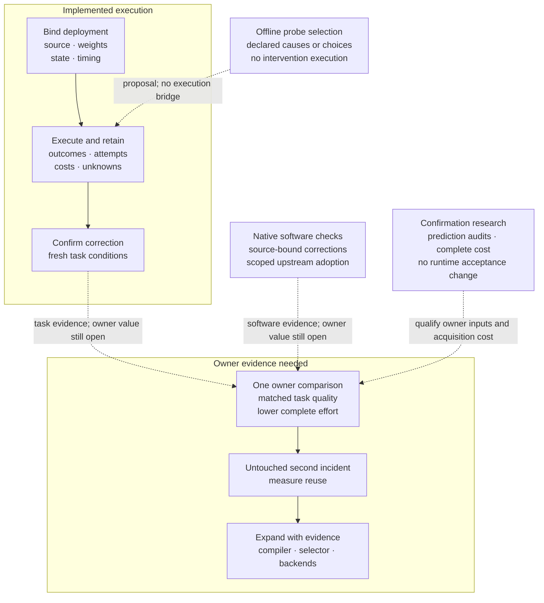
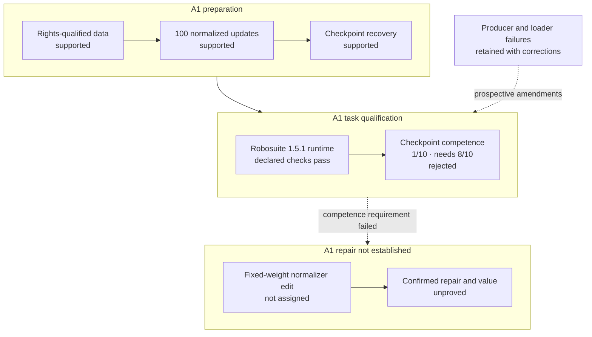
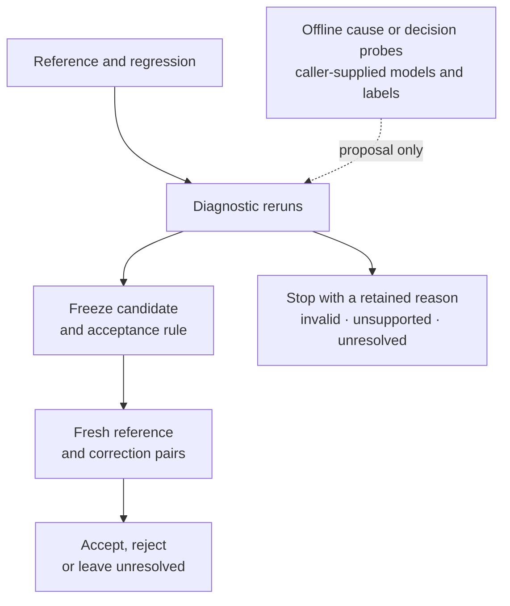

# Nisayon

**Experiments for robot-policy integration.**

Nisayon is building an experiment engine for physical AI: given a working
deployment, a changed deployment and a failed task, choose a correction, test it
on fresh conditions, and retain the regression. The intended advantage is a
better deployment decision with less complete engineering work. That advantage
has not yet been demonstrated.

A robot policy can fail after a deployment change while its learned weights
stay fixed. An observation arrives late, an action changes meaning, or recurrent
state survives a reset. Each suggests a different correction. A successful
rerun alone does not tell us whether that correction deserves acceptance.

Nisayon executes bounded experiments, checks the evidence and tests a frozen
correction on fresh conditions. It keeps failed attempts and returns unresolved
when the observations cannot support a decision. The established Lift case runs
one frozen robomimic BC-RNN policy in a headless CPU robosuite/MuJoCo simulator.
A separate line qualified a robosuite 1.5.1 runtime, rejected its normalized pilot
checkpoint at 1/10 task success, and confirmed a narrowly scoped input-convention
correction for a legacy policy at 9/10 versus 0/10 unchanged. These systems and
their claims remain separate.

A separate software harness exercises action chunks, late responses, clock
uncertainty and resets with scripted inputs. It runs queue and lifecycle code,
including a pinned historical LeRobot reset defect and its fix. It does not run
robot dynamics or learned inference.

A bounded offline tool now selects observations that distinguish either causes
or declared correction choices. Several causes can remain possible while
agreeing on one choice. The tool preserves that uncertainty; its answer still
needs a valid correction and fresh task confirmation.

[System map](#the-system-and-the-next-proof) · [Results](#what-the-experiments-found) ·
[Code and review](#inspect-the-work) ·
[Latest progress](#latest-progress) ·
[Contributions](#external-corrections-and-open-decisions) · [Current boundary](#current-evidence-boundary) ·
[Run it](#reproduce) ·
[Experiment records](docs/experiments/README.md) · [Release](docs/RELEASE.md) ·
[Apache-2.0](LICENSE)

## The system and the next proof

The implemented tools bind source and assets, execute bounded experiments,
preserve incomplete attempts, check evidence, and confirm frozen corrections.
Deployment-specific software investigations also run against native upstream
implementations. These are concrete components and experiments; a general
intervention compiler, adaptive selector and reusable deployment product remain
proposed.



The next milestone is one engineer's live choice between a runtime correction,
more training or data, and a different policy. Start with that engineer's
existing stack and competent conventional tools. Freeze the outcome and sampling
rules, confirm the selected correction on fresh task conditions, and measure
setup, failed attempts, diagnosis, confirmation, adoption, review and maintenance.
Equal or lower conventional cost at matched quality rejects the value claim
on that case. A separate untouched incident must then establish repeat use.

The Orin intake concerns a deployment failure with a reported working laptop
reference. Existing outputs and a live owner decision have been requested.
Two additional researched invitations have been sent and verified. At the last
retained readback on 16 October, neither invitation had a reply; no prospect is
enrolled and no source-bound owner incident is available. The
[research direction](docs/RESEARCH_PLAN.md) and [architecture](docs/ARCHITECTURE.md)
describe what would justify expansion. Useful upstream contributions give us
testable engineering evidence and contact with real problems; they do not by
themselves establish product demand.

## Inspect the work

The review path follows the claim from implementation to evidence. Current
software tests, historical experiment outcomes and untested product proposals
have distinct scopes.

| Question | Start here |
|---|---|
| What runs, and where are its boundaries? | [Implemented modules and data flow](docs/ARCHITECTURE.md#implemented-code-and-data-flow), followed by the proposed architecture. |
| What makes a correction acceptable? | [Fresh-confirmation obligation](docs/evaluation/CONFIRMATION_OBLIGATION.md), [assessment code](src/nisayon/evaluation/confirmation.py) and [failure paths](tests/evaluation/). |
| What did the comparisons actually show? | [Results below](#what-the-experiments-found), [complete experiment index](docs/experiments/README.md), and each result's protocol, retained failures and reproduction commands. |
| Can this checkout reproduce the software checks? | [Development setup](docs/DEVELOPMENT.md), [locked dependencies](uv.lock) and [Linux/macOS checks](.github/workflows/ci.yml). Optional-stack and private-store skips remain explicit. |
| What did the current repository review verify? | [Clean-clone checks, reproduction correction and diagram review](docs/experiments/results/main-refresh-2026-10-16/README.md), with the initial failure retained. |
| What remains unproved? | [Current research decision](docs/FRONTIER_DECISION_2026-10-14.md) and [next value test](#what-would-justify-the-next-experiment). |

## Latest progress

19 October: a [G1 simulation reset review](docs/contributions/g1-reset-review/README.md)
reproduces swallowed policy-reset errors and proposes handling viewer input on
the control thread. Sixteen selected checks pass with the patch, including an
actual recurrent-policy reset comparison. The upstream failures and an incomplete
fix are retained. This is a proposed software correction; locomotion improvement
and owner savings are unmeasured.

19 October: the invited [LongWAM port review](docs/contributions/longwam-cuda-qualification/README.md)
now includes full-weight IDM and COD execution. Fourteen original/candidate
case bodies pass after CPU loading and CUDA transfer on an A100 40 GB; the
fourteen direct-loading setup errors are retained separately. Exact fixtures,
a proposed changed-observation reset check, model identities and an offline
report reader make the result inspectable. These are software checks with
synthetic inputs, not physical task confirmation or measured owner savings.

*Research through 16 October 2026, N045; repository review and integration in
N046. The [release notes](docs/RELEASE.md) identify the public source snapshots.*

The latest research sharpens the question: which experiment could change the
correction we choose? Full cause identification can demand observations that
add nothing to that choice. This distinction is now executable in a small
offline module. Its cost is still tied by a competent conventional calculation.

Confirmation also has to earn its cost. An exact constructed study now qualifies
randomized prediction audits against ordinary sequential and binomial tests.
With a perfect predictor available before execution, the stronger comparison
uses 22.105 expected fresh acquisitions versus 26.840 at slightly higher support
probability. Extra contexts, prediction and preparation must fit inside the
remaining 4.735 execution cost units. This conditional result has no qualified
owner predictor, robot saving or production acceptance rule.

| Work | Retained result | What remains open |
|---|---|---|
| [System and frontier review, N038](docs/experiments/results/n038-system-review-2026-10-15/README.md) | Reconciled the implementation, evidence and alternatives; qualified Arisole 0.1.5 identity inference with a local correction. | Software qualification does not establish owner value. |
| [Distinguishing experiments, N039](docs/experiments/results/identifiability-001/README.md) | Three constructed families preserve ambiguity until a selected observation distinguishes six possible mechanisms. Twenty controls pass. | Competent conventional selection ties at six observations; reuse is untested. |
| Owner recruitment, N040 | Two researched invitations sent and verified, alongside the existing Orin request. | Participation and deployment records remain missing. |
| [Current research and proxy readback, N041](docs/experiments/results/n041-decision-value-2026-10-15/README.md) | Nine selected primary papers, including revisions through 14 October; reproduced CureWM's published scalar analysis with 20 native checks and 11 separate controls. | Proxy discrimination and autonomous loops do not establish Nisayon's correction or economic advantage. |
| [Decision probes, N042](docs/experiments/results/decision-probes-001/README.md) | Separates declared correction choices while preserving possible causes; 25 new and 20 existing controls pass. | Caller-supplied decision equivalence, fresh confirmation, complete effort and separate reuse still need qualification in an owner case. |
| [Async client identity, N044](docs/experiments/results/native-routing-001/README.md) | Reproduced a collision between distinct clients in vla.cpp PR #34. Minimal length framing changes native transport controls from 3/5 to 5/5; six unchanged queue tests pass. | Report and correction sent upstream. Adoption, a connection to an owner's deployed failure, and comparative savings remain unproved. |
| [Prediction audits and complete cost, N045](docs/experiments/results/prediction-audit-001/README.md) | Four primary papers; exact finite qualification with misleading-prediction controls and a stronger native stopping comparison. Validity survives bad predictions in scope; cost and power can worsen. | Fresh acquisitions can be saved only with suitable pre-execution inputs and sampling. Existing finite confirmation obligations remain unchanged; owner value and reuse are untested. |

The [decision-probe example](scripts/experiments/probe_decisions.py) has four
constructed hypotheses and two declared choices. One probe, with declared cost
one, determines the choice while leaving two causes possible. Full identification
costs four using two probes. The competent conventional decision calculation
also costs one. These are declared observation units, not measured engineering
effort or a fourfold competitive gain. A shared label must cover both the
correction and its confirmation requirements. The tool checks label coverage;
it cannot establish that the equivalence is physically justified.

The CureWM readback covers 12 suite/arm cells and 3,990 matched action conditions
per arm. Goal AUROC improves from 0.4955 to 0.7429. On LIBERO-10, AUROC is 0.4930;
at the published diagnostic threshold, low optimism on failed conditions coexists
with rejection of 329/331 successful conditions. The authors already report this
limitation. This is a check of exposed scalar records, with no new policy or
simulator execution. A cheap proxy needs decision-specific qualification and
cannot replace fresh task confirmation.

## External corrections and open decisions

*The 16 October readback covered the prior 19 threads, completed at 06:55 UTC
after retrying two failed reads. No substantive change; one merge-preview hash
changed. The two additional owner discussions were unchanged at 06:53 UTC,
and both email threads still contained only their original invitations.
N044 subsequently added the technical report below.*

A finding from Nisayon's evaluation work was adopted in **arisole-eval 0.1.3**.
A constructed case had 30 seed-matched episode pairs but only one fully labelled
pair. The old gate counted all 30 toward its evidence threshold and returned
`REVIEW`/0. The maintainer reproduced the issue and shipped a correction; the
published release returns `INSUFFICIENT_DATA`/2 under defaults and passes all
12 retained controls.

The [case note](docs/contributions/arisole-label-coverage.md) links the executable
reproducer, proposed patch, maintainer response and release verification,
including three upstream tests left unqualified by missing configurations.
This is external adoption of a bounded software correction; robot performance
and comparative cost remain separate, unproved claims.

Later checks verified Arisole 0.1.4's 32 original tests against its source and
wheel, plus the 12 retained controls. Version 0.1.5 adds identity inference and
CLI overrides. A [new qualification](docs/experiments/results/identity-inference-001/README.md)
finds that incomplete labels can establish a whole-run identity. A local
one-module correction changes 34/56 passing controls to 56/56 and preserves all
38 original tests. The patch has not been adopted upstream; this remains software
evidence, with task outcomes and comparative value unproved.

| Boundary | Retained result | External status and limit |
|---|---|---|
| Terminal observations | [LeRobot](docs/experiments/results/terminal-observation-followthrough-001/README.md): same native CPU suite changes from 40 passes/eight failures to 48 passes. | [PR #4943](https://github.com/huggingface/lerobot/pull/4943) open. A contributor's Windows fixture correction was incorporated; another contributor reports the same contrast on Thor, CPU only, without raw logs. No robot-task result. |
| Terminal action dispatch | [EXPO-FT](docs/experiments/results/terminal-dispatch-001/README.md): 8/24 to 24/24 selected native/source controls, continuing outputs preserved. | [PR #2](https://github.com/pd-perry/expo-ft/pull/2) open. Real sampler threads with explicit policy/environment doubles; no full training qualification. |
| Replay identity and clock | [Retriever](docs/experiments/results/replay-identity-001/README.md): five to eight of eight session round-trips; restored clock reproduces a timing-sensitive decision. | [PR #3](https://github.com/openretriever/retriever/pull/3) open. Broader testing retains three shared optional-dependency failures; no clean full-suite or physical qualification. |
| Sequential binary evidence | [N-SCORE](docs/experiments/results/sequential-confirmation-001/README.md): reverse test rejects 284/4096 exact null paths at alpha .05; corrected test rejects 4/4096 and passes 95 native tests. | [PR #5](https://github.com/dasnyder5/nscore/pull/5) open. Constructed six-pair IID Bernoulli(1/2) paths, not robot trials or a new statistical method. No runtime integration or measured savings. |
| Async client identity | [vla.cpp](docs/experiments/results/native-routing-001/README.md): distinct binary envelopes collide and replace another client's pending request. Length framing passes all five transport controls and preserves same-client replacement. | [Report on PR #34](https://github.com/VinRobotics/vla.cpp/pull/34#issuecomment-6210116834) sent and verified. Extracted native transport and unchanged queue; full server, inference and robot tasks unqualified. |

Nisayon's own [cost correction](docs/experiments/results/cost-retention-001/README.md)
also preserves a measured prefix when its parent measurement is missing, while
rejecting invalid ancestry or units. Fifteen controls improve from seven passes
to fifteen; the historical D05 outcome stays unchanged. The
[public delivery](docs/experiments/results/cost-publication-001/README.md) includes
explicit accounting status in text reports. Correct accounting still leaves
unmeasured labor, provider charges and maintenance unknown.

## What the experiments found

**No decision or efficiency advantage has been demonstrated.** Both comparisons
are retained, including failed, invalid, unsupported and unresolved assignments.

| Development comparison | Accepted A / B | Runs per arm | Trial time A / B |
|---|---:|---:|---:|
| [Scripted diagnostic procedures, ten incidents](docs/experiments/MATCHED_COMPARISON.md) | 6/10 / 6/10 | 569 | 881.95 s / 926.20 s |
| [Live model, three paired repetitions of one known incident](docs/experiments/BOUNDED_AGENT_COMPARISON.md) | 3/3 / 3/3 | 210 | 422.27 s / 435.16 s |

A is the competent conventional workflow; B has the same information and
opportunities plus Nisayon checks. In the scripted comparison B's extra checks
changed no decision. In the bounded model comparison both arms used
`gpt-6-astra`, medium reasoning, with equal budgets. B requested no optional
audit; both still used the common execution and mandatory confirmation service.
Three repetitions of one known incident are not three independent incidents.

Each accepted repair passed 32/32 fresh reference/candidate pairs. No false
acceptance was detected under the shared checker. D05 remains rejected under
the original absolute progress rule, D06 unsupported, D08 invalid and D10
unresolved. These are simulator development results, not evidence of physical
safety, general causal identification, unseen-fault performance or customer savings.

B measured about 5% and 3% more trial time in the respective schedules. These
times include nested execution and checking once; shared preparation and failed
development attempts are reported separately. Human effort, provider charges
and energy remain unknown. The [trace and cost analysis](docs/experiments/UNUSED_AUDIT.md)
explains why free diagnosis still cannot meet a 2× total-cost target with these
fixed confirmation schedules. A broader three-arm screen remains a proposal in
the [research plan](docs/RESEARCH_PLAN.md).

## Current evidence boundary

The A1 experiment asked whether an actively normalized policy could be
bound to a compatible task runtime and then evaluated without confusing training,
runtime, competence and repair claims. The bounded offline pilot completed all
100 assigned CPU optimizer updates. Its normalization reached the learner exactly,
its parameters changed, and its checkpoint state reloads within the measured cap.
That establishes a training operation, not a competent policy.

On 9 October, the isolated robosuite 1.5.1 runtime passed its declared compatibility
checks. The exact checkpoint then completed **1 of 10** development tasks against
the frozen **8 of 10** requirement. All episodes completed without an execution
failure. The checkpoint is rejected as the working reference for repair experiments
in this runtime. Producer mapping, recording and checkpoint-serialization failures
remain retained alongside their tested corrections; 1,106 software tests passed
at that qualification revision.
Full historical trajectory fidelity remains a separate limitation, and this
assessment is single-lane and non-independent. See the
[runtime execution record](docs/experiments/results/a1-runtime-001/README.md) and
[current handoff](docs/SESSION_HANDOFF.md).

A separate [policy-transfer experiment](docs/experiments/results/b2-semantic-transfer-001/README.md)
found a semantic change hidden by identical observation dimensions: robosuite
reversed the gripper/cube relative-position vector between versions. A correction
limited to the exact legacy checkpoint's input convention completed **9/10** fresh
paired conditions, versus **0/10** unchanged. All twenty episodes completed,
captured initial conditions matched, and weights stayed fixed. One condition
still failed. The result qualifies this corrected reference and a bounded repair;
it does not establish superior diagnosis or complete engineering cost. All
1,130 software tests passed at that revision. Execution and assessment remain single-lane.

The [portable evidence reader](docs/experiments/TRANSFER_EVIDENCE.md) recomputes
that paired result and checks the recorded network inputs from the sealed raw
packet. It runs without the simulator stack and makes no new task-success claim.



The later [controller-target probe](docs/experiments/results/decision-case-001/README.md)
retained six executions across three exposed condition pairs. The observed
differences crossed no confirmation predicate and changed no repair decision.
Neither controller convention was selected. The report preserves the timing
of the corrected admission rule and the limits of this small negative result.

The [confirmation evidence adapter](docs/experiments/results/confirmation-engine-001/README.md)
makes the existing cost and outcome records usable for further analysis. It
retains all 26 assigned trials, including six that never reached confirmation,
and all 660 scheduled pairs. D05's executed prefixes and progress failure remain
visible. The adapter verifies the retained raw evidence, preserves measurements
in their original units and reports missing or invalid inputs explicitly. Its
read-only export changes no historical decision or confirmation stopping rule.

The [temporal software experiment](docs/experiments/results/temporal-integration-001/README.md)
accounts for all 230 role assignments and three separate interrupted prefixes.
The source-bound audit verifies complete owner coverage and identical events
and assessments on all 35 declared conventional/selected pairs. The reference
distinguishes activation context, individual sends, exact clock arithmetic and
the identity actually admitted to the queue. Contradictory clock declarations
remain unresolved in either order; a refused delivery cannot overwrite a queued
action's provenance. Both frozen usefulness criteria and later retrospective
readings remain explicit. No advantage over the conventional remedy is
established. The
[combined freshness check](docs/experiments/results/temporal-integration-001/COMBINED_DEADLINE.md)
preserves a fresh queued action when an overdue response arrives, then checks
age again at dispatch. Both comparators receive it and tie on all six exposed
controls. The [closeout record](docs/experiments/results/temporal-integration-001/CLOSEOUT.md)
retains the corrected readings, original failures, known costs and supported
scope. These software results do not establish robot task success.

The [external processor decision](docs/experiments/results/external-decision-001/README.md)
uses one public LeRobot report, pinned processor code and the retained SmolVLA
configuration/statistics bytes. The shipped files skip both required exact-key
transforms; suffix matching repairs only action and chooses among three datasets by
store order. An explicit override transforms state and action and preserves legitimate
visual identity, but its deployment binding remains unresolved because the retained
artifact has no dataset selector and the state statistics are only a reporter
transcription. All 18 arm executions agree with the separate reference and eight
controls pass. The A/B tie establishes no value advantage: A's outcomes are constants
on the same executor and witnesses used by B. No model, simulator or robot ran.

## How a correction earns acceptance



Changing an action requires recomputing its affected future state and
observations. Replaying observations from the old trajectory cannot establish
what the intervention would do. Nisayon therefore executes each supported
intervention as a full closed-loop rerun; partial continuation is unsupported.

The evaluator checks source and configuration identity, acquisition timing,
reset evidence, candidate scope, confirmation freshness and task progress.
Stopping the robot fails the progress obligation. A completed process, a valid
measurement and an accepted repair are distinct results. The
[contract](docs/evaluation/CONFIRMATION_OBLIGATION.md) and
[adversarial controls](docs/evaluation/CONTROLS.md) make those distinctions executable.

The finite probe tool is separate from this execution path. A declared choice
can be resolved while its cause remains uncertain, including a zero-probe case
when every supplied hypothesis has the same label. Neither case skips fresh
confirmation: the tool always reports `task_confirmation: not_assessed`.

## Reproduce

### Check the source and retained scores

Install Python 3.12, Git, [uv](https://docs.astral.sh/uv/) and
[ripgrep](https://github.com/BurntSushi/ripgrep#installation). Workspace search
uses the `rg` executable. On macOS, `brew install ripgrep` supplies it; on
Debian or Ubuntu, use `sudo apt-get install ripgrep`. In a new checkout, run:

```sh
uv sync --frozen
make check
uv run --frozen python -m nisayon.evaluation score \
  docs/experiments/results/development-ablation-001/comparison-ledger.json \
  --root docs/experiments/results/development-ablation-001
uv run --frozen python -m nisayon.evaluation score \
  docs/experiments/results/bounded-agent-comparison-001/comparison-ledger.json \
  --root docs/experiments/results/bounded-agent-comparison-001
```

Those commands re-score the retained compact evidence. They do not execute
physics or independently reconstruct every raw store. Exact historical source,
protocol identities and reproduction limits are in the [release notes](docs/RELEASE.md).
Keep retained experiment environments intact. In the existing research
workspace, use their direct executables or `UV_NO_SYNC=1`; do not synchronize
them to reproduce these examples.

To export the complete confirmation evidence and reproduce its cost partition
from the existing local raw stores, use a new output directory:

```sh
uv run --frozen nisayon run --label confirmation-evidence-export -- \
  python -m nisayon.engine.confirmation_view --out artifacts/confirmation-export
```

This command executes no simulator trajectories. It needs the original raw
stores and the pinned metadata commit `14e7805643dfe32252f2b46926512807d56c0035`
in the original research checkout; that private commit is not part of public Git
history. `--raw-base` specifies the raw-store location. A public clone alone
cannot regenerate this historical export.
The [adapter report](docs/experiments/results/confirmation-engine-001/README.md)
describes its pinned inputs, output manifest, deterministic pair iterator and
recovery checks. Statistical consumption is retrospective: the exposed records
do not establish the sampling assumptions of a new decision contract.

### Distinguish a declared correction choice

This example needs only Python's standard library. From the prepared checkout,
choose a new output path:

```sh
PYTHONDONTWRITEBYTECODE=1 .venv/bin/python -B -S \
  scripts/experiments/probe_decisions.py \
  --out artifacts/decision-probe-example.json
```

The output compares full identification, decision-labelled selection and a
competent conventional calculation on the same constructed inputs. It keeps
cause status, decision status and task confirmation separate. The
[record](docs/experiments/results/decision-probes-001/README.md) documents the
12-hypothesis/16-probe limit, strict error-bound separation and all 45 controls.
The example executes no policy, simulator or physical probe.

### Exercise a late response after reset

This small example runs six remedies on the same frozen software schedule and
applies the separate temporal reference. Use a fresh output directory:

```sh
uv run --frozen python -m nisayon.engine.temporal_experiment workflow \
  --suite docs/experiments/temporal-late-reset.example.json \
  --out artifacts/temporal-late-reset-example
```

The output separates process completion, retained evidence, temporal predicates
and software dispatch coverage. Robot task outcome remains unmeasured. The
[interface](docs/experiments/TEMPORAL_INTERFACE.md) documents complete and
interrupted inspection and the exact historical source reproduction.

### Run five simulator trajectories

The example executes two references, a sign regression, a correction and action
suppression on a known condition. Install the optional stack in a separate new
environment, and use a new output directory:

```sh
uv sync --frozen --extra simulation
uv run --frozen python -m nisayon.engine.first_case \
  --output artifacts/release-example --assets artifacts/assets --explore-only
uv run --frozen python -m nisayon.engine.integrate \
  --bundle artifacts/release-example/bundle.json \
  --artifact-root artifacts/release-example \
  --output artifacts/release-example-evaluation
```

The adapter downloads the pinned policy once, verifies its SHA-256, and reuses
it. Read the [asset identity and upstream terms](docs/experiments/ASSETS.md)
before obtaining the checkpoint; weights and training data are not distributed
here. The measured stack is Python 3.12.13, robomimic 0.3.0, robosuite 1.4.1,
MuJoCo 3.2.7, Torch 2.5.1 and NumPy 1.26.4 on macOS arm64. Other environments
need qualification. This adapter does not reproduce the original model-zoo study.

The small example should reproduce task completion for reference and correction,
failure for regression and suppression, and rejection of deliberately invalid
replay. Its correction stays **unresolved for acceptance** because exploration
does not supply fresh confirmation. It cannot replace the retained scored result.
The [first joint experiment](docs/experiments/LIFT_PROTOCOL_V3.md) documents the
larger, already completed fresh confirmation; its spent seeds must not be reused
as new confirmation.

## What would justify the next experiment

The scripted comparison exposed a fixed selector that already knew its remedy.
Replacing it with a live model gave both arms a more direct procedure, but the
optional audit still changed no decision. That is a sharper account of the
limitation, with the original negative results preserved.

Another comparison needs an ambiguous engineering decision that ordinary
telemetry cannot already resolve equally cheaply, and enough avoidable work
for the extra experiment to earn its cost. The
[trace analysis](docs/experiments/UNUSED_AUDIT.md) sets out that requirement.
Repeating the same known repair would add runs without answering it.

Confirmation accounts for about 81–88% of measured diagnosis-plus-confirmation
time in the retained comparisons. The later N-SCORE investigation therefore
qualified a released stopping method before considering integration. Changing
the confirmation schedule could change those conditional cost ceilings; it
requires a prospective protocol at matched quality and error control. A passing
software screen alone establishes neither task reliability nor a cost saving.

The [latest research decision](docs/FRONTIER_DECISION_2026-10-14.md) therefore
prioritizes experiments that can alter a real correction choice. The finite
probe module makes that distinction explicit, under supplied model and label
premises. Its next useful test is an independently owned incident with a live
choice, followed by a separate untouched reuse case. Charge preparation and
adaptation to that reuse; a useful first correction alone cannot establish a
repeatable advantage.

## Read and contribute

| To inspect | Start here |
|---|---|
| Measurements, failures and corrections | [Experiment records](docs/experiments/README.md) |
| Current execution boundary and exact restart gate | [Session handoff](docs/SESSION_HANDOFF.md) |
| Implemented boundaries and proposed extensions | [Architecture](docs/ARCHITECTURE.md) |
| Installation, tests and command records | [Development](docs/DEVELOPMENT.md) |
| Exact historical sources and reproduction limits | [Research release](docs/RELEASE.md) |
| A concrete defect or contribution | [Contribution guide](CONTRIBUTING.md) |

Reports preserve the state known when they were written. The release notes
identify subsequent corrections; the original records remain available.

Licensed under [Apache-2.0](LICENSE). Copyright 2026 Daniel Wahnich.
[Licensing scope and third-party assets](docs/LICENSING.md) distinguish the
released source from separately obtained dependencies and policy weights.

We let experiments overturn our explanations. We preserve failures and
uncertainty. We accept an improvement only when fresh, valid tests support it.

*Nisayon — ניסיון — experience; an attempt. Built by Daniel Wahnich.*
