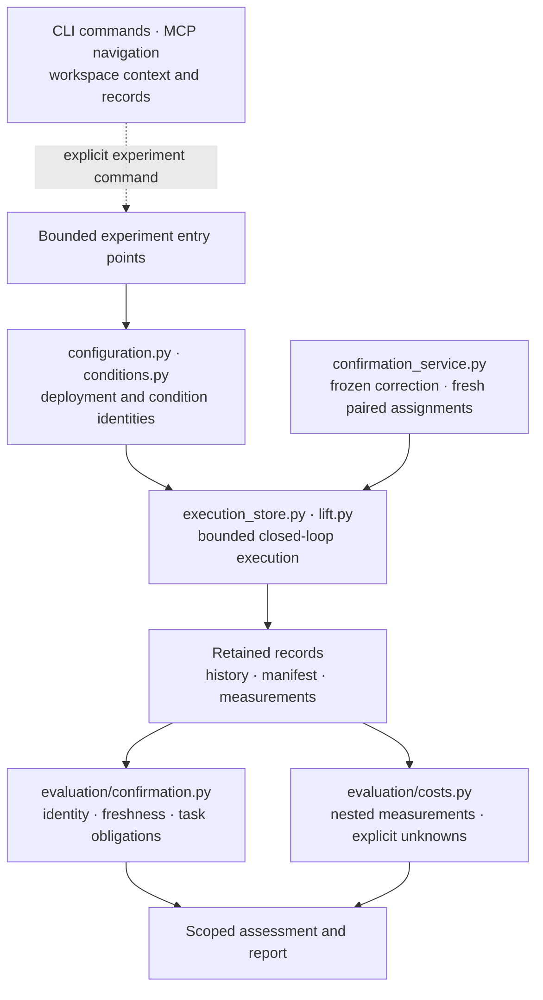
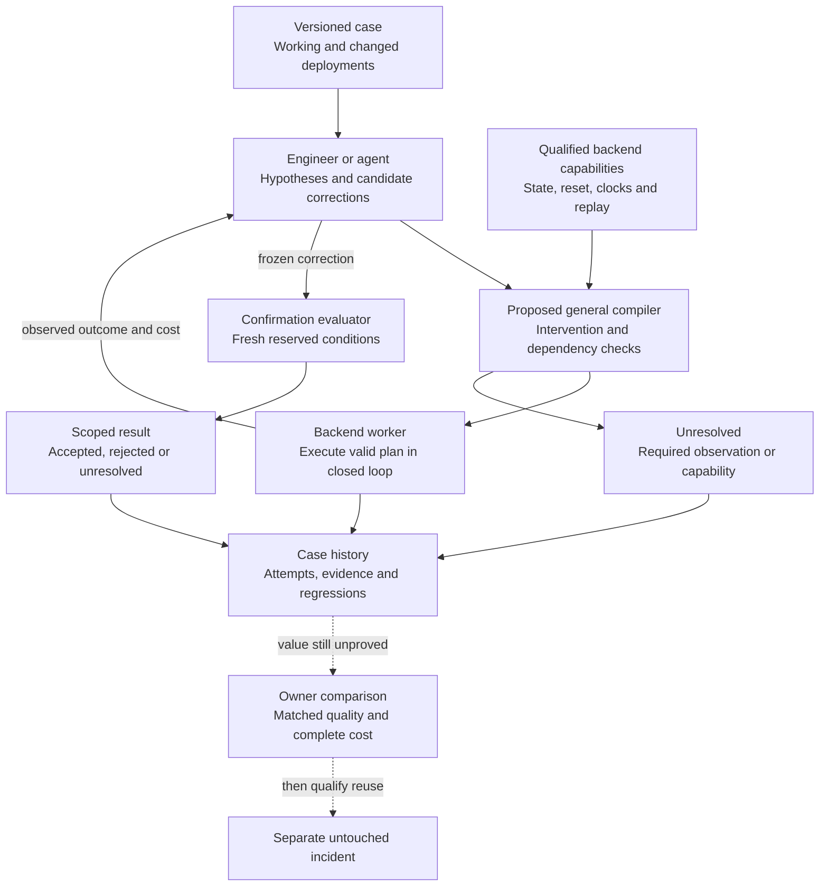
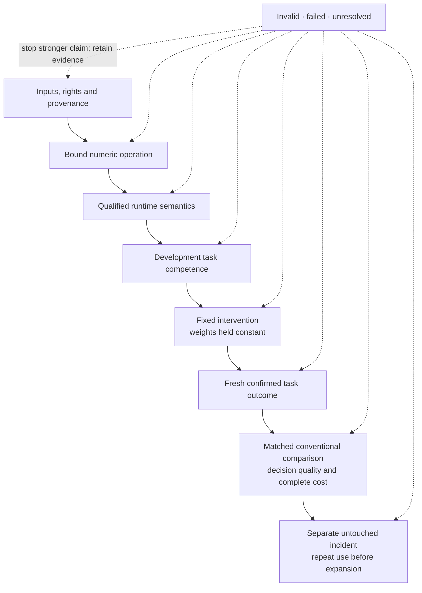
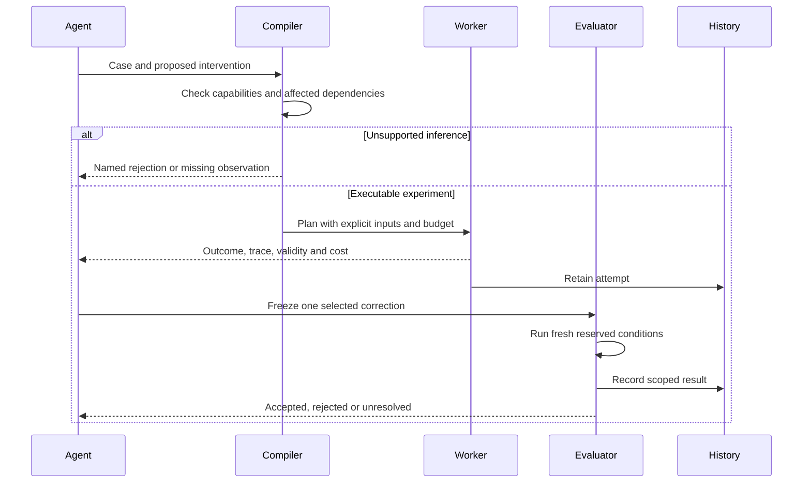
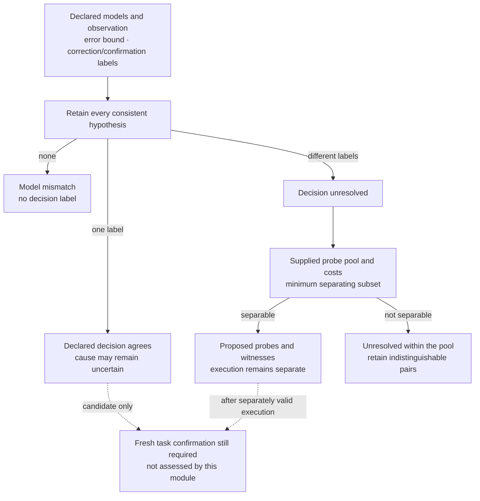

# Architecture

**Design v0.1 · 17 September 2026; implementation status updated 24 October
2026.** The general product architecture remains proposed.

The workspace tools, one CPU Lift adapter, a finite diagnostic procedure,
bounded model-request interface, fresh-confirmation service and integrated
evaluator run today. The
[first case](experiments/LIFT_PROTOCOL_V3.md) retains a regression, correction and
32 paired fresh development conditions. The
[ten-case scripted comparison](experiments/MATCHED_COMPARISON.md) confirms six
incidents in each arm without a demonstrated cost advantage. The
[bounded model comparison](experiments/BOUNDED_AGENT_COMPARISON.md) also tied
on three paired repetitions of one known incident. A general intervention
compiler, adaptive experiment selector and reserved screen remain targets.
The diagrams below distinguish that proposed architecture from the implemented
finite decision mechanism. The
[README's experiment path](../README.md#how-a-correction-earns-acceptance)
describes the implemented workflow.

The temporal software harness executes scripted queues and lifecycle changes
with a virtual clock and a reference assessment. Its
[interface](experiments/TEMPORAL_INTERFACE.md) preserves missing evidence and
interrupted attempts. Robot dynamics and learned inference are outside this
software experiment's scope.

The A1 line has retained evidence for rights-qualified offline data,
100 normalized CPU optimizer updates and checkpoint state recovery. Its separate
robosuite 1.5.1 runtime now passes the declared qualification checks. The exact
checkpoint completes 1/10 development tasks against the required 8/10, so it is
rejected as the competent reference in this runtime. Historical trajectory
fidelity remains limited. The [runtime record](experiments/results/a1-runtime-001/README.md)
retains every producer failure, the corrections and the single-lane assessment;
neither task repair nor comparative value follows from this qualification.

The subsequent [B2 experiment](experiments/results/b2-semantic-transfer-001/README.md)
retains a real cross-version observation-convention failure. Its policy-specific
adapter restores 9/10 fresh paired tasks versus 0/10 with unchanged inputs, with
all actual network inputs checked and every downstream trajectory recomputed.
This qualifies that exact corrected reference. The one remaining task failure,
historical replay discrepancy and absence of comparative cost evidence remain.

The [portable transfer reader](experiments/TRANSFER_EVIDENCE.md) separately
recomputes B2's recorded obligations with NumPy. It provides a reproducible
evidence readback for this exact sealed case; generic correction dispatch and
the five-field agent repair interface are unchanged.

The [11 October system review](FRONTIER_REVIEW_2026-10-10.md#n020-verdict--11-october-2026)
narrows the next product test to deployment-change qualification alongside an
owner's conventional tools. The general architecture below remains proposed.
The [12 October reassessment](FRONTIER_REVIEW_2026-10-10.md#n022-system-and-frontier-assessment--12-october-2026)
retains that direction after source/evidence reconciliation and comparison with
current policy models, integration systems and learned evaluators. It identifies
change-specific decision quality and complete cost as the comparison to earn.
The existing processor packet can now also be inspected outside a workspace;
complete readback requires a verified summary, manifest and seal. This does not
provide a generic record importer or qualify deployment behavior.

The [native episode-boundary check](experiments/results/async-eval-qualification-001/README.md)
adds a specific obligation for retained evidence: a terminal observation belongs
to the episode that produced it, even when a vector environment immediately
returns the next episode's reset observation. Live control and recorded
successor observations can therefore need different values. The source-bound
correction passes 41 CPU software checks with the existing upstream metric fix;
this adds regression coverage, with comparative economics still unmeasured.

That N023 result is historical. The later
[LeRobot submission](experiments/results/terminal-observation-followthrough-001/README.md)
passes 48 native CPU checks, including the eight controls that fail on its base.
The [EXPO-FT dispatch](experiments/results/terminal-dispatch-001/README.md) and
[Retriever replay](experiments/results/replay-identity-001/README.md) corrections
extend source-specific qualification to terminal actions and recorded clocks.
They are upstream patches with retained controls, not general Nisayon adapters.
The [N-SCORE qualification](experiments/results/sequential-confirmation-001/README.md)
corrects a released binary sequential test before any runtime integration.
Its finite null counterexample does not qualify a robot sampling process.

The [accounting correction](experiments/results/cost-retention-001/README.md)
preserves measured prefixes when parent measurements are unavailable and keeps
invalid totals explicit. Complete engineering costs remain unmeasured. The
[current research decision](FRONTIER_DECISION_2026-10-14.md) calls for an owner's
real deployment choice using existing native tools, followed by fresh task
confirmation and a complete-cost comparison. N015 is awaiting existing deployed
records and a live owner choice. The Orin request and two later invitations
remain pending at the retained 16 October readback. N038's reassessment is
complete; its native identity qualification does not establish an economic advantage.

[N039](experiments/results/identifiability-001/README.md) adds a bounded offline
identifying mechanism: retain every declared hypothesis that fits the trace,
then choose a minimum-cost nonadaptive set from supplied probe predictions, or
report the pairs that remain indistinguishable. Three constructed families and
20 unit controls pass; a competent conventional probe choice ties its cost.
This module executes no probes and does not discover the hypothesis set. A
general planner and a measured reuse advantage remain unestablished.

[N042](experiments/results/decision-probes-001/README.md) extends that finite
calculation to declared correction choices. It can leave causes unresolved when
they imply the same supplied correction and confirmation requirements. All 25
new and 20 existing controls pass. This remains an offline Python API and
example, with no execution or acceptance integration. The
[N041 research and proxy readback](experiments/results/n041-decision-value-2026-10-15/README.md)
supports qualifying each observation by the decision it changes; it does not
qualify a proxy as a replacement for fresh task confirmation.

[N044](experiments/results/native-routing-001/README.md) qualifies a native
binary client-identity correction in vla.cpp; it adds no transport backend to
Nisayon. [N045](experiments/results/prediction-audit-001/README.md) qualifies a
published prediction-audit formula and its acquisition costs in constructed
probability models. It leaves the implemented finite confirmation obligation
unchanged. An owner's pre-execution signal, sampling process and complete costs
would need their own qualification before this research option could be used.

## Native qualification and review · 24 October 2026

The implemented `nisayon.qualification` package adds explicit project/environment
contexts, immutable cases and plans, native call witnesses, retained attempts,
read-only assessments, applicability checks and portable review bundles.
The [interface](NATIVE_QUALIFICATION.md) keeps software qualification separate
from deployment acceptance. The experimental decision-planner bridge is measured
in the [native comparison](experiments/results/native-sdk-2026-10-23/README.md);
it did not establish an advantage over the fixed probe. The
[cost assessor](COST_TARGET.md) preserves missing costs and false acceptances.
A general execution compiler and learned selector remain proposed.

New plans also freeze a bounded CPython owner-file read policy. Observed
undeclared reads or incomplete witnesses prevent acceptance; a declared data
change invalidates reuse. The [read-witness experiment](experiments/results/owner-read-witness-2026-10-24/README.md)
retains the omitted-data counterexample and the metadata-import defect found
during implementation. This is a checked boundary under explicit premises,
not complete dependency discovery. The [native flow](NATIVE_QUALIFICATION.md#python-interface)
shows execution, read-only assessment, portable review and scoped reuse.

The separate [full-weight continuation investigation](experiments/results/native-continuation-2026-10-24/README.md)
qualifies the combined LongWAM/LeRobot/Accelerate candidate on two synthetic
seeds and two A100 GPUs. Exact next-update witnesses agree on both ranks after
fresh-process resume. This is an instrumented native training experiment, not
a generic training backend in the SDK; training quality and owner value remain
unmeasured.

## Implemented code and data flow

These components exist in the current Python package. The workspace CLI starts
commands and retains engineering records; MCP provides context and navigation.
Both are separate from the experiment and assessment interfaces. Entry points bind
their own case, assets and execution budget. There is no general dispatch layer
connecting the offline probe planner to a robot.



| Inspect | Implementation | Verification and limit |
|---|---|---|
| Workspace entry points | [CLI](../src/nisayon/cli.py), [MCP](../src/nisayon/mcp_server.py), [workspace](../src/nisayon/workspace.py) | [Workspace tests](../tests/test_workspace.py); developer permissions do not isolate evaluation answers. |
| Native software qualification | [SDK and CLI](NATIVE_QUALIFICATION.md), [runner](../src/nisayon/qualification/runner.py), [read witness](../src/nisayon/qualification/reads.py) | [Controls](../tests/qualification/); exact source, data and environment identities, observed calls and bounded owner reads. Software acceptance leaves deployment unresolved. |
| Evidence review and reuse | [Portable reader](../src/nisayon/qualification/bundle.py), [applicability](../src/nisayon/qualification/reuse.py) | [Portable review contract](PORTABLE_REVIEW.md); no owner code executes during review. Procedure, observations and verdict have separate reuse requirements. |
| Complete owner cost | [Cost target](COST_TARGET.md), [active-effort recorder](../examples/qualification/owner_effort/README.md), [prospective comparison](OWNER_COMPARISON.md) | Setup, retries, review and declared charges are included; missing costs stay unknown. The twofold target remains unproven. |
| Closed-loop execution and retention | [Execution store](../src/nisayon/engine/execution_store.py), [Lift adapter](../src/nisayon/engine/lift.py), [history](../src/nisayon/engine/history.py) | [Execution tests](../tests/engine/); the measured physical model is the pinned simulator, not a hardware guarantee. |
| Fresh task confirmation | [Producer service](../src/nisayon/engine/confirmation_service.py), [assessment](../src/nisayon/evaluation/confirmation.py) | [Frozen obligation](evaluation/CONFIRMATION_OBLIGATION.md); source identity and task progress must both hold. |
| Cost accounting | [Reconciliation](../src/nisayon/evaluation/costs.py), [regressions](../tests/evaluation/test_evaluation_costs.py) | Nested measurements count once; invalid or unmeasured cost remains explicit. |
| Bounded integration cases | [Temporal runtime](../src/nisayon/engine/temporal_runtime.py), [processor cases](../src/nisayon/engine/processor_case.py) | [Temporal interface](experiments/TEMPORAL_INTERFACE.md); constructed software execution and retained readback, with no robot-performance inference. |
| Declared decision probes | [Finite API](../src/nisayon/engine/identifiability.py), [controls](../tests/engine/test_decision_probes.py) | Exact bounded enumeration; supplied models and labels are premises. |
| Confirmation research | [Prediction-audit qualification](../scripts/experiments/qualify_prediction_audit.py), [cost challenge](../scripts/experiments/challenge_prediction_audit_cost.py) | Exposed finite arithmetic, separate from the production confirmation service. |

The proposed architecture below describes what further components would need to
do. Its compiler and general selector are not additional implemented services.

## The problem we intend to own

A learned policy works in one deployment and fails after a change. Its engineer
has a recording, a code diff, several plausible explanations, and an expensive
way to test each one. Nisayon should turn that situation into a sequence of
valid experiments and a correction that survives fresh confirmation.

The first boundary is policy integration: observation freshness and transforms,
action interpretation, chunk queues, inference timing, controller settings, and
reset state. The first backend is one pinned CPU MuJoCo/robosuite stack with a
frozen policy. The measured backend is qualified only for this finite interface;
other policy families and physical hardware remain unqualified.

The output is a tested correction, its executable regression case, its cost,
and its remaining uncertainty. An unresolved result is useful when it names
the observation needed to distinguish incompatible explanations.

## The proposed system



## Component boundaries

Start with one Python codebase and separate execution processes. Each component
earns distribution when measured throughput, fault isolation, or customer
deployment requires it.

| Component | Responsibility | Output and boundary |
|---|---|---|
| Case capture | Bind deployments, task, failure and relevant assets | Versioned references; large recordings remain in existing storage |
| Backend adapter | Reset, snapshot, execute and report actual actions | Explicit capabilities; unsupported operations remain unsupported |
| Experiment compiler | Resolve intervention effects and dependencies | Executable plan or a named validity rejection |
| Selector | Choose the next useful experiment within budget | Start with competent conventional selection; evaluate adaptive planning separately |
| Finite probe calculation, implemented offline | Separate supplied hypotheses or declared correction choices | Exact nonadaptive subsets within 12 hypotheses/16 probes; caller supplies predictions, error bound, costs and decision labels; no execution |
| Worker | Execute a plan and measure its outcome | Trace, process state, measurement state and cost stay separate |
| Confirmation evaluator | Assess a frozen correction on fresh conditions | Scoped result under a frozen obligation |
| Case history | Preserve outcomes, explanations, patches and regressions | Reuse requires a new applicability check |

An existing coding agent reads code, proposes hypotheses, and writes candidate
patches. The agent is replaceable. Typed experiment semantics, execution, and
confirmation belong in ordinary software. The current workspace MCP server
supports engineering these components; it is not their product API.

## Contracts before optimization

The first product records should be small typed Python objects with explicit
serialization versions. Introduce the following when the first adapter needs
them; do not generate empty schemas for an imagined platform.

| Object | Required information |
|---|---|
| `Case` | Working and changed revisions; policy and assets; task predicates; failure reproduction; allowed changes |
| `BackendCapabilities` | Reset semantics; supported snapshots; hidden state; clocks; random streams; observed replay behavior |
| `Intervention` | Changed mechanism; activation time; duration; reset needs; diagnostic substitution or deployable edit |
| `ExecutionPlan` | Input identities; operations to recompute; retained state; declared assumptions; budget |
| `Run` | Intended and executed actions; observations; process result; measurement validity; costs; artifacts |
| `ConfirmationProtocol` | Frozen patch; reserved conditions; outcome, progress and constraint obligations; stopping rule |
| `RepairReport` | Accepted, rejected or unresolved within the protocol; retained evidence; applicability limits |

A `Run` can finish successfully as a process and still contain an invalid
experiment. A valid experiment can leave the decision unresolved. Avoid a
single `success` boolean across these layers.

Runtime transformations also have to preserve relationships among components.
The [parallel-evaluation source audit](experiments/results/eval-copy-graph-001/README.md)
shows why. Copying processors separately can isolate each worker yet disconnect
the postprocessor from the state its preprocessor updates. The retained control
then produces target `101` where the sequential reference produces `11`.
The [native follow-through](experiments/results/eval-copy-native-001/README.md)
reproduces the same defect through installed pipelines and the complete evaluator
with scripted CPU policy/Gym fixtures. The connected copy passes all thirteen
controls; this does not qualify arbitrary learned policies or devices.

For a worker-context change, check three separate obligations: required
references remain connected within the worker; mutable state is separated
between workers; and the declared input/action trace agrees with the sequential
reference under matched state and randomness. Source-specific ownership rules
must distinguish deliberate sharing from forbidden sharing. A single connected
copy satisfies the inspected processor controls, not every possible policy or
runtime. Nisayon does not yet infer these contracts or verify them generically.
This is a concrete requirement for a future qualification adapter, grounded in
an existing upstream decision.

## Evidence ladder

Each transition requires its own executed evidence. A later success cannot repair
an unsupported earlier binding, and an earlier software check cannot stand in for
a task outcome.



## Intervention validity

An intervention changes a mechanism. That change determines what must be
recomputed. For the first adapter, **a full closed-loop rerun is the reference
implementation**. Partial reuse must agree with it under stated premises.

| Change | Consequence to check |
|---|---|
| Action or controller output | Recompute affected future plant state and observations |
| Observation transform | Recompute policy inputs and all affected descendants |
| Chunk length, queue alignment or timing | Reconstruct the action schedule; old indices and timings may be inapplicable |
| Controller state or reset | Account for integrators, queues and recurrent policy state |
| Physics, geometry or solver version | Requalify state interpretation and numerical continuation |
| Random draw order | Verify coupling of disturbances; an equal seed alone is insufficient |
| Revised policy from episode start | Recompute its reachable prefix before using a later snapshot |
| Diagnostic oracle observation | Label the substitution; remove it from a deployable correction |



**Established principle.** In a deterministic acyclic dependency graph with
complete read dependencies, recomputing all descendants of a changed node and
retaining unaffected inputs gives the same result as full recomputation.
Induction in topological order proves it. That is ordinary dependency reasoning.
The difficult engineering lies in whether the graph includes the real state,
timing, numerical behavior, and dynamic dependencies. A checksum cannot answer
that question. Differential tests can reveal omissions; passing tests do not
prove a complete model of reality.

## What the decision means

Bind the owner's outcome predicate, time window and stopping/continuation
behavior before choosing a correction. Bind the target population, sampling
unit and physical initial-state pairing before interpreting an interval. The
[recorded endpoint comparison](experiments/results/decision-endpoint-001/README.md)
reproduces opposite PushCube pipeline rankings for first-hit and deadline
success on the same trajectories. More precision cannot settle an unspecified
objective. Rescoring a fixed trajectory is valid for an alternative measurement;
changing when the robot stops changes the execution and requires a new run.
These are intake requirements, not an implemented general ranking backend.

Let `H` be retained evidence and `M(H)` the explicitly declared models consistent
with it. Let `A(m)` be the corrections satisfying the task under model `m`.
The robust decision asks for one common correction:

```text
there exists r such that, for every m in M(H), r belongs to A(m).
```

A different correction for each surviving explanation is insufficient to choose
what to deploy. When no common correction can be justified, the next experiment
should separate explanations that recommend incompatible actions.

This formulation connects to active diagnosis, robust decision theory, and
experimental design. We have not established a new theorem, an efficient general
solver, or a universal causal identification procedure. The near-term research
question is whether this discipline changes the cost and quality of a real
engineering decision. [Source map](SOURCES.md)

### Implemented finite decision mechanism

The [bounded API](../src/nisayon/engine/identifiability.py) implements a narrower
case of that question. `assess_decision` retains all hypotheses consistent with
the supplied observation and error bound, then reports whether their labels
agree. A label covers both the correction and its confirmation requirements;
the caller must justify and freeze that equivalence before outcomes. The code
checks complete, nonblank labels but cannot validate their physical meaning.

`minimum_decision_probe_plan` separates differently labelled pairs. For each
such pair, at least one selected prediction coordinate must differ by strictly
more than twice the common absolute error bound. Touching error balls remain
ambiguous. Exact nonadaptive subset enumeration minimizes positive integer
observation costs, then probe count and lexical identifiers. The bound is
12 supplied hypotheses and 16 probes; these costs are not measured owner effort.



When all supplied hypotheses share one label, the plan can require zero probes.
No matching hypothesis instead yields model mismatch and no label. The API
always reports `task_confirmation: not_assessed`, and the original full-cause
assessment remains separate. The constructed example costs one for the declared
decision and four for full identification; competent conventional grouping also
costs one. It establishes neither validated decision equivalence nor a saving.

A correction may restore a software invariant while changing a convention learned
by existing weights. Bind the checkpoint's training-time processors, masks and
policy context to their deployment counterparts before accepting such a remedy.
For example, the open [GR00T padding-mask proposal](https://github.com/NVIDIA/Isaac-GR00T/pull/741)
keeps strict masking opt-in for released-checkpoint compatibility. Its structural
controls do not determine the task effect of changing that setting on fixed
weights. A serving-only change, fine-tuning under new semantics and training from
scratch are distinct interventions with different costs and confirmation needs.

Likewise, a proxy can preserve overall policy ordering without resolving the
specific deployment choice. The [rank readback](experiments/results/proxy-ranking-readback-001/result.json)
illustrates that distinction. Qualify the proxy against the decision it will
support; model-ranking evidence alone does not validate a repair-ranking rule.
These are experiment-design requirements, not implemented GR00T execution or
sim-to-real transfer guarantees.

## Trust and evaluation

The trusted scope includes parsers, adapter semantics, task predicates, state
capture, measurement, and the confirmation evaluator. Counting only a small
checker would understate it. Solver output can carry an independently checked
artifact where the problem permits one; empirical outcomes still depend on
measurement and operating conditions.

During a comparison, freeze task criteria and reserve confirmation cases outside
the solver's accessible environment. Use separate processes, storage credentials
or machines as required. The full-access developer launchers are convenient
engineering tools; they do not isolate a benchmark. Keep held-out answers out
of shared notes and agent context. Freeze retrieval at the evaluation cutoff.

The first acceptance result covers a finite declared set. Broader stochastic
claims require a justified sampling model and statistical protocol. No automotive
or aerospace safety conclusion follows from a manipulation experiment.

## Storage and growth

The implemented workspace uses Git-tracked JSON notes and checkpoints, plus
ignored local command logs and session snapshots. Unique record files avoid a
shared append-buffer race. Git worktrees keep concurrent changes separate. This
works for a small engineering team and is deliberately easy to inspect.

For product execution, introduce a transactional run registry and an object
store when jobs and assets require them. SQLite is a reasonable first local
registry. Keep large videos and checkpoints out of Git. Store hashes as content
identifiers and preserve provenance; never interpret a hash as scientific
validation. At larger scale, a queue can dispatch the same typed plans to workers
without moving acceptance logic into the agent.

Adapters should depend on a small backend protocol. Begin with one working
adapter. Add a second backend only after the first result survives the baseline.
Keep simulator-specific state and timing semantics at the adapter boundary.

## Implementation order

1. Engineering tools, shared memory and recovery. **Implemented foundation.**
2. One pinned backend and a measured reset/replay qualification. **Historical Lift
   backend complete; A1 runtime qualified under its declared checks, checkpoint
   competence rejected at 1/10. B2's exact semantic adapter qualifies its separate
   legacy-policy reference at 9/10 fresh paired conditions.**
3. One integration regression, full rerun, and invalid-replay control.
   **Implemented in bounded cases.**
4. Explicit intervention checks and fresh correction confirmation.
   **Implemented for declared adapters and finite obligations; general compilation
   and population guarantees remain unproved.**
5. The historical three-arm experiment. **Two development comparisons reached
   parity; the reserved screen remains unrun and unallocated.**
6. Finite offline cause and decision probes. **Implemented in N039/N042;
   competent conventional calculations tie. No execution bridge or owner value
   established.**
7. An independently owned deployment decision, fresh confirmation and complete
   comparative costs. **Current value milestone; Orin and two later invitations
   remain unqualified.**
8. A separate untouched repeat-use case, then adaptive selection, reusable
   qualification or another backend only where measured evidence supports them.

[Next experiment](RESEARCH_PLAN.md) · [Development](DEVELOPMENT.md) · [README](../README.md)
