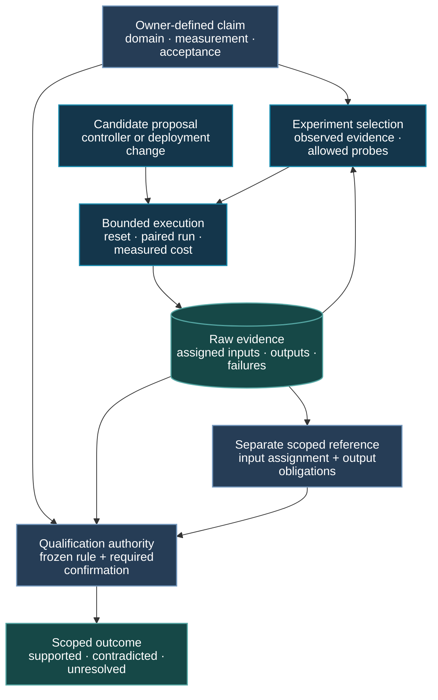
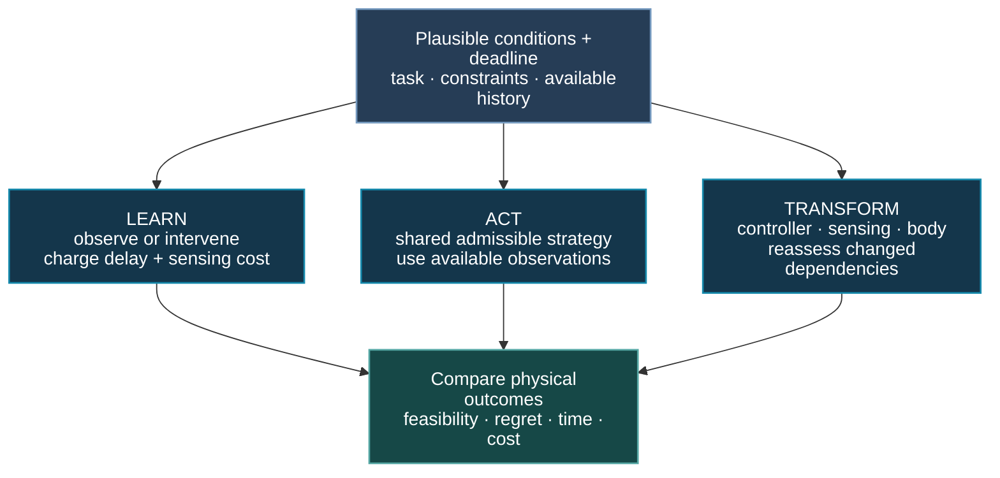

# From change qualification to retained physical competence

**Research direction · 26 November 2026.** Evidence-Directed Physical
Intelligence (EDPI) is an internal research program. Its long-term question is
whether a physical learning system can discover consequential gaps in its
knowledge, resolve them efficiently, and retain useful competence across changes
without weakening the rules that judge its progress.

Nisayon enters through a concrete engineering problem: after a deployment
changes, which previous observations still support a decision, and what must be
measured again? The [current architecture](ARCHITECTURE.md) implements declared
dependency checks, bounded execution, retained evidence and portable review.
The [26 November experiment](../experiments/edpi_finite/README.md) adds a small
active qualification mechanism. It found **no advantage over strong conventional
selection rules**. Its [symmetry analysis](../experiments/edpi_finite/SYMMETRY.md)
explains why those rules cannot differ under that particular acquisition model.

This negative result sets a more demanding next question: can justified
structure in a real change make some experiments more consequential than others,
and can using that structure save complete work at matched decision quality?

## Phase II: observable differences and an open decision

The [new public packet](../experiments/edpi_phase2/README.md) establishes a
physical inertia/fluid dependency and different native serving-input contracts.
It also retains seven counterexamples against the first evidence reader and
a supplement that checks all 1,170 assigned inputs across the same 324 cases.
These are concrete mechanism and verification results. They do not define which
correction an independent owner should accept.

No new selector was built. The required prospective witness must show that two
justified acquisition choices can change an engineering decision, not merely
produce different measurements or experiment orders. The owner-value campaign,
complete-cost baseline and fresh task confirmation remain open. The
[decision specification](../experiments/edpi_phase2/MATHEMATICS.md) distinguishes
robust admissibility, missing model coverage, complementary experiments and
abstention; the [prior-art matrix](../experiments/edpi_phase2/PRIOR_ART.md) identifies
established alternatives and the limits of the literature review.

## The architecture follows the authority boundary

Candidate generation may change a controller. Experimental reasoning may propose
what to observe. Neither may redefine measurement semantics, acceptance criteria,
mandatory confirmation, or the operating domain of the claim. Existing SDK
checks bind reviewed declarations; the new finite selector remains research code
with a narrow execution adapter. The diagram states the intended responsibility
boundary, not a claim that a general autonomous learning system is implemented.

The finite campaign withholds case inputs and reference answers from the selector
process and tests a denied file read. Its builder knows the cases; it does not
establish independent human review or general containment of a hostile process.
The separate rational reference avoids importing the simulator or selector.
Portable integrity verifies retained bytes, not that a physical experiment
actually happened. These distinctions remain visible in the evidence packet.

## Four questions, with prerequisites

| Question | What would establish progress? | Current position |
| --- | --- | --- |
| H1: evidence applicability | Correctly retain, invalidate or withhold evidence for a scoped claim after a change | Implemented declared-dependency contracts and adversarial controls; completeness is an owner-supplied premise |
| H2: experimental economy | Lower complete expenditure at matched harmful-admission, missed-opportunity and abstention performance | Finite mechanism runs; comparative advantage remains unestablished |
| H3: cumulative adaptation | Better independently measured old, new and compositional task competence across adaptation rounds under matched budgets | Deferred until qualification and its comparative value are established |
| H4: consequential physical uncertainty | A justified sensing, control or embodiment intervention improves attainable physical decisions under uncertainty | Research direction; Ricci provides scoped simulation evidence, not this general result |

A gate that rejects every change can avoid harmful admissions while preventing
learning. A gate that admits every change can acquire useful behavior while
accumulating regressions. H3 must evaluate both costs, retained competence and
trajectory-level performance. Passing H1 or implementing H2 does not establish H3.
Hard physical constraints must not be averaged away by gains on unrelated tasks.

For a declared candidate-minus-reference expected loss $\Delta$, bounds $[L,U]$
support non-inferiority at tolerance $\epsilon$ when $U\leq\epsilon$, contradict it
when $L>\epsilon$, and otherwise leave it unresolved. Superiority and two-sided
equivalence require their own criteria. Today's finite bounds are identification
bounds over named conditions. They are not sampling confidence intervals.

Future stochastic comparisons must retain meaningful paired initial conditions,
the full joint outcome table, missingness and censoring. Adaptive selection,
optional stopping, dependence, multiple claims and repeated promotion of the
reference require a separately justified inference protocol. A shared random seed
alone supplies none of these guarantees. The
[primary-source matrix](../experiments/edpi_finite/prior-art-matrix.json) and
[paired-inference addendum](../experiments/edpi_finite/prior-art-addendum.json)
identify established machinery and the limits of this review.

## Information, action and physical design

A hidden physical distinction matters when it changes which response can succeed.
Let $H$ be the plausible hypotheses and $\ell(a,h)$ the loss of response $a$ under
hypothesis $h$. The minimum robust regret is

$$
R^*(H)=\inf_a\sup_{h\in H}
\left[\ell(a,h)-\inf_{a'}\ell(a',h)\right].
$$

This measures the cost of using a shared response relative to hypothesis-specific
responses. It does not establish identifiability, useful sensing, enough time to
wait, or physical feasibility. A low-regret action can still be unacceptable if
every action fails a hard constraint. Absolute feasibility and relative regret
must therefore be assessed separately.

There are three distinct interventions to compare:

1. **Learn:** sense or intervene to distinguish hypotheses before acting, charging
   sensing cost, estimation error, delay and the physical consequences of waiting.
2. **Act:** execute an admissible response that works across plausible hypotheses
   without first identifying the true one.
3. **Transform:** change control, sensing, environment or embodiment so that the
   distinction matters less to attainable outcomes.

For a design $\theta$ and deadline $\tau$, consider the set of policies that obey
the observation history, act before the relevant deadlines, and satisfy declared
constraints for every $h\in H$. A useful design intervention may enlarge this
set even without making $h$ easier to estimate. That is a different mechanism
from installing a better sensor. Comparing them requires matched task, cost and
constraint definitions, with privileged-information controls kept separate.

A common recovery strategy must be **nonanticipative**: equal observation
histories require the same response distribution. Intersecting action sets
computed with privileged knowledge of each hidden state does not prove that a
deployable shared policy exists. Sampled success, certified model-relative
feasibility and hardware validation are different evidence levels.

[Minimally Sufficient Robot Brains](https://arxiv.org/abs/2308.09041) provides
relevant prior work on information representations. The
[Ricci mathematical direction](../work/experiments/ricci-brain-01-2026-11-24/MATHEMATICAL_DIRECTION.md)
and [retained experiment](../work/experiments/ricci-brain-01-2026-11-24/RESULTS.md) supply the
existing local starting point. Both controllers completed 17/28 held-out trials;
the recovered table has zero discordant completions and five jointly censored
trials among the eleven pairs without observed completion. Equal totals do not
show improvement, and censored trials do not establish eventual failure.

The sigmoid $df/dt=kf(1-f/L)$ remains a possible empirical model of a measured
transition. Fit it only against a declared mechanism and compare it with
mechanistic and nonparametric alternatives. Contact changes can introduce
discontinuities and multiple regimes. No universal logistic law of recovery or
intelligence has been established here.

## Building a physical research platform

The proposed route to an advanced body and control system begins with measurable
task requirements and recovery deadlines. No single body is best across all
payloads, contacts, energy limits, sensing requirements and operating domains.
Hardware selection follows those requirements and its own authorization.

First build the smallest instrumented simulation and later a contained test rig
that can falsify the information-versus-action hypothesis. Separate state
estimation, fast feedback control and slower task reasoning. Measure the complete
sensor-to-actuator delay distribution, actuator limits, calibration drift and
failure recovery. Learning proposes changes; independent qualification governs
their admission.

Then compare sensing and controller changes against passive or mechanical
changes using the same task constraints. Progress from a contained mechanism to
manipulation, mobility or a humanoid only when the task demands it and retained
evidence supports the added degrees of freedom. Each addition creates new
dependencies, operating domains and qualification obligations. This document
authorizes no physical deployment and reports no hardware result.

## The single next value experiment

The serving intake supplies a concrete contract distinction: may generated
placeholders be omitted, and are missing real views acceptable? Source inspection
and the native matrix cannot answer the second question for an absent owner.
Obtain that acceptance contract and a permitted raw reproducer first.

Admit one independently owned deployment change with a live correction decision
under the [owner comparison protocol](OWNER_COMPARISON.md). Before execution,
verify from justified hypotheses that at least two permitted experiments can
change the correction choice differently; expose any symmetry to the conventional
baseline as well. Freeze the measurement, budgets, stopping rules and mandatory
fresh confirmation. Compare against competent selective checks with equal
information, charging preparation, unsuccessful work, execution, review and
maintenance. Preserve harmful admissions, missed beneficial opportunities and
abstentions separately.

If the comparison shows no complete-cost advantage, retain that result and
reconsider expansion. If it supports the value claim, test the same frozen
procedure on a separately selected untouched incident. Only then advance the
frozen candidate-stream admission study. Cumulative learning, compositional
competence and embodiment experiments remain subsequent questions.
