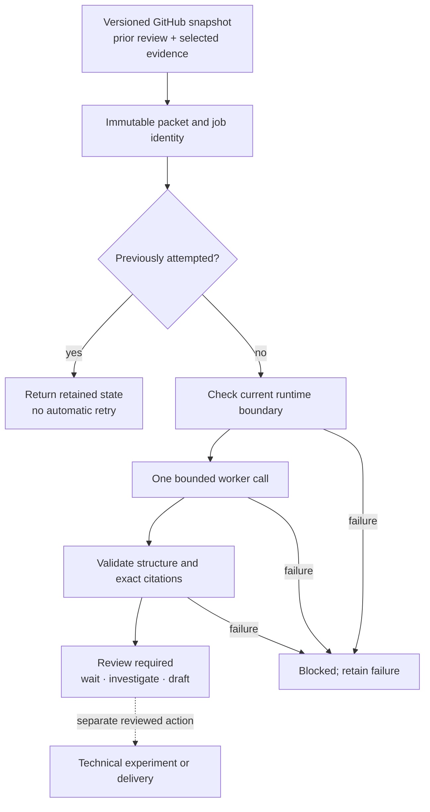

# Bounded investigation of an upstream question

The GitHub monitor notices changes. `nisayon.engagement_agent` can then prepare
one evidence packet and, when explicitly invoked, ask the existing bounded
worker to propose a response or the next experiment. Its outputs remain
`review_required`. It cannot post, acknowledge a thread, execute owner code,
allocate hardware or promote a lesson.



## Interface and limits

The module consumes the shared ignored engagement store described in the
[monitor guide](ENGAGEMENTS.md). Preparation reads the recorded snapshot;
it does not establish that the live thread remains unchanged.

```sh
uv run --frozen python -m nisayon.engagement_agent OWNER/REPO#NUMBER \
  --evidence docs/CAPABILITIES.md
```

`--run-once --timeout 90` explicitly invokes the configured model worker.
This requires an admitted runtime and the applicable model-resource authority.
There is no scheduled model loop. The 1–120-second worker timeout is not a
guarantee of cleanup after host failure or parent-process termination.

The packet binds the thread, prior review, selected evidence, voice, worker
implementation and runtime identity. A repeated immutable job returns its
retained state without another preflight or model call. Interrupted or uncertain
jobs require reconciliation. A changed source produces a different job; this
mechanism does not itself impose an account-wide spending limit.

The response checker enforces a schema, bounded fields, source identities and
exact quoted substrings. It checks inspectability, not whether a quote entails
the claim. A reviewer must still check factual interpretation, source freshness,
duplication, experimental validity and authority before acting.

### Versioned experiment proposals

New packets use `nisayon.engagement-investigation.v2`. An investigation includes
one `experiment_design`: predictions bound to its alternative answers, an oracle
measurement/identity/independence/limitations, minimum execution, estimated costs
with a basis for every value or explicit unknown, and unresolved assumptions.
Wait and reply proposals carry an empty design array. Historical v1 responses
remain readable with design and cost checks marked `not_checked_legacy`.

The checker rejects missing obligations and malformed estimates; it does not
validate the oracle, causal interpretation, source completeness or estimated
cost. A deliberately wrong interpretation with a matching quote still requires
semantic review. Explicit unavailable evidence can remain in a useful proposal.
No checked design authorizes experiment execution, delivery or lesson promotion.
Changing the policy produces a new immutable job, not permission to rerun it.

The [2 November audit and comparison](experiments/results/investigation-design-2026-11-02/README.md)
retains the original failing test, adverse controls, ordinary-checklist parity
and the incomplete live-model comparison. No economic or learning advantage is
established.

## Executed qualification, 1 November 2026

The integration's 64 related deterministic controls passed. One real XPolicyLab
investigation produced a checked proposal; repeating that job made zero further
worker calls. Five altered-record controls were rejected. The standalone audit
reconstructed four cited factual claims and nine exact quotations. These are
software and record-consistency checks, not independent semantic adjudication.

The first model canary failed: it claimed an excluded read was denied without
the required operation in its trace. The existing checker rejected that claim.
A subsequent direct preflight through the same executable and sandbox profile
observed an allowed read, a denied excluded symlink read and a denied packet
write on macOS 14.4 arm64. This does not establish every filesystem or network
boundary on every host.

The two model calls reported 224,819 input tokens, including 167,808 cached,
and 1,451 output tokens; their elapsed times were 9.30 and 44.00 seconds.
Provider charges and complete human effort are unknown. The actual investigation
reread its 59,928-byte packet through five shell commands. Smaller evidence
presentation is therefore a concrete cost question, not a demonstrated saving.

The next evaluation should compare response correctness, omitted obligations,
duplicate outreach and complete cost on later chronological threads against
the existing manual workflow. Remembering lessons does not prove improvement.
The [implementation](../src/nisayon/engagement_agent.py) and
[adverse controls](../tests/test_engagement_agent.py) expose the present contract.
