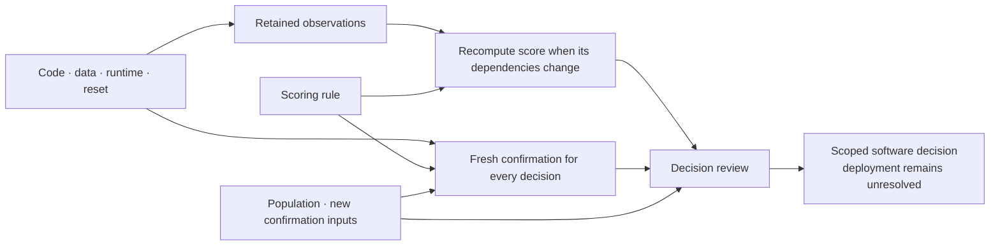

# Which evidence still applies after a change?

A stricter scoring rule need not invalidate the measurements it scores. A
changed calibration file can invalidate those measurements even when the
Python source is identical. Nisayon's explicit applicability planner represents
that difference and explains the checks each declared change requires.

This is an unreleased addition to the source SDK. The published v0.2.0 wheel
does not contain it. It is a bounded planner for a reviewed dependency model,
not automatic dependency discovery or permission to accept a deployment.
The existing `assess_reuse` whole-claim check retains its conservative behavior.



## SDK and CLI

```python
from pathlib import Path
from nisayon.qualification import DependencyModel, EvidenceState, plan_applicability

model = DependencyModel.read(Path("model.json"))
previous = EvidenceState.read(Path("previous-state.json"))
# Actual current identities, including explicit nulls for unknown inputs.
proposed_inputs = previous.record()["inputs"]
proposed_inputs["population"] = None
report = plan_applicability(
    model, previous, proposed_inputs, evidence_root=Path("retained-evidence")
)
assert report["automatic_acceptance"] is False
```

```sh
nisayon-qualify applicability model.json previous-state.json inputs.json \
  --evidence-root retained-evidence
```

Exit 0 means a check plan was produced with the required declared premises;
it does not mean checks passed or a deployment was accepted. Exit 3 means
unresolved applicability. Malformed declarations or invocation errors return 2.
The command reads evidence without importing owner code or running a check.

The [runnable comparison](../examples/qualification/applicability/README.md)
builds a complete model, review, inputs and receipts around the real OpenPI
statistics loader. It includes a competent native workflow with the same
dependency knowledge. Its input changes are constructed and exposed.

## The dependency contract

`DependencyModel` stores canonical immutable JSON with schema
`nisayon.qualification.dependencies.v1`. It contains an ID, scope, typed inputs,
checks, decisions and a review reference. `record()` returns a new copy;
`sha256` identifies the whole record and `definition_sha256` omits only `review`.
The example's [model definition](../examples/qualification/applicability/model.py)
shows every field.

| Element | Required meaning |
| --- | --- |
| Input | Kind and description; current identity supplied separately as SHA-256 or null |
| Check | Observation, analysis, confirmation or review; explicit input/check dependencies; `on_change` or `always` refresh |
| Decision | Description and required checks; transitive coverage of code, data, runtime, scoring and population |
| Review | Exact definition digest, reviewer label and retained review artifact path/digest |
| Evidence state | Exact model digest, all input identities and any completed check receipts |

Input kinds also include `state`, `weights`, `protocol` and `other`. Model weights,
reset state, dataset/split/seed identities, executor and scorer implementation,
runtime/device settings and unmeasured population assumptions must be declared
when they affect the question. A string naming an environment is insufficient
unless its exact meaning and remaining assumptions are reviewed.

Input, check and decision IDs are disjoint. Cycles, unknown dependency nodes,
duplicate edges, unsupported schema fields and invalid digests are rejected.
Each mapping has at most 256 entries. A decision without the five required
dependency kinds or a fresh confirmation check remains unresolved. Coverage of
five kinds is a structural check; it cannot prove every dependency was listed.

The retained review is JSON with schema
`nisayon.qualification.dependency_review.v1`, `definition_sha256`, `reviewer`,
`coverage` and `statement`. Applicability requires the exact reviewed definition
and reviewer plus `coverage: reviewed_for_declared_scope`. The statement is a
nonempty string of at most 500 characters. Missing, changed or incomplete
reviews prevent applicability. A review label is not authentication, independent
human review or scientific approval; state who actually reviewed what.

## Receipts, changes and unknowns

`EvidenceState` uses `nisayon.qualification.evidence_state.v1`. `inputs` covers
exactly the model's input IDs; null means unknown. `checks` may contain receipts
for any completed artifacts, including evidence of rejection or failure.
Unattempted checks are absent. Preserve interrupted attempts separately.

`record_check(model, state, check, evidence_root=..., artifact=...)` returns a new
state. It binds the artifact bytes, exact model, SDK implementation, direct input
identities and upstream receipt identities. It checks retained upstream bytes
and refuses to overwrite a receipt. It does **not** execute the check, validate
its scientific content or attest that the caller truthfully recorded execution.
Only retain a check whose execution and domain validation actually occurred.

For a new decision, begin a new state with current input identities. Copy only
the receipts the report marks reusable. Produce and bind the required new
artifacts in dependency order. Keep previous states and failed artifacts.
The example demonstrates this sequence; the planner does not schedule it.

The report gives each check an action, reasons and affected inputs with the
immediate dependency through which each change propagates. Changed inputs,
missing receipts, altered artifacts, stale receipt bindings and changed model
or SDK identities require new checks. An unknown input cannot establish reuse
of any dependent check, even when its old value was also unknown. A changed
population does not rewrite historical observations into new-population evidence.

Confirmation has `refresh: always`, and every downstream check is renewed with
it. Copying an identical file is not fresh execution; the domain workflow must
enforce actual new confirmation conditions. A planning report never contains an
adoption authorization. Domain-specific execution and decision assessors remain
responsible for failures, controls, uncertainty and acceptance.

Artifacts are relative files under the declared evidence root, at most 16 MiB
each. Escapes and direct symlink files are rejected. Hashing consumes bounded
bytes, and the review is decoded from those same verified bytes. A later
consumer must verify the expected digest again before consuming an artifact.
The planner does not lock mutable directories or provide a hostile-file sandbox.

## What remains to establish

The five required input kinds do not make the graph complete. In particular,
an omitted calibration edge can escape structural checks when another data
edge remains. Native read witnesses and domain controls provide additional
evidence within their own limits. Closed-loop action changes require recomputed
downstream state and observations; this planner supplies no simulator or hardware
adapter and cannot validate counterfactual replay.

The representation is useful only if it removes real work without weakening
the decision. The comparison therefore gives native tools the same reusable
knowledge, includes fresh confirmation and retains missing costs. Setup,
adaptation, retries, review, owner effort and maintenance belong in the twofold
complete-cost target. Local execution speed alone cannot establish that target,
independent transfer or superiority over another system.
