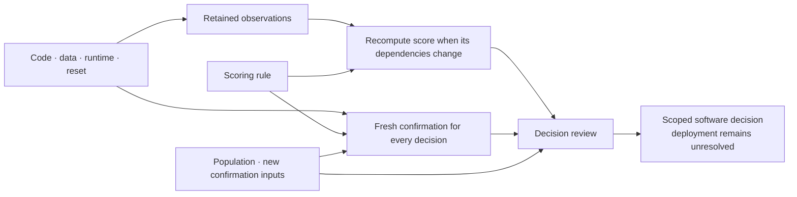

# Which evidence still applies after a change?

A stricter scoring rule need not invalidate the measurements it scores. A
changed calibration file can invalidate those measurements even when the
Python source is identical. Nisayon's explicit applicability planner represents
that difference and explains the checks each declared change requires.

This is an unreleased addition to the source SDK. The published v0.2.0 wheel
does not contain it. It is a bounded planner for a reviewed dependency model,
not automatic dependency discovery or permission to accept a deployment.
The existing `assess_reuse` whole-claim check retains its conservative behavior.



## SDK and CLI

```python
from pathlib import Path
from nisayon.qualification import DependencyModel, EvidenceState, plan_applicability

model = DependencyModel.read(Path("model.json"))
previous = EvidenceState.read(Path("previous-state.json"))
# Actual current identities, including explicit nulls for unknown inputs.
proposed_inputs = previous.record()["inputs"]
proposed_inputs["population"] = None
report = plan_applicability(
    model, previous, proposed_inputs, evidence_root=Path("retained-evidence")
)
assert report["automatic_acceptance"] is False
```

```sh
nisayon-qualify applicability model.json previous-state.json inputs.json \
  --evidence-root retained-evidence
```

Exit 0 means a check plan was produced with the required declared premises;
it does not mean checks passed or a deployment was accepted. Exit 3 means
unresolved applicability. Malformed declarations or invocation errors return 2.
The command reads evidence without importing owner code or running a check.

The [runnable comparison](../examples/qualification/applicability/README.md)
builds a complete model, review, inputs and receipts around the real OpenPI
statistics loader. It includes a competent native workflow with the same
dependency knowledge. Its input changes are constructed and exposed.

## The dependency contract

`DependencyModel` stores canonical immutable JSON with schema
`nisayon.qualification.dependencies.v1`. It contains an ID, scope, typed inputs,
checks, decisions and a review reference. `record()` returns a new copy;
`sha256` identifies the whole record and `definition_sha256` omits only `review`.
The example's [model definition](../examples/qualification/applicability/model.py)
shows every field.

| Element | Required meaning |
| --- | --- |
| Input | Kind and description; current identity supplied separately as SHA-256 or null |
| Check | Observation, analysis, confirmation or review; explicit input/check dependencies; `on_change` or `always` refresh |
| Decision | Description and required checks; transitive coverage of code, data, runtime, scoring and population |
| Review | Exact definition digest, reviewer label and retained review artifact path/digest |
| Evidence state | Exact model digest, all input identities and any completed check receipts |

Input kinds also include `state`, `weights`, `protocol` and `other`. Model weights,
reset state, dataset/split/seed identities, executor and scorer implementation,
runtime/device settings and unmeasured population assumptions must be declared
when they affect the question. A string naming an environment is insufficient
unless its exact meaning and remaining assumptions are reviewed.

Input, check and decision IDs are disjoint. Cycles, unknown dependency nodes,
duplicate edges, unsupported schema fields and invalid digests are rejected.
Each mapping has at most 256 entries. A decision without the five required
dependency kinds or a fresh confirmation check remains unresolved. Coverage of
five kinds is a structural check; it cannot prove every dependency was listed.

The retained review is JSON with schema
`nisayon.qualification.dependency_review.v1`, `definition_sha256`, `reviewer`,
`coverage` and `statement`. Applicability requires the exact reviewed definition
and reviewer plus `coverage: reviewed_for_declared_scope`. The statement is a
nonempty string of at most 500 characters. Missing, changed or incomplete
reviews prevent applicability. A review label is not authentication, independent
human review or scientific approval; state who actually reviewed what.

## Receipts, changes and unknowns

`EvidenceState` uses `nisayon.qualification.evidence_state.v1`. `inputs` covers
exactly the model's input IDs; null means unknown. `checks` may contain receipts
for any completed artifacts, including evidence of rejection or failure.
Unattempted checks are absent. Preserve interrupted attempts separately.

`record_check(model, state, check, evidence_root=..., artifact=...)` returns a new
state. It binds the artifact bytes, exact model, SDK implementation, direct input
identities and upstream receipt identities. It checks retained upstream bytes
and refuses to overwrite a receipt. It does **not** execute the check, validate
its scientific content or attest that the caller truthfully recorded execution.
Only retain a check whose execution and domain validation actually occurred.

For a new decision, begin a new state with current input identities. Copy only
the receipts the report marks reusable. Produce and bind the required new
artifacts in dependency order. Keep previous states and failed artifacts.
The example demonstrates this sequence; the planner does not schedule it.

The report gives each check an action, reasons and affected inputs with the
immediate dependency through which each change propagates. Changed inputs,
missing receipts, altered artifacts, stale receipt bindings and changed model
or SDK identities require new checks. An unknown input cannot establish reuse
of any dependent check, even when its old value was also unknown. A changed
population does not rewrite historical observations into new-population evidence.

Confirmation has `refresh: always`, and every downstream check is renewed with
it. Copying an identical file is not fresh execution; the domain workflow must
enforce actual new confirmation conditions. A planning report never contains an
adoption authorization. Domain-specific execution and decision assessors remain
responsible for failures, controls, uncertainty and acceptance.

Artifacts are relative files under the declared evidence root, at most 16 MiB
each. Escapes and direct symlink files are rejected. Hashing consumes bounded
bytes, and the review is decoded from those same verified bytes. A later
consumer must verify the expected digest again before consuming an artifact.
The planner does not lock mutable directories or provide a hostile-file sandbox.

## Progress while an input is unknown

`execute_checks(..., allow_partial=True)` may execute checks whose transitive
inputs are all known while withholding the affected checks. For example, when
the reviewed model puts population only in confirmation's dependencies, an
unknown population can leave observation and scoring available. If population
also affects observation, observation is withheld. The graph's completeness
remains a reviewed premise.

This option does not waive missing model review, uncovered dependency kinds,
missing confirmation declarations or acquisition failures. It applies only to
explicit `None` inputs; an unreadable declared file still fails acquisition and
produces no check receipts. The default continues to run nothing when an input
is unknown. The option is bound into the procedure identity, so switching modes
conservatively invalidates procedure-dependent receipts.

The execution stays `unresolved`. Errors such as
`withheld_check:confirm:unknown_input:population` identify what is withheld and
why. Supply the missing input and execute into a new output directory, passing
the previous `EvidenceState`. Applicable receipts are verified again; changed
inputs and tampered artifacts require recomputation, and confirmation executes
anew. A partial portable review returns no verified result artifacts and grants
no decision. Its retained attempt records remain available for inspection.

Read-only review reconstructs completed receipts even when the execution remains
unresolved. Attempt order, intent, completion, result bytes, dependency bindings
and finite nonnegative attempt durations must agree. A failed, interrupted or
started attempt may only end the recorded prefix and supplies no completed
receipt. Valid empty prefixes remain supported when acquisition or applicability
blocked execution. Missing or contradictory records fail review and export.
Native failure files remain retained without becoming successful check results.
An interruption before required records are written can still make the prefix
unreviewable; this does not promise recovery from hard kills or failed writes.

This validates record consistency, not authentic execution or handler semantics.
The existing exact-checker identity rule remains: use the recorded implementation
to review historical evidence, or execute a new qualification under this checker.

The [SDK example](../examples/qualification/executable_checks/README.md#staged-inputs)
shows this sequence. It is conditional evidence retention, not automatic
dependency discovery or a demonstrated saving over native tools.

## Continue with a transported evidence root

`import_check_bundle` validates a prospectively supplied archive digest and the
existing portable review, then writes the captured evidence bytes into a new
private directory. It shares the same bounded parser and receipt reconstruction
as `inspect_check_bundle`; conflicting saved assessments are not admitted.
The [portable continuation example](../examples/qualification/executable_checks/README.md#continue-from-a-portable-packet)
shows passing its retained `EvidenceState` into a new execution.

Import does not establish applicability to a new deployment. Current inputs,
trusted handlers, reviewed dependencies and actual fresh confirmation remain
necessary. Relocating the evidence files does not qualify a changed execution
environment or unknown implicit dependencies. The existing checker identity
rule is unchanged. An expected digest binds bytes, not authentic measurements.
Import grants no new export permission and does not run bundled code. A failed
write may leave an incomplete destination; it is not a crash-durable transaction.

## Prospective file admission

The [calibration example](../examples/qualification/executable_checks/README.md#pinned-external-calibration)
uses the existing `execute_checks` input mechanism. An ordinary admission input
names an expected SHA-256, supplied provenance, permitted computation and export
permission. A handler verifies and parses the same immutable
`CheckContext.input_bytes` value. Updating a declaration does not upgrade an old
observation: a new execution acquires and checks the newly declared bytes.

The executor opens inputs without following a leaf symlink, uses a nonblocking
open, and checks that the acquired descriptor is a regular file. This rejects
the tested leaf-symlink and FIFO substitutions after pathname inspection. The
supported platform must provide these open flags. Parent-directory aliases,
source authenticity and atomic filesystem versions are not established. A
concurrent write can produce mixed bytes; the example refuses them unless their
complete digest matches the prospective pin. The handler consumes the captured
bytes, and the existing live-input stability checks remain in force.

New executions use `nisayon.qualification.check_execution.v2`. A failed initial
acquisition retains an unresolved record with no input identities or check
receipts. Its `acquisition` object identifies the resource, reason code and
`rebind_input_and_execute_new_output` action. Graceful interruption retains the
same prefix before propagating `KeyboardInterrupt`; hard-kill durability is not
promised. Invalid invocation and size-limit errors retain their exception
behavior. Output directories remain create-only.

The reader accepts v1 and v2 record shapes under the existing exact-checker
identity rule. `checker_source_mismatch` asks for the recorded SDK when reviewing
historical evidence, or a new qualification with the current SDK. Rewriting a
historical checker identity is not migration.

Generic check export is unredacted. The example adds a permission check for the
current snapshot and every included prior result, then exports the same captured
packet that was authorized. Private or unknown history requires a fresh run
without that previous state before export. A packet without frozen permission
cannot use this example's export path. This is a narrow example-level boundary,
not a general privacy filter. Subprocess/native-library reads, environment and
network state remain outside this calibration contract; neither hashes nor the
dependency graph discover omitted inputs.

## What remains to establish

The five required input kinds do not make the graph complete. In particular,
an omitted calibration edge can escape structural checks when another data
edge remains. Native read witnesses and domain controls provide additional
evidence within their own limits. Closed-loop action changes require recomputed
downstream state and observations; this planner supplies no simulator or hardware
adapter and cannot validate counterfactual replay.

The representation is useful only if it removes real work without weakening
the decision. The comparison therefore gives native tools the same reusable
knowledge, includes fresh confirmation and retains missing costs. Setup,
adaptation, retries, review, owner effort and maintenance belong in the twofold
complete-cost target. Local execution speed alone cannot establish that target,
independent transfer or superiority over another system.
