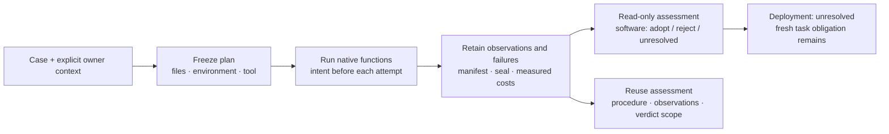

# Qualify a native software change

A processor port can return the expected shape while reversing an action,
discarding state or changing a coordinate convention. Nisayon now exposes a
Python SDK and a CLI for a bounded version of that decision: run a reference,
a deliberate failure control and a candidate on declared inputs; check actual
native calls; retain the evidence; assess the declared software relation.

`nisayon.qualification` works with an explicit owner directory and Python
environment. The owner directory need not contain Git or a Nisayon workspace.
The installed tool, owner files and native environment have separate identities.
The existing `nisayon` workspace commands retain their own repository checks.

The current adapter supports synchronous Python functions with JSON inputs and
outputs on CPython 3.12 or 3.13. It can qualify exact or numerical relations on
the frozen probes. Deployment acceptance remains `unresolved`: this adapter
does not execute a policy in a closed loop or satisfy a fresh task obligation.
The [implementation and comparison record](experiments/results/native-sdk-2026-10-23/README.md)
retains the measured results and limits. The [owner comparison](OWNER_COMPARISON.md)
sets out the separate prospective value test.

## Reuse an executable domain contract

The [CPU mixing example](../examples/qualification/kornia_mix/README.md) packages
qualified semantics for three Kornia entry points. It binds complete source
snapshots and a pinned environment, rejects source/file-set or input-domain
drift, and runs through either ordinary Python or this SDK. Both modes share the
same checker; each changed candidate still requires native execution. This is a
bounded example, not automatic contract discovery.

The [24 October experiment](experiments/results/contract-reuse-2026-10-24/README.md)
reuses that package on a selected current proposal without editing its bytes.
The report distinguishes default behavior from the proposal's new feature,
records selection exposure and compares the competent native workflow. Neither
portable integrity nor a reused procedure transfers a previous verdict.

## Run the example

Use a new installation environment; preserve historical experiment environments.
From a source checkout with the frozen base environment installed:

```sh
uv run --frozen nisayon-qualify plan examples/qualification/normalization/case.json \
  --project examples/qualification/normalization \
  --out artifacts/normalization-001 \
  --plan artifacts/normalization-001-plan.json
uv run --frozen nisayon-qualify run artifacts/normalization-001-plan.json
uv run --frozen nisayon-qualify inspect artifacts/normalization-001
```

Each output path must be new. Planning freezes identities and creates only the
requested plan file; it does not import the owner's entry point. The runner
checks those identities again, then executes the exact plan once. Inspection
reads retained bytes and never executes or retries a native function. The
[example](../examples/qualification/normalization/case.json) returns `adopt` for
its declared normalization relation and `unresolved` for deployment acceptance.
Changing the candidate symbol to `wrong_sign` in a new case should produce
`reject` with the first differing JSON path.

For an installed wheel, use the same `nisayon-qualify` commands without `uv run`.
Set `--project` to the owner's directory and `--python` to its existing Python
executable. The worker loads the installed SDK in that interpreter without
installing or changing the owner's dependencies. Do not resolve a virtual
environment's executable symlink to the underlying global Python; the executable
path determines its environment. Package import and qualified execution do not
require the simulator, PyTorch or NumPy in the SDK host.

The [portable review interface](PORTABLE_REVIEW.md) adds `export STORE --out FILE`
and `review FILE`. It carries the complete retained store to another machine
and recomputes its assessment without the native environment. This is a local
read-only transfer, with software and deployment decisions still separate.

## Python interface

```python
from nisayon.qualification import (
    CaseSpec,
    ExecutionContext,
    plan_change,
    run_plan,
    assess_change,
)

context = ExecutionContext.from_project(
    "/path/to/owner-project",
    output_dir="/path/to/new-run",
    python="/path/to/native-venv/bin/python",
    timeout_seconds=10,
    total_seconds=120,
)
case = CaseSpec.read("qualification.json")
plan = plan_change(case, context=context)
evidence = run_plan(plan, context=context)
assessment = assess_change(case, evidence)
assessment.write("/path/to/new-assessment.json")
```

Write assessments outside the sealed run directory. Adding a file to a sealed
store changes its membership and invalidates that store. Declarations and plans
are immutable canonical JSON values; `record()` returns a separate copy.
`RunEvidence` identifies a retained plan and directory. Assessment rereads the
evidence rather than trusting a caller-supplied success flag.



## Declare a checkable question

The case schema is `nisayon.qualification.case.v1`; see the example for the
complete structure. Unknown fields are rejected. Declare one to 32 probes and
one to 1,024 source, data or lock files. Include each entry point, imported owner
implementation and any data that can change the result. Owner imports absent
from the manifest invalidate the execution. New plans also require a bounded
CPython witness of file-read attempts during owner import and execution. An
observed owner read absent from the declaration prevents acceptance; it is never
silently added to the dependency list. Declare the input explicitly and make a
new plan. The [normalization-data experiment](experiments/results/owner-read-witness-2026-10-24/README.md)
retains the omitted-input counterexample, controls and reproduction.

Read events record attempted opens, including attempts that fail; they do not
prove bytes were consumed. Missing witnesses, unresolved file descriptors,
ambiguous relative `os.open` paths, owner-path aliases, observed owner reads from
another thread and exceeded event/path limits return `unresolved`. Ordinary
relative Python `open` paths use the worker's current directory. Write-only
opens are counted separately. The bound is 32,768 open events and 1,024 distinct
owner read paths per call. A project-local Python environment remains excluded
unless its files were explicitly declared; environment identity still applies.

Dependency completeness remains a premise. File access outside the owner root
is counted without retaining private host filenames. Native C I/O, variables,
remote services, child processes and device state are not traced. Background
work after the synchronous call is outside the observation window. Before/after
hashes do not establish an atomic snapshot or detect a transient change that is
restored before the final hash. Inputs must remain stable during the call.

Every case supplies `reference`, `negative_control` and `candidate` targets.
Each target names a file and function. Optional `required_calls` names Python
functions accessible through that module, including attributes such as
`native.pack_robot_state`. The worker observes their actual call frames during
the target call. Registering or importing a hook does not count. This witness
covers synchronous Python calls in that thread; it does not cover GPU kernels,
C functions, async execution or spawned threads. Use a separately qualified
adapter when those operations are part of the claim.

Each probe supplies an input and expected reference output. The reference must
satisfy that oracle; the negative control must differ from the reference on at
least one probe; every candidate output must satisfy the reference relation.
An ineffective control or unavailable observation produces `unresolved`, not
acceptance. Expected outputs are owner-supplied premises. The engine checks
consistency but cannot establish that the owner's oracle is physically correct.

| Contract | Rule | Limit |
| --- | --- | --- |
| `exact` | Canonical JSON equality, preserving numeric representation and signed zero | JSON semantics on declared inputs; not arbitrary Python object equivalence |
| `numerical` | For each numeric leaf, `abs(candidate-reference) <= atol + rtol*abs(reference)`; structure and other values must agree | Frozen, finite nonnegative tolerances; does not prove kernel coverage or adequate task behavior |
| `behavioral` | Planning records an unmet task-adapter obligation | No execution or acceptance through this adapter |

Both reference-oracle and candidate-reference checks use the declared contract.
Numerical closeness is not transitive: candidate-reference agreement does not
establish a tighter candidate-oracle error bound. Boolean values are not numeric
leaves. Duplicate JSON keys, nonfinite numbers and overflowed tolerance bounds
cannot yield a pass.

The required `population`, `state` and `environment` premises state the scope.
Use JSON `null` for an unknown premise; it blocks execution. The implemented
reset is `fresh_process`. It creates a process for every role/probe and seeds
Python's `random`; other RNGs, files, queues, devices and remote state need
explicit native preparation and declared dependencies. A fresh process is not
a robot reset. Action-changing cases, including those that propose using the old
trajectory's future observations, are blocked by this adapter.

## Evidence and cost boundaries

Before each subprocess starts, the runner writes its intent and request. It
records stdout, stderr, return status, elapsed wall time, actual call counts,
input hashes, returned values, loaded owner files, bounded read witnesses and
source identities before and after execution. It redirects bytecode lookup to a new cache location so an
old `.pyc` cannot replace the pinned source. Source or environment changes,
unexpected imports and unexecuted required calls prevent acceptance.

New plans use `nisayon.qualification.plan.v2` and bind the read policy into every
request; their observations use `nisayon.qualification.observation.v2`. The case
schema and SDK call signatures remain unchanged. Historical v1 evidence remains
readable and is explicitly labeled `legacy_declared_files_and_imports_only`.
It cannot supply the read witness for a v2 plan. Replan before new execution;
older readers cannot assess v2 evidence. This migration does not retroactively
promote the coverage of a historical verdict.

An older review bundle can report `assessment_mismatch` because its recorded
assessment predates the explicit read policy and stable-input premise. Review
preserves both assessments and returns `unresolved`; it does not silently waive
the difference. Raw v1 stores remain inspectable without the owner environment,
and a new export records the current assessment under that same historical scope.

Native environment identity includes the Python executable digest, version,
prefix, platform, library roots and installed distribution metadata/RECORD
digests. A virtual environment inside the owner directory remains part of that
environment identity; its installed libraries are not mistaken for undeclared
project imports. Explicitly declared files are always checked. The identity does
not rehash every installed binary, qualify a driver or characterize a GPU.
Native code is trusted and runs with the operator's permissions. Neither the
worker nor the manifest is a sandbox or an authenticity boundary. Hashes detect
inconsistency; a party that rewrites an entire store can construct new hashes.

Timeouts and operator interrupts retain the attempted prefix. POSIX execution
terminates the subprocess group, including ordinary descendants; Windows only
terminates the direct child. Detached processes and hardware need a separate
lifecycle contract. A hard kill can leave an unsealed prefix, which inspection
reports as incomplete. Partial or inconsistent finalization is invalid. Neither
state grants acceptance. The runner does not resume or retry silently.

Attempt wall time is nested inside runner wall time; do not add the two.
Runner wall includes its preflight and child calls, ending before sealing and
assessment. Earlier planning, finalization, engineering time, provider cost and
compute cost are separate. Unmeasured components remain `null`. A driver can
measure its outer workflow, but that measurement is still not complete human
engineering cost. No savings claim follows from a successful software check.

## Reuse without transferring an unsupported verdict

```sh
nisayon-qualify reuse /path/to/prior-run /path/to/new-plan.json
```

The corresponding SDK function is `assess_reuse(previous_evidence, new_plan)`.
It re-assesses the prior raw records, then compares question, contract, probes, target,
premises, sources, tool and native environment. A changed owner root also
requires execution because it can change imports and implicit resources.

The result separates an adaptable **procedure**, observations of the **previous
execution**, and applicability of the **verdict**. Matching declared dependencies
can support only the same scoped claim; unknown premises remain unresolved and
known changes make the verdict inapplicable. Every result has
`automatic_acceptance: false`. There is no learned selector or claim that the
declaration captures all dependencies.

## Command outcomes

| Command | Exit code | Meaning |
| --- | --- | --- |
| `plan` | 0 | Plan retained; inspect obligations; no native execution occurred |
| `run`, `inspect` | 0 / 1 / 3 | Software relation adopted / rejected / unresolved |
| `reuse` | 0 / 3 | Same scoped claim applicable / inapplicable or unresolved |
| `export` | 0 | Local file created; does not imply experiment acceptance |
| `review` | 0 / 1 / 3 | Recomputed software adoption / rejection / unresolved, with transport and saved-assessment agreement checked |
| Any command | 2 | Invalid invocation, unreadable plan or output error |

Always read the assessment's `execution_validity`, `result_status`, obligations
and `deployment_decision`. A process exit code is not a scientific success
criterion. Version 1 is an experimental local interface; hosted execution,
arbitrary native command adapters, task dispatch and automatic intervention
selection remain unimplemented.
