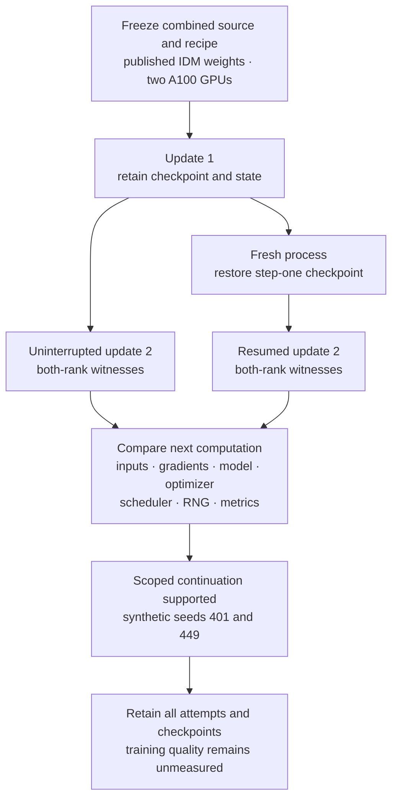

# Native full-weight update and checkpoint continuation

24 October 2026. Published LongWAM IDM weights complete two optimizer updates
and an exact fresh-process continuation for each of two synthetic seeds. All
25 declared gates pass; 1,344 frozen input files verify afterward. The result
qualifies the combined candidate and instrumented LeRobot/Accelerate recipe
described in the [published evidence packet](https://gist.github.com/manfromnowhere143/3e69613629931462503930f0961590f1/fe977fbe46284606068f9e66ae18484e4651d6a8).
It is a source-bound investigation, separate from the native qualification SDK.

A successful checkpoint load is insufficient: the next computation must also
agree. The experiment compares the resumed second update with the uninterrupted
second update, including both ranks' consumed inputs, gradients, model/buffer
and optimizer state, scheduler, RNG and update metrics.

| Synthetic seed | Two updates and saves | Fresh-process continuation | Next-update witnesses |
|---|---:|---:|---|
| 401 | 1,009.1 s | 753.5 s | Exact agreement on both ranks |
| 449, reserved confirmation | 1,038.7 s | 756.5 s | Exact agreement on both ranks |

These durations include loading, instrumentation, checks and checkpoint I/O.
They are not throughput measurements or a complete-cost comparison. The recipe
uses two A100 40 GB GPUs, FSDP2, CPU-offloaded FP32 parameters and Adam state,
BF16 autocast, activation checkpointing and one synthetic sample per rank.
The native frozen/trainable split is preserved: 6,020,710,599 trainable elements
within 12,406,309,603 unique model parameters.

The combined candidate starts from policy commit
`b1b5ba0d90713490af19d56ef11fe97a83174e07` and the packet's
`composite-native-training.patch`. It includes separate proposed precision,
resume, rank-RNG, CPU-offload, staging and shared-parameter corrections. It also
backports the native preparation function containing Sebastian Pagel's merged
[Accelerate #4369](https://github.com/huggingface/accelerate/pull/4369) correction.
The source-consumption change is separately proposed in
[Accelerate #4447](https://github.com/huggingface/accelerate/pull/4447).
This is not an unmodified-release or stock owner-launcher result.

The evidence retains failed prefixes and their corrections. A reduced
missing-optimizer control precedes full execution. Separately, the comparison
tool accepts matching retained evidence and rejects 12 copied-evidence
alterations, including rank-one-only changes. Those alterations test the
comparator; they do not simulate native checkpoint corruption.

The completed retention record accounts for all 108 files across six V9
checkpoints and another 18 files from an earlier V7 checkpoint. The bulk bytes
remain in private storage; the public packet supplies the original hashes,
object observations and verification records. That metadata does not establish
present storage availability. The numerical result and the later retention
assessment are preserved separately.

For reproduction, clone the pinned Gist and read its `README.md` before running
`reproduce.sh`. It includes source reconstruction, frozen inputs, native probes,
raw numerical observations, failures, retention metadata and resource needs.
The public wrapper was reconstructed and checked locally; it was not a separate
repeat of the GPU experiment. The [delivered LeRobot update](https://github.com/huggingface/lerobot/pull/5008#issuecomment-6384345107)
links the same evidence and remaining owner decisions.

This supports continuation under the exact source, synthetic inputs, numerical
recipe and two-rank topology. Full-policy gradient parity, training quality,
LIBERO outcomes, physical gripper semantics, changed topology, arbitrary data
worker recovery, interrupted-write atomicity, full safetensors export, owner
adoption and complete-cost savings remain unqualified.

Return to the [experiment index](../../README.md) or the
[system map](../../../../README.md#the-system-and-the-next-proof).
