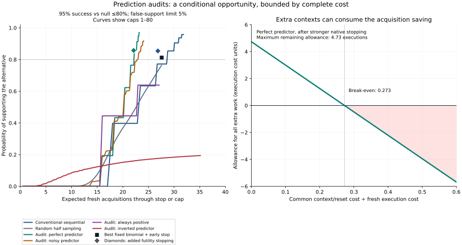

# When predictions can reduce confirmation effort

**16 October 2026 · N045 · finite qualification complete; owner value untested.**

An existing predictor might help confirm a correction with fewer fresh task
executions if its inputs are available before those executions. Random audits
can correct misleading predictions while retaining a declared false-support
limit. The useful question is whether the saved executions pay for extra
contexts, predictions and integration. This report qualifies that question in
an exact constructed model. It adds no production acceptance rule.

The strongest favorable cell survives a more capable conventional comparator,
but its allowance is small: **22.105 expected fresh acquisitions versus 26.840**,
with support probabilities **85.748% versus 85.435%** at the same 5% error limit.
This is a perfect-predictor construction, not a measured robot result. Before
charging any extra work, the difference is **4.735 execution cost units**.



The left curves retain all six planning-alternative cells, including failures to
reach the decision target. Diamonds add decision-preserving futility stopping.
The right panel shows the remaining allowance after charging extra contexts.
It does not assume preparation or prediction is free: those costs must fit
inside the allowance. [PNG](cost-tradeoff.png) is also retained.

## Research that changes the decision

This extends the [October frontier review](../n041-decision-value-2026-10-15/README.md)
with four selected primary papers about confirmation. It is not an exhaustive
survey. [Source identities](sources.json) bind the retrieved publications and
their hashes. The first three methods were inspected, not replicated. The last
row supplies the formula independently qualified below.

| Primary source | Consequence |
|---|---|
| [Bayes-assisted bounded-mean confidence sequences, v2, 11 May 2026](https://arxiv.org/html/2605.07964v2) | A working predictive distribution selects predictable valid bets. Finite-time validity survives a wrong prior; asymptotic log-optimality additionally requires predictive consistency. This is a stronger bounded-mean result than the earlier asymptotic Bayes-assisted work discussed in our historical review. It does not make current task outcomes known. |
| [No Free Lunch: Non-Asymptotic Analysis of Prediction-Powered Inference, ICML 2026](https://proceedings.mlr.press/v306/mani26b.html) | Finite-sample estimation of a prediction's usefulness can cost more variance than it saves. The analysis states sample-splitting and large-unlabelled-pool premises. Its Gaussian correlation threshold is not a robot confirmation rule. An asymptotic gain cannot settle a small-budget decision. |
| [Betting for Sim-to-Real Performance Evaluation, v1, 27 April 2026](https://arxiv.org/html/2604.24018v1) | Simulator-informed weighting targets point-estimation efficiency. Its wealth bound tests a no-edge condition; the authors explicitly warn against reading wealth as the probability of outperforming Monte Carlo. It supplies no direct acceptance interval for our correction. No released robot data or implementation was run here. |
| [Prediction-Powered E-Values, ICML 2025](https://proceedings.mlr.press/v267/csillag25a.html) | Random acquisition and a residual correction can preserve sequential validity despite imperfect predictions. The required acquisition floor prevents negative evidence factors. Whether a skipped label saves a physical execution depends on when the cheap input exists. The publisher's linked software returned 404; we use an independent scalar implementation of the published formula. |

These are established external methods. Nisayon cannot claim their mathematics
as differentiation. The possible advantage remains applying a suitable method
to a source-bound deployment correction with less complete work, then reusing
that preparation on a separate incident. The [earlier cost audit](../../UNUSED_AUDIT.md)
makes confirmation worth examining: it consumed 81–88% of measured time in two
historical schedules. Those schedules neither establish complete costs nor
justify changing their already frozen acceptance obligations.

## What ran

The [initial protocol](PROTOCOL.md) and program were hashed before execution.
For a binary outcome Y, the illustrative null is conditional success probability
at most 0.8. Alpha is 0.05; the planning alternative is IID success probability
0.95. The predictor Z is observed before a fresh independent audit coin A with
probability 1/2. The evidence factor is

`F = 1 + (Z - 0.8)/2 + A*(Y-Z)`.

Its possible values are 0.6, 1.1, 1.6 and 0.1. Averaging over the audit coin
recovers `1 + (Y-0.8)/2`. Under the conditional null, each factor has expectation
at most one and stays nonnegative. Their product starts at one; crossing 20
supports the alternative with false-support probability bounded by 5%, including
optional stopping. This is a conditional statistical guarantee, not a posterior
probability or a physical-safety guarantee.

The ordinary sequential comparator uses the likelihood ratio for the declared
0.95-versus-0.8 planning point, with factors 19/16 and 1/4. A random-half-sampling
version supplies an acquisition-rate control. Every cell uses the same endpoint
and error limit. The target is at least 80% support probability by cap 80;
otherwise the planning comparison remains unresolved. No threshold was tuned
after the first results.

Integer probability mass and rational wealth comparisons cover 13 cells and
7,335,181 aggregated states. They are arithmetic states, not task executions.
All 12 factor expectation/range controls, six rejected-input controls and four
literal-path crosschecks pass. Those crosschecks independently enumerate
66,393 paths, including actual early crossings, and match every retained curve.
Probability mass is conserved at every step. All seven valid null cells stay
below 5%; their largest crossing probability is 4.410% through cap 80.

| Method / predictor at true success 0.95 | Support by cap 80 | Expected acquisitions through stop/cap | First cap reaching the planned 80% support |
|---|---:|---:|---:|
| Conventional sequential, every outcome | 95.775% | 31.837 | 45 |
| Conventional sequential, random half sampling | 76.314% | 27.541 | Not reached |
| Prediction audit, perfect | 97.011% | 23.214 | 57 |
| Prediction audit, sensitivity 0.99 / specificity 0.90 | 91.765% | 24.060 | 63 |
| Prediction audit, always positive | 63.858% | 27.097 | Not reached |
| Prediction audit, inverted | 19.410% | 35.127 | Not reached |

The always-positive predictor has 95% accuracy in this alternative, yet misses
the target. Accuracy alone hides its inability to identify failures. Bad
predictions preserve the declared null bound here but can consume the budget.
The noisy predictor's first-target support is 80.563%, below the native first
target's 85.435%; its acquisition count is not an equal-power saving. Full
curves and exact fractions are retained in [results.json](results.json).

Three deliberate misuse controls fail. Replacing outcomes with always-positive
predictions yields false support with probability one. Choosing a stake using
the current perfectly predictive covariate, while justifying it with only the
marginal mean, yields false support greater than `1 - 1e-15`. Repeating one
latent outcome as 80 trials yields 80% false support. These are our violations
of the premises, not defects alleged in the cited methods. Fresh identifiers
and accurate predictions do not establish valid sampling.

## The stronger conventional comparison

The initial favorable result prompted an explicitly separate [challenge](CHALLENGE.md),
frozen after the initial readback and before execution. Both original programs,
results and freezes remain. This is exposed adversarial review, not independent
confirmation.

First, both selected rules now stop unresolved when even the largest possible
remaining factors cannot reach the support threshold. The audit rule uses the
actual permitted maximum 1.6, including a wrong prediction. It never assumes
perfect predictions to stop. Exact support probabilities are unchanged at both
the null and alternative; expected costs fall.

Second, all 3,240 deterministic fixed binomial cap/threshold combinations through
80 were considered. Of these, 118 satisfy the frozen error and support targets.
Each stops once enough successes occur or too many failures make success
impossible. Exact binomial tails and the absorbing calculation agree on all
118 at both probabilities. The best expected-cost rule requires 28 successes
within 30 trials; it still costs more than the qualified sequential comparator.

| Rule after early stopping | Support probability | Expected acquisitions | Expected contexts |
|---|---:|---:|---:|
| Conventional sequential, cap 45 | 85.435% | 26.840 | 26.840 |
| Best eligible fixed binomial, cap 30 | 81.218% | 27.584 | 27.584 |
| Prediction audit, perfect predictor, cap 57 | 85.748% | 22.105 | 44.211 |

All expectations include unresolved paths. This is a comparison with competent
specified rules, not a proof of optimality over every possible test. The native
workflow may itself use prediction-powered inference. [challenge.json](challenge.json)
retains every eligible rule and the exact cost calculation.

Let R be the avoidable execution cost, C the common cost of preparing a context,
P the additional prediction cost per context, and S all remaining additional
preparation, review, adoption and maintenance. In the perfect-predictor cell,
the saving survives only when

`S + 17.3706*C + 44.2106*P < 4.7347*R`.

Even with S=P=0, C must be less than 0.2726R. If obtaining the proxy already
requires the completed rollout, its 44.211 contexts cost more executions than
the native 26.840. A cheap annotation is then not a saved robot trial. At the
null, the audit rule also costs more acquisitions: 24.240 versus 19.393. This
direction has no uniform cost advantage.

## What changes in the mission

Carry one additional question into a relevant owner intake: is there an existing,
cheap pre-execution signal that could predict the frozen correction's outcome,
and can omitted executions leave later sampling and reset state unaffected?
If so, price the complete acquisition process and compare the strongest native
rule before allocating trials. Reusing a checked predictor and experiment
procedure may amortize preparation; building a new world model now has no
measured justification.

The endpoint must genuinely permit inference about a declared task population.
This mechanism cannot skip conditions in Nisayon's existing 32-pair finite
confirmation obligation, change a success definition, confirm each individual
task, or replace a paired repair comparison with an unrelated average. The
owner's correction, population, sampling unit, randomization, reset, error
budget and stopping rule must be frozen before fresh outcomes. No owner predictor
or acquisition cost is qualified. Multiple endpoints or candidate corrections
need their own multiplicity budget; this one-claim calculation does not price
that additional obligation. N015 and separate untouched reuse remain open.

No pending engagement was polled or contacted in this work. All previous
requests, sent messages, spent conditions and retained runtimes are preserved.
The production confirmation implementation is unchanged.

## Reproduce and cost boundary

Both qualification programs use only the standard library and ran with site
packages disabled. No dependency, model, simulator, GPU, hardware or cloud job
was added. The first process took 25.273 seconds; the challenge took 0.999
seconds. These command times exclude research, implementation, retrieval and
review. Complete human effort, provider costs and deployment savings are unknown.

From the repository root, choose output files that do not already exist:

```sh
PYTHONDONTWRITEBYTECODE=1 .venv/bin/python -B -S scripts/experiments/qualify_prediction_audit.py --out artifacts/n045-replay.json
PYTHONDONTWRITEBYTECODE=1 .venv/bin/python -B -S scripts/experiments/challenge_prediction_audit_cost.py --original artifacts/n045-replay.json --out artifacts/n045-replay-challenge.json
```

[Protocol freeze](protocol-freeze.json), [challenge freeze](challenge-freeze.json),
[first command](command.json), [challenge command](challenge-command.json),
raw stdout/stderr and [SHA256SUMS](SHA256SUMS) bind the evidence. The plot is derived
from these files with the existing Matplotlib 3.11.2 and was visually inspected.
Raw paper bytes remain in ignored local artifacts; their hashes and exact URLs
are retained without redistributing the papers.
