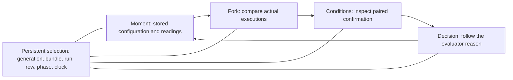
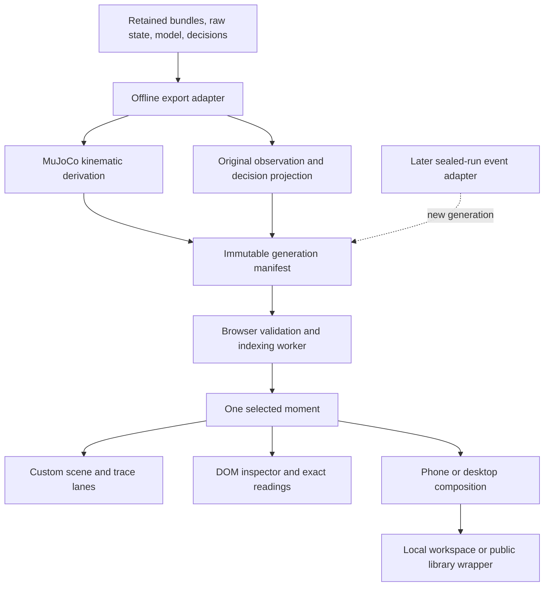

Current release, 9 November 2026: the instrument is deployed at
<https://nisayon.danielwahnich.dev/>. Runtime `82e9f69f` adds a silent cinematic
opening and a full-viewport intro while preserving direct access to the recorded
lab, research library and local portable review. See the
[current implementation](../../apps/instrument/README.md)
and [deployment receipt](qualification/cinematic-opening-2026-11-09/deployment.json).
The following design record remains the historical 17 October baseline.

---

# One moment, with depth

17 October update: System and Investigate now frame the retained robot lab.
The source-bound research catalog exposes eleven investigations through N052.
Each keeps its comparator, failures, costs and limits beside a visual mechanism.
The historical robot Study keeps its separate publication identity.

Daniel's reviewed direction is one viewport, compact headlines, opaque white
neutral text on black, dark text on paper and centered native glass cards for
detail. The five-layer System anatomy assembles once, bottom up. Investigate
traces relationships with finite cancellable motion; values remain exact.
Reduced motion and transparency have explicit fallbacks.

A single persistent glass dock joins the three surfaces. Recorded playback sits
above navigation when the lab is ready. Its opening waits for the first complete
scene frame; errors retain navigation. The device card offers user-initiated app
installation and explains offline scope. Complete release code and the current
research catalog are integrity-checked offline; recordings and APIs need a
connection. Updates wait for all instrument windows to close. Older immutable
assets remain available so an open page can load its deferred lab after release.

The local frontend and publication checks pass; see the
[release qualification](qualification/research-instrument-2026-10-17/release/) and
[current handoff](../SESSION_HANDOFF.md). SVG review is not browser acceptance.
Actual device fit, Safari/PWA operation and GPU timing remain unqualified because
the approved browser connection is unavailable. Daniel authorized production
publication after checks. Production now serves runtime `c56476b`, verified by
31 exact release-file readbacks and 342 public checks; see the
[deployment receipt](qualification/research-instrument-2026-10-17/release/deployment.json).

18 September 2026 · final direction for the first instrument build

An engineer selects a moment in a robot's execution. The instrument shows the stored
configuration, the observation the policy consumed, the action it intended, the
action that reached the controller and the evidence for the next decision. Going
deeper keeps the selected experiment and exact reading in place.

## Decisions

| Question | Decision for this build |
| --- | --- |
| Visual center | A custom, articulated reconstruction from retained state, present in slice one |
| Navigation | One surface with contextual depths: Moment, Fork, Conditions, Decision |
| First device | 390 px phone; then 1440 px desktop and short/zoomed windows |
| Grounds | Graphite black and warm paper, equally finished |
| First data path | Verified immutable export over static HTTP; no application server or live control required |
| Scene renderer | A narrow Three.js/WebGL2 scene with Nisayon's own controls; DOM/SVG fallback |
| Policy memory | Reset events, availability and exact digest equality first; a frozen projection later |
| Public edition | Portfolio `/nisayon`: Home, Watch, Library, sharing the instrument renderer |
| Meshes | Qualify exact assets and attribution before public redistribution; use an articulated schematic meanwhile |
| First command surface | Recorded inspection only; live jobs are a later adapter over the same contract |

Home, Watch and Library belong to public browsing. They are not three engineering
screens. Moment, Fork, Conditions and Decision are contextual depths within Watch
and the local instrument, not a permanent four-tab dashboard.

The standalone local application is the first delivery. The portfolio route is the
chosen public integration target; this assignment does not publish it or edit the
active portfolio worktrees. A later domain change should affect the host wrapper,
not the experiment renderer.

## What changed after reading Fable

The earlier proposal correctly separated source, transport and evaluator state. Its
chart studies remain useful for trace semantics. Its Run/Compare/Decision navigation
and delayed reconstruction are superseded by this document. Rerun remains an
interoperability option, not a dependency or a viewer-selection task for this slice.

Fable correctly identified retained `qpos`, MJCF and recurrent state. Direct checks
on D01 establish 16 generalized coordinates, 15 velocity coordinates, 24 compiled
bodies including world, 86 geoms and 64 locally available mesh files. Reconstructing
those configurations is feasible now. Calling the whole task “a few hundred lines”
would omit asset handling, clocks, selection, failure states and browser behavior.

Three corrections are part of the build contract:

1. **Configuration and observation are distinct.** Running MuJoCo 3.2.7
   `mj_kinematics` on all 488 D01 rows, before and after each action, produced cube
   height differences up to **0.000557965764 m** from the recorded height reading.
   The maximum end-effector coordinate difference was **0.000498729959 m**.
   These are measured representation differences, not an allowed error budget.
   A simulation update/cache boundary is a plausible explanation, not established
   by this check. Render retained configuration; label and inspect recorded
   observations separately. Never silently move the geometry to make the two agree.
2. **Detect events from data.** D01's first intended/executed gripper mismatch is
   step 0. Row 20 in the earlier study was an explicitly selected example, not
   a claimed onset. D03 first violates its age obligation at step 1 with 0.05 s,
   then 0.10 s at step 2, reaching approximately 0.15 s at step 3. “150 ms from
   step 1” is incorrect.
3. **Memory has several states.** The retained tensor is a tuple of hidden and
   cell states, each with shape `2 × 1 × 400`: 1,600 scalar entries in total.
   At an initialized episode boundary the hidden value can be `None`; that is
   different from D10's unavailable telemetry. Raw state also retains
   `qacc_warmstart`; a blanket claim that no solver-related state exists is wrong.
   This does not establish a complete reproducible solver cache or contact forces.

The raw-store qualification and source bindings are in [qualification](qualification/README.md).
No simulation step or policy inference was executed for it.

## Taste, translated into behavior

Daniel's portfolio gives this interface its visual grammar: black and paper, fine
geometry, deliberate empty space, restrained material and a persistent floating
control. Sentinel contributes trace-linked drawing. Telos contributes inspectable
consequence. Inbar contributes explicit absence. Reiyah's final design contributes
depth around one selected object. These are design references, not inherited claims.

The scene owns the composition. Its geometry is quiet enough that a changed finger
position or selected observation is visible. The selected run gains luminance and
a contour; correction can use a restrained steel blue. Rejected obligations carry
a shape, a word and restrained red. Unresolved readings have a visible open mark.

Avoid the generic admin template: sidebar, KPI shelf, rounded cards, chat column and
an ornamental robot. The robot and its traces answer the selected question. No
invented trajectories, physically meaningless glows or animated “health” percentages.

Use the portfolio's measured material and motion patterns as references, but do not
copy its monogram, Reiyah's mark or application code blindly. No new logo is needed.
Read these actual sources before styling:

- `/Users/danielwahnich/Projects/daniel-portfolio-release-library-20260918/docs/personal-site/DANIEL-GLASS-BAR-DESIGN-LAW.md`
- `src/components/glass-bar/GlassBar.tsx` and `src/app/globals.css` in that worktree.
- `src/components/research-products/{SentinelDecisionArc,TelosExecutionBeam,InbarInstrument}.tsx` there.
- `src/app/odeya/OdeyaInstrument.tsx` and `OdeyaOpening.tsx` there.
- `/Users/danielwahnich/workspace/reiyah-console/docs/reviews/console-final-design-2026-09-09/FINAL_DESIGN.md`

The earlier source investigation remains at
`/Users/danielwahnich/.codex/reports/nisayon-ui-research-2026-09-18/RESEARCH.md`.
Fable's independent verdict is at
`/Users/danielwahnich/.claude/reports/nisayon-ui-verdict-2026-09-18/VERDICT.md`.
This document resolves their differences; do not revive superseded navigation.

## Phone composition

At 390 × 844, the opening moment has a quiet identity/source line, an articulated
scene, a protected concise finding, two selected trace lanes, and one floating
transport. Expand the remaining lanes when they become relevant. Let the document
scroll on short screens; do not crop a finding to satisfy a fixed viewport.

```text
 D01 / Lift                       Recorded
 Reconstruction from retained configuration

               articulated robot
                table and cube
           selected frame / actual pose

 Gripper command reversed.              ↗
 First difference · step 0

 intended / executed       recorded traces
 cube height               original reading

        ‹   play/pause   ›   findings
                  0.00 s
```

The finding is source-derived and changes with the selected context. The sketch is
a hierarchy, not permission to hardcode the text. Show units and clock context.
The first moment jumps to a computed event; an explicit shared URL wins over the
default. A phone switches paired runs while preserving the anchor. Swipe is optional;
named buttons and keyboard equivalents do the same work.

The inspector is a full-width sheet on phone and a side region on desktop. Opening
it recomposes the scene. It does not cover the finding or trap the transport beneath
it. Desktop adds room for paired views, not more unrelated modules.

## Depth and continuity



Opening a depth preserves the anchor. Selecting a different confirmation condition
is an explicit selection change: keep the parent anchor for Back/Escape. Do not
pretend identical row numbers across unrelated runs establish synchronized time.
Use simulator time from a declared reset, with exact sample mapping. A trajectory
ends where its recording ends; an ended run stays ended.

Fork shows two distinct recorded executions, an explicit alignment and the relevant
intervention. A proposed branch is dashed and has no observed future. The original
failed run remains available after a correction. A ghosted overlay is optional;
paired views and labels must make two configurations unambiguous.

Conditions is a field of paired outcomes, with its count read from the frozen
record. It is 32 for the current confirmed cases, not a constant in the component.
Select D05 condition 10423 and expose the progress reason. No sample is invented if
the evaluator supplies a condition-level finding without a row locator.

Decision is the retained scoped conclusion. D06 and D08 illustrate why status cannot
be flattened: their trials are `unsupported` and `invalid`, while their diagnostic
evaluator decisions are `unresolved`. D08's offered replay was rejected before
execution. Do not draw it as another measured robot run.

## Memory and motion

The first memory lane has episode/reset marks, initialization/availability, state
digest equality and a selected-source inspector. None is a “memory health” score.
A later projection may expose structure only after tensor identity, layer selection,
scaling, fit population, transform digest and missingness are fixed. Fit on the
declared reference only. Never claim distance in a 2D projection proves causation,
equality or model understanding. Keep full hidden vectors off the phone's initial load.

The transport remains mounted as depth changes. Input response should be immediate;
scrubbing snaps to recorded samples. Numeric readings do not count upward. Baseline
playback uses discrete stored poses; any future interpolation is identified as a
drawing aid and never supplies a selected reading. Reduced motion keeps the entire
inspection path with immediate settlement. No compulsory entrance sequence.

Every canvas mark has an accessible DOM route to the same sample and finding.
Touch controls target 44 px, named icons keep accessible labels, keyboard focus
remains visible and no meaning relies only on hover, dragging, sound or color.

## Build architecture



Precompute body/site/geometry transforms with the pinned native engine. The browser
renders them; it does not reimplement MuJoCo or run physics. Bind coordinate frames,
units, quaternion order and sample phase. A procedural articulated drawing can ship
locally before mesh qualification. It must say schematic and must not imply that
its decorative link thickness is a collision boundary.

Use React/TypeScript with Vite for the shell, Three.js/WebGL2 for the narrow scene,
DOM/SVG for labels and sparse lanes, and a worker where decoding/verification warrants
it. Lock versions. No renderer-owned navigation, Rerun spike, WebGPU requirement,
new backend service or model call is required for the first complete path.

## Completion means behavior

The first slice must open a real D01 generation, compute the first mismatch, inspect
the two action values at that row, show before/after state with correct times, switch
paired runs, preserve the selected moment through inspection and copy a pinned URL.
Its corrupt/missing-data state must work as deliberately as its valid state.

Then add D03, D05, D06, D08 and D10, all meanings intact. The product becomes public
only after actual browser review, mobile/keyboard/reduced-motion checks and asset
redistribution review. Passing unit tests or producing a screenshot is not that review.
