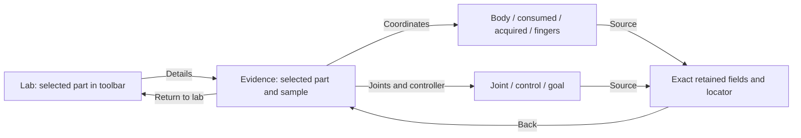

# Evidence that fits the workspace

20 September 2026 proposal · authorized and implemented locally 21 September;
rendered qualification pending. See the [implementation and checks](IMPLEMENTATION.md).

Give Nisayon one stable workspace with complete, readable evidence pages. Keep
part details outside the lab image. Size each evidence page from the space it
actually receives, with explicit access to the remaining records.

Daniel requested research and planning after authorizing publication of the
lighting correction. That correction is [published separately](../qualification/lighting-retraction-release-2026-09-20/README.md).
This proposal changes presentation and navigation; it requires no new scientific
export, interpretation of recorded physics, or renderer replacement.

## What causes the current problems

The application fixes the outer viewport but several inner surfaces deliberately
scroll. Existing pagination limits record counts, not rendered height. Six facts
with long values can exceed the available space, and an expanded exact-value
disclosure can overflow a page containing just one record.

The part card also repeats a name already shown in the selector and places its
Details button over the scene. Mobile moment inspection creates a second, larger
obstruction. Both problems are in the layout, not the robot renderer.

Source baseline: Nisayon UI `deb1415e956b16589ce0bc3a51e5cf5034c6bac1`.
The [source ledger](sources.json) binds the inspected files. These findings come
from code and Daniel's supplied screenshots, not a fresh browser interaction.

| Surface | Current mechanism | Proposed presentation |
| --- | --- | --- |
| Readings, Fork, Conditions, Decision, Engine | `dashboard.css:27` makes `.reading-content` scroll. Its children can grow without a height allocation. | One evidence frame with a fixed context header, a bounded body and one page footer. Each section receives the remaining measured space. |
| Record lists and facts | `RecordPages.tsx:5` uses a fixed count; all pages remain mounted. `PagedFacts` defaults to six facts. Nested lists can introduce several independent pagers. | Measure visible record groups, retain stable record identities, and use one active pager per view. A record opens its child collection as a named detail view with Back. |
| Exact source inspector | `dashboard.css:88` makes `.inspector-content` scroll; facts, arrays and disclosures have variable height. | Paged fields with a breadcrumb for object/array descent. Preserve exact source pointers, full values and copy/source access. |
| Spatial and physical readings | `SpatialPanel.tsx` stacks body pose, consumed pose, acquired pose and fingers. `PhysicalInspector.tsx` stacks histories, ranges, actuators and controller state. | Coordinates become named Body / Consumed / Acquired / Fingers sections. Joint, Control, Goal and Source become separate physical sections. Show related values together whenever they fit. |
| Inspect moment | `inspection.css:3` scrolls the inspection. Its mobile rule at line 42 overlays up to 66% of the lab. | Keep Capture / Command / Result. Desktop uses the evidence column. Phone uses the full evidence workspace with an explicit return to the same lab view. |
| Study library | `study.css:20` scrolls all trial assignments. | Search across the whole retained list; show the rows that fit plus their ordinal range and total. Previous/Next and direct selection reach every assignment. |
| Study trial details | `study.css:33` scrolls details. At short heights, line 132 transfers scrolling to `.study-detail`. Run comparisons, reasons, candidate records and declarations can all grow. | Give Decision, Diagnostic, Pairs, Executions, Custody, Costs and Integrity their own fitted views; navigate the selected record within them. |
| Study reports | `study.css:69` scrolls reports, including temporal and processor instruments. `DetailValue` recursively expands arbitrary retained objects. | Purposeful report sections plus a complete source-field navigator. Page opportunities, witnesses, obligations and attempts by identity. |
| Selected part cue | `choice.css:23` absolutely positions `.scene-part-cue` over the robot. | Move Details beside the part selector, in normal layout above the canvas. Remove the duplicate floating card on every screen size. |

The app's failure/unavailable screen and dropdown option lists are different
surfaces. Preserve readable error recovery. Menus may retain their own accessible
option list; the no-scroll requirement here applies to evidence cards and
panels. Chart/camera interaction must not become a page-swipe gesture.

## What to learn from Reiyah

The reference is the separate, unchanged Reiyah Console at
`1ca96a94f8a0da9abba1b4903eca1d6949595342`. Its current implementation and its
September 9 design proposals are distinct.

- `src/components/primitives.tsx:17` implements `FitList`: observe the available
  height, account for row gaps and reserve a footer. This is a useful starting
  principle. It estimates from the first row and only renders a prefix of the
  collection. Nisayon's varied evidence needs measured groups and navigation to
  every omitted item.
- `src/components/StationFrame.tsx` prepares a destination at its real dimensions
  with inactive content kept inert. Carry over the continuity principle: retain
  the current useful view until its replacement is ready. A ready, cached panel
  needs no artificial waiting period.
- `src/instrument.css:1798` moves the mobile Seeing scene into normal flow. This
  supports allocating separate space to information and the visual it explains.
- The proposed `FINAL_DESIGN.md` and `MOTION.md` retain the selected subject as
  the surface changes purpose. Nisayon can retain generation, run, sample and
  part identity through the same journey. Those proposals are not evidence of
  already delivered Reiyah behavior.

Some compact Reiyah rules hide particular rows or use very small text. Do not
port them. Readability and full evidence access determine Nisayon's layout.
No Reiyah source, private data or visual assets are imported.

## The composition

On desktop, the lab remains the dominant visual beside one evidence workspace.
The evidence header carries the selected subject, section and recording context.
Its central area holds one coherent reading; the footer carries a source action
and record navigation. Large windows can show more related readings together.

On a phone, the existing Reconstruction / Evidence switch becomes the reliable
boundary between two full workspaces. A small context line identifies the part,
run, sample and phase when viewing evidence. It offers Return to lab; it does
not duplicate the scene as a tiny, unreadable preview.

Details gets a 44 CSS-pixel touch target beside the selector. Short widths may
wrap that toolbar as a unit; they must not place it over the canvas. Secondary
view tools can use a clearly named View control when their full row will not fit.
The selected part remains visible by name and the existing scene highlight.
Selecting a part never changes the camera.

Opening Details uses the existing spatial-details action, including its focus
handoff. Closing restores focus to the originating control. Browser Back and
Forward restore the same subject and view. Opening Inspect moment retains its
current deliberate pause behavior. Ordinary panel navigation introduces no new
pause, automatic resume, seek, physics interpolation or camera move.

Retain the mounted scene and its camera state while evidence is foregrounded;
suspend unnecessary hidden rendering. Ignore zero-sized hidden layout for camera
fitting, then resize and redraw coherently when the lab becomes visible again.

## Fit content without losing it

Use a shared evidence frame with four regions: context, section navigation,
content, and footer. Grid/flex layout gives the content a definite remaining
height. Width determines columns; height determines how much of a collection
belongs on a page. Safe areas, browser chrome and the transport are measured
space, not assumed constants.

CSS container queries choose the composition at the panel's actual dimensions.
A `ResizeObserver` supplies available size for variable-height pagination.
These techniques have separate responsibilities: CSS arranges the view;
measurement partitions its records. Container size containment needs an
explicitly allocated size to avoid collapsing the panel. [Container queries](https://web.dev/learn/css/container-queries).

The shared paging implementation should:

1. Accept stable record IDs, source identity and a selected-record anchor. Keep
   the original order unless the user explicitly filters or sorts it.
2. Reserve context, section controls and footer before fitting records. Measure
   complete rendered groups, including wrapped values, rather than multiplying
   the first row's height by a count.
3. Cache measurements by content version, width and text metrics. Invalidate
   after a real resize, font change or content change. Batch geometry reads and
   writes; changing the number of visible records must not change the measured
   available height and create a resize loop.
4. Render the active page and, where useful, a bounded preparation area. Keep
   preparation inert and outside the accessibility tree. Avoid mounting every
   report and measuring hundreds of hidden rows at playback cadence.
5. Show an exact range and count, such as “7–10 of 26”, Previous/Next, and direct
   record selection/search. Search indexes the entire admitted collection.
   Do not invent a total page count before the page partition is known.
6. Anchor resize and rotation to the current record ID. A new height can change
   its page number without changing the record the reader is inspecting. A new
   generation does not silently substitute evidence for a pinned record.
7. Promote an oversized record into its own detail view. Separate facts,
   interpretation, reasons and source by meaning. Nested object fields open with
   their full path and Back, rather than expanding indefinitely inside a card.

One pager owns the active collection. For example, an Engine module opens its
entry points as a child view, rather than showing a module pager enclosing a
second pager. A source action remains available from every such view.

For unusually long prose or enlarged text, provide an explicit full-workspace
reading view with normal document reflow. It has no scrollable cards or floating
transport covering the text. This is the accessibility escape from a finite
dashboard; do not clip text or shrink its font to preserve a one-screen claim.
W3C permits adapting and relocating content if it remains available and usable,
and requires text reflow at an equivalent 320 CSS-pixel width. [Reflow guidance](https://www.w3.org/WAI/WCAG22/Understanding/reflow.html).

## Keep the scientific relationships visible

Pagination follows questions, not arbitrary rectangles:

- **Signals:** retain the intended/executed pairing and each lane's own time
  field. At short heights, use Command / Outcome / Timing sections. Preserve the
  selected sample and threshold on the active chart; keep every lane reachable.
- **Coordinates:** keep X/Y/Z and a quaternion's declared ordering together.
  Exact values open a fitted source view rather than expanding over another pose.
- **Joint and control:** keep each selected value, declared range, units and
  history together when possible. Controller residuals retain their descriptive
  scope; an actuator force limit remains separate from measured force.
- **Decisions:** retain the conclusion and scope as context while paging reasons,
  candidates or evaluator records. Unresolved, failed and invalid keep their
  literal meanings. Zero and unrecorded remain distinct.
- **Paired conditions:** show the same condition, obligation and common comparison
  together. When full run records require separate phone views, retain the pair
  identity and selected reference/candidate side in the header.
- **Temporal report:** Overview / Opportunities / Paired procedure / Contract &
  source. Preserve each clock and separate send, validity, acknowledgement and
  useful work.
- **Processor report:** Decision / Witnesses / Binding / Comparison & costs /
  Source. Software acceptance never implies deployment binding or robot success.
- **Engine:** keep execution disconnected explicit. A publication timestamp is
  not an observation timestamp or evidence of a live control connection.

## Materials, transitions and performance

Use restrained translucent treatment for navigation and the transport, with
opaque, high-contrast evidence content. Apple's WWDC26 guidance places glass in
the control layer and cautions against applying it throughout static content.
This informs the visual hierarchy; native SwiftUI effects are not a web
performance claim. [SwiftUI Group Lab, glass and adaptive layout discussion](https://developer.apple.com/videos/play/wwdc2026/8120/).

Keep the existing visual identity, spacing rhythm and fine chart lines. Start
with readable body text around 15–16 CSS pixels and secondary labels around
13–14; treat these as review targets, not a license to shrink under pressure.
Use fewer simultaneous groups when space is short. The completed screen should
feel quieter because it has one clear subject and aligned controls.

Selection commits as soon as admitted data is ready. A brief 120–160 ms opacity
arrival may clarify a new evidence view; remove the current vertical text
translation for these transitions. Avoid blending two readings into one another.
Reduced motion uses an immediate change. Rapid input cancels an older arrival,
and a stale completion callback cannot override the newest selection.

Leave the live canvas, camera and transport outside panel transitions. The
existing Web Animations path is sufficient for an opacity arrival. Element-scoped
View Transitions are a possible measured enhancement for a genuine shared
subject; feature-detect them and retain the simple path. Chrome documents their
subtree scope and the layering problems of document-wide transitions. The API
alone establishes no speedup on Nisayon or Safari. [Scoped transitions](https://developer.chrome.com/docs/css-ui/view-transitions/element-scoped-view-transitions).

Do not add a new boot loader for panel navigation. An uncached selection retains
its current useful view until verified data is ready and reports actual failure.
Blur radius, text scale and whole-panel layout are not animated. Record paging
must not recreate Three.js resources, reload geometry or hash evidence on the
main thread at every playback frame.

## Implementation order and acceptance

| Slice | Concrete change | Required evidence |
| --- | --- | --- |
| 1. Clear mobile lab | Move Details to toolbar; make Inspect moment a normal evidence workspace; restore focus and context on return. | Phone and desktop recording: no card covers the scene, no camera/row jump, no blank return frame; keyboard and history checks. |
| 2. Shared fitting | Add the allocated evidence frame and measured paging; migrate Coordinates and exact fields first. | Variable-length records, font/size changes, every item reachable, no resize oscillation or lost selection. |
| 3. Complete coverage | Migrate Readings, physical state, Fork, Conditions, Decision, Engine, inspector and every Study section/report. | Inventory above checked off with long real records; no nested evidence scroller and no concealed field. |
| 4. Finish and qualify | Refine control density, restrained material treatment and short arrivals. | Both themes, real desktop/mobile interaction, performance traces and accessibility review before publishing the redesign. |

Test 1440×900 and 1280×720 desktop, narrow tablet, 390×844 and 375×667 phone,
landscape, small browser windows, PWA safe areas, open software keyboard and
200% text enlargement. Check 320 CSS-pixel reflow at high browser zoom. These
are test sizes, not the only supported breakpoints.

For each paged view, verify that its content and controls fit their allocated
rectangles, wheel/touch cannot scroll a card, and all records are reachable with
keyboard and touch. Include the long D10 unresolved findings, all Study trial
assignments, paired executions, temporal opportunities, processor witnesses,
nested source objects and absent data. Check visible focus, focus restoration,
screen-reader page announcements and the full reading view. Do not announce
every playback tick as a live-region update.

Measure repeated warm selection-to-useful-paint, cold verified loads separately,
long tasks, scene frame pacing and memory on named devices/browser versions.
An initial engineering target is warm selection below 100 ms at the 95th
percentile; it is not an achieved result or a substitute for measured INP.
Compare the same recording and camera against the existing raster baseline.
Retain both failed runs and successful traces, including a physical iPhone/PWA
pass. Do not label emulation as a real-device result.

The completed lighting deployment and source inspection supported this plan.
Daniel subsequently authorized implementation. The local implementation uses
native line fragmentation for fitted pages, selected-field navigation and the
mobile workspace separation described above; the implementation record documents
the refinements and limits. Browser discovery remains unavailable: fresh rendered
layout, touch performance, VoiceOver and phone acceptance are still outstanding.
Next qualify that local implementation on the named desktop and phone sizes
before publication. The experimental lighting mode stays disconnected.
