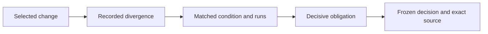

# Engine exposure and interface verdict

20 September 2026. Review of the existing instrument, not a new implementation
or scientific result.

**The current interface does not expose every engine workflow, and the evidence
does not support calling it the most advanced robotics interface or renderer.**
It is a substantial recorded-experiment instrument: model-bound reconstruction,
distinct observation/action/result clocks, retained evaluator decisions and
source-bound study evidence. Its next substantial improvement is continuity
between those pieces, followed by measured device performance and more useful
physical overlays.

**Scope and evidence.** Canonical engine `f27e858f42b80ac24910b13ceb0ee7075b9d5cc7`;
UI review checkout `54f26a78ec342dc879e2b11cdbe9cd0b4b94783f`;
published application `bad2d2daa4bc58aea33bcec175b905617cb30647`.
The [module map](module-map.json) inventories all 67 canonical Python files,
24,019 lines, with file digests, definitions and coverage families. The
[earlier complete tracked-path inventory](../engine-exposure-2026-09-20/tracked-files.json.gz)
covers the repository around them. This review combines that inventory with
targeted reading of execution, export, publication, selection and rendering
mechanisms. It is not a claim that every source line received a new correctness
proof. No reserved answers, new experimental executions or model calls were
used.

[Fresh anonymous HTTP readback](http-readback.json) verifies the public study
manifest against its declared digest and length. It confirms 26 trial
assignments, 660 pairs, 1,474 confirmation records and six unscheduled
assignments. The public API still says `execution_connected: false`. These
counts describe the retained study; they are not counts of reconstructed scenes.

The published inventory's 63 modules are 54 eligible canonical engine/evaluation
modules plus nine UI exporter modules. Its 13 MCP interfaces remain local
interfaces. These are different denominators from the 67-file canonical
inventory; none is a percentage of finished product workflows.

**Visual limits.** The review uses Daniel's supplied Nisayon screenshots,
retained Reiyah desktop/phone captures and current local source. Fresh Chrome
inspection has not succeeded. The initial conversation was in Codex CLI, where
the instruction to select Chrome from the file-mention menu was incorrect.
Daniel subsequently invoked the Chrome plugin. The extension and native-helper
checks pass, but discovery returns no browser, including after an authorized
fresh-window recovery attempt. See [the readback](browser-readback.json) and
[official extension setup](https://learn.chatgpt.com/docs/chrome-extension).
No fresh rendered, installed-iPhone, VoiceOver, GPU timing or motion acceptance
is claimed. The latest supplied Nisayon scene has the old `3b4e1590` generation
pinned. Its missing Study control cannot be diagnosed from that data pin alone:
the current application's Identity component includes that control independently
of scene generation. A fresh browser check must distinguish application version,
data generation and layout before assigning a cause.

**What the engine exposes today.**

| Engine responsibility | Actual interface | Remaining boundary |
| --- | --- | --- |
| Recorded Lift state, observation acquisition, actions and task readings | Six B-arm scene cases, 286 scene runs, clock-aware signal lanes, Capture/Command/Result, exact source links | A finite scene library; no general robot or policy viewer |
| Native joints, actuators and controller state | Spatial → Joints & controller: qpos, qvel, ctrl, ranges, goal position/orientation and position residual | Mostly instantaneous numeric inspection; no controller-target scene frame or joint/control time-series view |
| Diagnostic search and candidate choice | Study diagnostic proposals, execution status, declared changes and decision reasons | No public diagnostic launcher, hypothesis editor or candidate execution workflow |
| Frozen confirmation, pairing and evaluation | Study assignments, both arms, pairs, all retained execution roles and original obligations | Study-to-scene joins and shareable Study selections are absent; not every study execution has a published reconstruction |
| Declarations and custody | Freeze chronology and retrospective declaration reports, with their limitations | No prospective declaration authoring, custody service or reserved-condition issuance through the website |
| Costs and evidence recovery | Separate phase costs, nested costs, missing categories, partial/restored evidence | Descriptive retained records; no operational job recovery, exactly-once execution or demonstrated cost advantage |
| External evidence and DC01 | Separate external-obligation and controller-target comparison views | The external record does not establish a repair comparison; DC01 establishes no repair advantage |
| Sealed output publication | Verified objects, staged readback, promotion, visible-client discovery | Requires the operator Mac and network; no hosted worker, execution stream or publisher heartbeat |
| Workspace CLI/MCP and evaluation controls | Source inventory and provenance | Local engineering tools and development controls are not public control-panel operations |

The broad evidence coverage is useful. It does not make Nisayon a live operations
console. The current architecture explicitly distinguishes implemented finite
procedures from proposed general selection, intervention and worker services.
Every internal utility does not need its own button. Each supported engineering
task does need an understandable path from its question to its evidence.

**Concrete gaps in the present interaction.**

1. **A Study investigation cannot be shared or reliably resumed.**
   `StudyWorkspace` keeps its trial, section, pair index and execution index in
   component state. `locator.ts` pins scene/run/row/phase/part, but has no Study
   selection. Closing the dialog discards the local investigation. A copied
   scene URL does not reproduce the condition being examined in Study.
2. **The record and the robot are separate navigation systems.** Pair and
   execution views render `RunReading`; they do not navigate to an admitted
   reconstruction. Joining them requires full study/trial/run identity and
   compatible model evidence. A common case name or row number is insufficient.
   Where no reconstruction exists, the interface should say so and preserve the
   record view.
3. **Some of the new engine coverage is still a generic record reader.**
   `DetailFields` serializes nested values with `JSON.stringify`. This is useful
   for completeness and exactness, but makes users interpret protocol structure
   themselves. Obligations, paired outcomes, progress margins and cost scopes
   need deliberate visual comparisons, with exact fields one step deeper.
4. **Useful retained physics is not yet drawn.** The observation overlay has an
   end-effector frame, cube wireframe and latency connector. It has no consumed
   finger opening. Controller goals are numerical; collision geometry has no
   inspection toggle. The part indicator marks a body origin with rings rather
   than outlining the selected surface. None of these missing views requires
   inventing a new robot or filling the room with props.
5. **Performance instrumentation does not yet establish perceived performance.**
   The current input metric ends at DOM commit, not the next paint; it is not
   INP or GPU frame duration. First-useful-view instrumentation exists, but no
   qualified production phone measurements accompany this review.

Relevant implementation: [StudyWorkspace](../../../../apps/instrument/src/ui/StudyWorkspace.tsx),
[locator](../../../../apps/instrument/src/state/locator.ts),
[physical inspector](../../../../apps/instrument/src/ui/PhysicalInspector.tsx),
[spatial overlay](../../../../apps/instrument/src/scene/evidenceLayer.ts),
[performance metrics](../../../../apps/instrument/src/perf/metrics.ts).

**What the sibling interfaces contribute.**

Read-only references were inspected at Reiyah Console `1ca96a94f8a0da9abba1b4903eca1d6949595342`
and Daniel portfolio `2de873bdf657e93234873dd022649b8e3565a7b8` (which owns the
Sentinel UI). [Reference file digests](reference-files.json) preserve the inspected
sources and captures. Existing unrelated changes were preserved. These local references
do not establish their current production behavior.

Reiyah's current `App.tsx` prepares a destination while preserving the current
stage and permits only the latest request to commit. Its Fold renders a selected
record's computed hash path. The transferable idea is a visible explanation
whose identity survives the interaction. The proposed September 9 continuous
instrument design remains a proposal; its suggested motion timings are not
measured benchmarks. The retained 1280 × 820 and 390 × 660 Harbor captures also
show dense microtype and competing cards. They are references to learn from,
not a design to copy wholesale.

Sentinel's `SentinelDecisionArc.tsx` connects a logged episode to a scrubber,
numeric readout and source identity. Its mode selection is written into the URL.
Its drawing interpolates between logged frames while its numeric readout selects
a real frame. Nisayon should retain its own stricter recorded-pose semantics;
that interpolation must not silently become measured robot motion.

The portfolio's `HomeReelPlayer.tsx` preserves the same video node and subscribes
its playback controls directly to media position. The useful transfer is to keep
the robot canvas and investigation alive across inspection depths and update
only what changes. Atmospheric effects, narrative timing and automatic camera
motion do not inherit scientific meaning from those references.

**External comparison, researched 20 September 2026.**

| Reference | Verified capability or guidance | Consequence for Nisayon |
| --- | --- | --- |
| [Foxglove 3D](https://docs.foxglove.dev/docs/visualization/panels/3d) | Timestamped entities and transforms distinguish message stamps from log time; the viewer supports inspection and synchronized topics | Several clocks and a selectable robot are not unique advantages. Make experiment validity and the decisive evidence easier to understand |
| [Rerun chunks](https://rerun.io/docs/concepts/logging-and-ingestion/chunks) | Arrow-based columnar chunks, explicit timeline columns and configurable batching support efficient data transfer and ingestion | Measure and improve the data path before making renderer replacement the main project |
| [Isaac Sim rendering](https://docs.isaacsim.omniverse.nvidia.com/latest/reference_material/rendering_modes.html) | Current documentation, updated September 18, describes RTX path tracing, DLSS and modes trading fidelity for throughput | Nisayon cannot claim comparable rendering capability. Sensor simulation and a lightweight evidence viewer have different workloads |
| [three.js WebGPURenderer](https://threejs.org/manual/pages/webgpurenderer) | WebGPU with WebGL2 fallback, node materials and a different post-processing stack; the guide still identifies migration limits and experimental status | Benchmark a representative scene and both backends before choosing migration. WebGPU by itself proves neither fidelity nor speed |
| [Apple materials](https://developer.apple.com/design/human-interface-guidelines/materials) | Liquid Glass is intended for a restrained functional navigation/control layer; standard materials serve content | Keep translucent navigation legible. Quantitative plots and evidence text should have a quiet, stable background |
| [Chrome element-scoped transitions](https://developer.chrome.com/blog/element-scoped-view-transitions) | Chrome 147 supports transitions within a DOM subtree while the rest remains interactive | A candidate enhancement for one inspection surface, with capability detection and immediate/reduced-motion fallback. Do not transition the entire robot scene |
| [Tesla AI and robotics](https://www.tesla.com/AI) | Public material describes robotics and evaluation infrastructure | This is not access to Tesla's internal Optimus console, usability results or rendering benchmark |
| [SpaceX docking simulator](https://iss-sim.spacex.com/) | Public controls separate orientation, translation, range and rate | Bind a display to quantities needed for its task. The public simulator does not establish the design of SpaceX's internal engineering tools |

The external references establish capabilities and guidance, not a head-to-head
usability result. No evidence supports predicting approval from a named designer,
director or engineering team. There is also no evidence that this review
establishes company valuation, defensibility or acquisition prospects.

**Graphics and motion verdict.** The renderer uses authentic native meshes,
physically based surfaces, ACES tone mapping, a 128-pixel environment cube and
1024-pixel PCF shadow maps. Pixel ratio is capped at two. It requests a low-power
WebGL2 context, decodes visual assets in a worker and renders on demand. This is
a reasonable web foundation. It is not a measured frontier in image quality.
Source: [renderer](../../../../apps/instrument/src/scene/renderer.ts).

The supplied captures show a recognizable robot and coherent light/dark
composition. They also show room surfaces consuming much of the scene, small
task geometry and exact coordinate strings dominating some views. The useful
refinement is task-specific framing without moving the camera on mere selection,
clearer part emphasis, restrained shadows that show separation from the table,
and readable unit-aware precision with exact source values still available.
Lighting remains a display treatment, not evidence of contact or force.

[Playback](../../../../apps/instrument/src/model/playback.ts) deliberately holds
the last retained sample using its recorded time. A 20 Hz recording contains
only twenty measured pose updates per second. Better scheduling can remove
avoidable UI delay; it cannot create additional measured motion. Any future
interpolated presentation must be explicitly identified, leave sample readouts
and picking exact, and never bridge unknown recording gaps.

The native visual JSON is 13,788,768 bytes; one D01 regression frame object is
4,909,982 bytes and its sample object is 2,654,425 bytes before transport
compression. These sizes are workload evidence, not download timings. Profile
transfer, decompression, digest verification, decode, allocation and first draw
separately. A versioned, digest-bound binary pose layout with bounded chunks and
worker decoding is a credible next optimization. Float32 display poses must be
identified as a derived representation with checked error; exact scientific
readings and source digests must remain authoritative. No size reduction or
phone speedup has been measured for such a change.

**The next coherent design slice.** Extend the existing Capture → Command →
Result inspection into a complete investigation:

Keep one pinned study/trial/run identity, one selected condition and explicit
clocks through that path. Direct links, reload and Back must reproduce it.
Prepare the destination before switching, cancel stale selection work, keep the
scene mounted and make reduced motion immediate. An unavailable reconstruction
is an explicit state, not a fabricated animation.

Use D03 to explain what the policy received: at regression step 30, the retained
example has a 150 ms observation age and 17.52902764980821 mm end-effector
observation separation. It still completes its task; latency is not synonymous
with task failure. Use D05 to explain why matching binary outcomes do not satisfy
an absolute progress obligation. The interface should lead a reviewer to the
actual rejected obligation and its measurements without requiring them to decode
JSON. These are existing records, not new causal results.

Draw controller target position/orientation and retained finger opening next;
add joint/control lanes with each lane's clock and native units. Separate
visual and collision geometry explicitly. Preserve the difference between a
declared force limit and measured force. Defer Jacobian/manipulability displays
until the derivation, coordinate conventions, units and comparison have their
own verification. Defer hand-camera mirroring until an actual demonstration or
recovery experiment requires and retains that input.

**What must be measured before calling the experience finished.** These are
proposed acceptance checks, not results obtained in this review.

| Check | Evidence to retain |
| --- | --- |
| Cold and warm production startup | Real device/browser/OS/network/cache conditions; time to verified interactive scene; launch/resume recordings for installed iPhone |
| Interaction responsiveness | Input-to-next-paint measurements, request cancellation and stale-selection checks; use the [INP guidance](https://web.dev/articles/inp) of at most 200 ms at the 75th percentile, separately for mobile and desktop field samples |
| Playback and camera | Frame-duration distribution, long tasks, sample/DOM alignment, memory behavior across repeated switches and ten minutes of use; distinguish display cadence from recording cadence |
| Layout and access | Desktop and 390 × 660 / 440 × 956 phone layouts; short-height Study; keyboard and VoiceOver; both themes and reduced motion/transparency; [320 CSS-pixel reflow](https://www.w3.org/WAI/WCAG22/Understanding/reflow.html) for controls and prose |
| Recovery | No-GPU fallback, context loss/restoration, missing/corrupt objects, offline reopening and interrupted selection; visible unknowns remain unknown |
| Engineering comprehension | A robotics reviewer can identify the selected run, clock, validity, failed obligation, original source and missing evidence without coaching; retain task errors and completion time |

A stable dashboard need not put every fact on screen at once. Preserve the main
frame, provide bounded inspection surfaces and keep controls/text reachable as
the viewport shrinks. The reflow exception for a two-dimensional scientific
graphic does not make clipped explanatory text acceptable.

**Review outcome.** The source/research verdict is ready; its visual and device
qualifications remain open. Keep the authentic model, source-bound data and quiet visual
language. Close the Study continuity and physical-overlay gaps, qualify the
experience on real devices, then choose further renderer work using measurements.
This review changed no application code, scientific record, publication job,
sibling repository or production deployment. The
[prior release checks](../engine-instrument-2026-09-20/README.md) remain their own
record; they are not rerun or reclassified as visual acceptance here.
