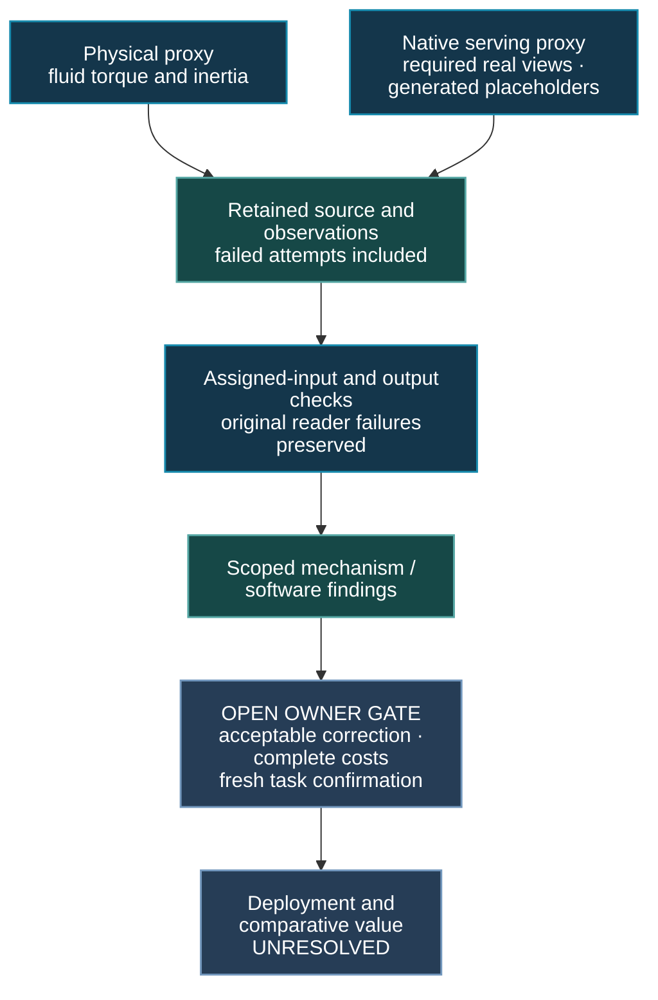

# Decision validity under physical change

**26 November 2026 · bounded research proxies.** Phase II reproduced a physical
dependency, distinguished two serving-input contracts, and found a defect in its
own evidence reader. It has not established an owner-approved correction,
experiment-selection advantage or complete-cost saving.

The [previous finite campaign](../edpi_finite/README.md) remains a negative result.
Its [permutation proof](../edpi_finite/SYMMETRY.md) explains why the tested
acquisition rules agree under the declared model. We did not enlarge that
symmetric campaign or introduce artificial weights to manufacture a difference.

## What the new evidence establishes

| Question | Observation | Decision boundary |
| --- | --- | --- |
| Can an unchanged software interface hide a physical dependency? | In a pinned robosuite/MuJoCo model, fingertip inertia affects both mass and fluid torque. At the declared 0.9 rad/s query, joint-7 fluid torque is −5.474594339 N m in stock and −0.115750203 N m under the diagnostic inertia change; disabling fluid gives zero. | Different mechanisms are measurable. A calibrated correction, successful task and owner acceptance are not established. |
| Can two serving corrections preserve different requirements? | Across 324 authored LeRobot software cases, the original validator accepts 20/108 requests, a generated-placeholder-only proposal 24/108, and a broader optional-visual proposal 36/108. | All match their frozen software expectations. Whether a real camera may be omitted is an owner-defined contract, not a result a selector can invent. |
| Does consistent output prove the assigned experiment was performed? | The first reader accepted seven misleading mutations, including a native-rejected NaN state in a record marked accepted. | The supplement checks all 1,170 assigned input arrays and refuses those mutations while retaining all original decisions. This does not attest execution authenticity. |

The serving study uses actual native validators, request batching and image
preprocessing at LeRobot `b07adcc5e3ce42c26a248236dbb3571f84c28c43`. It bypasses
learned-model initialization and uses empty processor pipelines. No weights,
diffusion, action generation, server transport, robot trajectory or task score
was tested. The reporter's learned-policy results are not our observations.
The source of the incident is [LeRobot #5525](https://github.com/huggingface/lerobot/issues/5525);
the proposed patch here is not an upstream submission or enrolled owner case.

## Inspect and reproduce

| Packet | Source, observations and checks |
| --- | --- |
| Physical dependency | [Protocol](physical/PROTOCOL.md), [failed original probe](physical/probe_drag.py), [compiled-copy correction](physical/probe_drag_v2.py), [arithmetic result](physical/records/native-audit.json), [portable unresolved record](physical/mechanism.nisayon.zip) |
| Serving correction | [Frozen protocol](serving/PROTOCOL.md), [native patch](serving/synthetic-only.patch), [324-row freeze](serving/records/freeze-v2.json), [raw outcomes](serving/records/native-02/rows.jsonl), [numeric arrays](serving/records/native-02/arrays.npz) |
| Reader correction | [Seven before counterexamples](audit/records/before/result.json), [supplement](audit/verify_v2.py), [after result](audit/records/after.json), [fault controls](audit/check.py) |
| Research premises | [Decision mathematics](MATHEMATICS.md), [primary-source matrix](PRIOR_ART.md), [complete-cost preflight](serving/records/economic-preflight.json) |
| Public projection | [Source and byte identities](projection.json), [reproduction commands](REPRODUCE.md), [third-party boundaries](THIRD_PARTY.md) |

The [publication checks](evidence/publication-validation.json) distinguish retained
results from checks rerun on this source projection. Historical paths in frozen
records are provenance, not instructions to access those paths. Private session
history, contact drafts, cloud account records and model artifacts are excluded.
The compiled 61 MB physical model remains outside this source release; arithmetic
readback does not need it. Native reproduction requires the declared environment
and upstream assets. No clean native environment build was independently qualified.

## Failures remain part of the result

The first physical harness exported XML and recompiled it, changing the nominal
mass matrix by about 3.33×10⁻⁶. The compiled-model-copy correction passes at the
original tolerance; no threshold was relaxed. Both native attempts remain
inspectable. The independent fluid calculation agrees within 4.44×10⁻¹⁶ N m
for the ten declared single-hinge controls. These are simulator-relative checks.

Serving preparation retained incompatible dependency imports and an initial
harness failure before any completed row. The [amendment](serving/AMENDMENT-01.md)
adds the required feature-semantics fields without changing the assignment.
The actual native patch produces the same row and array hashes as the completed
prototype. A supplied black real camera remains present; omitted generated slots
receive false masks. Four comparisons change only those masks.

The old reader checked camera outputs against supplied inputs without checking
every supplied input against the frozen recipe. A self-consistent producer could
therefore substitute state or coordinate a changed input/output. An externally
pinned original digest detects changed bytes; the defect was semantic assignment
coverage, not a broken hash. The stronger reader uses explicit typed input checks,
the existing strict JSON decoder and bounded numeric-array loading. It still does
not independently reimplement nonconstant resized-image interpolation.

The ten original reader controls and seventeen additional check invocations
refuse. Some exercise the same mechanism through different boundaries; they are
not 27 independent failure mechanisms. The selected production regression group
passes 167 tests. The earlier physical group passed 217 and serving group 131;
those overlapping selections must not be summed into a larger independent suite.

## The next decision

For surviving hypotheses `H(E)`, a correction is admissible only if it belongs
to every owner-defined `D(h)`. Mechanical or software differences do not define
those acceptance sets. Empty hypothesis coverage is model mismatch, never
automatic approval. Decision-region determination and active testing have close
established prior art; no novel acquisition algorithm is claimed here.

No independent owner is enrolled. Fresh 32-pair task confirmation remains unrun
and required wherever applicable. Harmful policy admissions, missed beneficial
opportunities and task competence were not measured in a new Phase II campaign;
their missing denominators must not be reported as zero. Software request counts
are different endpoints.

Complete work remains unknown. The optimistic twofold ceiling
`C / (C - R + H)` cannot be resolved without a baseline, justified removable work
and added overhead. Native subprocess seconds are not owner-effort savings.
The next justified investment is the owner-approved serving contract and a
permitted raw reproducer, followed by economic preflight and a consequential
prospective discriminability witness. A new planner, untouched second case,
cumulative adaptation and physical deployment have not been authorized by these
results. [Owner comparison protocol](../../docs/OWNER_COMPARISON.md).
