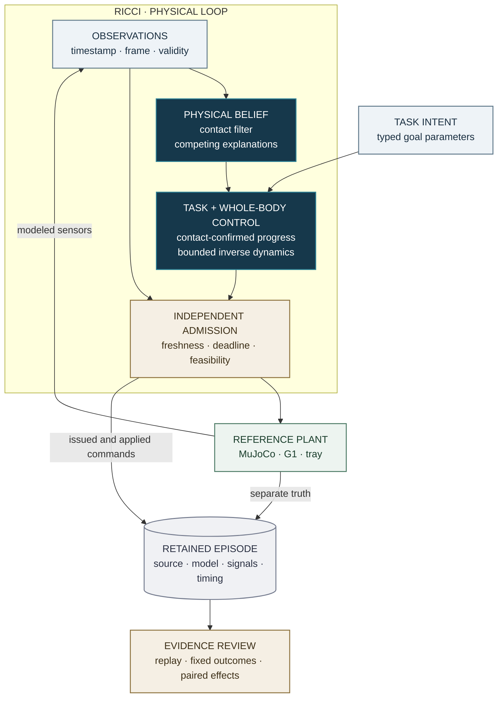
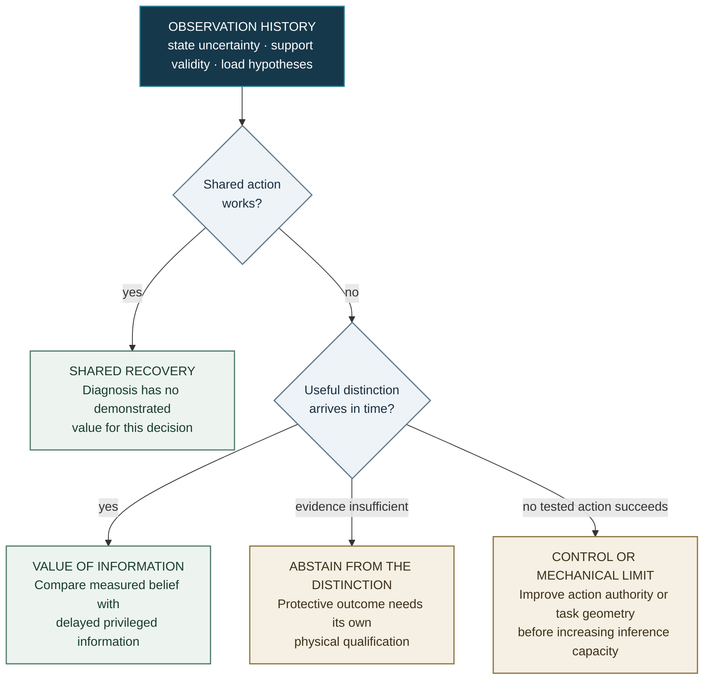

# Ricci

**A general-purpose humanoid research program.**

A slipping foot and a moving load can both make a robot lurch. Knowing which one
happened matters only if a different, feasible response can still improve the
outcome. Sometimes ordinary feedback is enough. Sometimes several explanations
remain plausible and one action works across them. Sometimes the opportunity to
recover has already closed.

Ricci's physical intelligence is being built around that distinction: what the
body can still accomplish, which observations could change the decision, and how
much time remains before the action must take effect. The long-term objective is
a humanoid that can understand unfamiliar tasks, compose skills and adapt to new
loads, contacts and environments. The tray experiment is the first measuring
instrument for that program.

**Ricci acts; Nisayon evaluates the retained evidence.** The current implementation
is an inspectable CPU simulation on a pinned Unitree G1 reference embodiment.
Ricci's own dynamics, hardware and general-purpose capabilities remain to be
established. The authored Motion Study and exhibit are separate design artifacts.

[Architecture](#architecture) · [The research question](#when-information-is-worth-acting-on) ·
[Measured results](#what-the-first-experiment-establishes) · [Reproduce](#reproduce) ·
[Research position](#research-position) ·
[Continue the engineering](../../work/experiments/ricci-brain-01-2026-11-24/HANDOFF.txt)

## Architecture

The physical loop separates measurements, belief, decisions and motor authority.
A task confidence score cannot create a support contact, enlarge a torque limit,
or turn a stopped experiment into a completed task.



The estimator, decision rules and solver receive immutable sensor packets and a
constant reference model. Simulator state, scenario labels, filenames, seeds and
absolute clocks are absent from that interface. Privileged mode information has
a separate diagnostic channel that is refused by the baseline and candidate.
Evaluator separation is a software and data boundary; it is not an independent
scientific replication or an operating-system security sandbox.

| Interface | Implemented contract | Current boundary |
|---|---|---|
| [Observations](ricci_brain/interfaces.py) | SI units, declared frames, acquisition/delivery stamps, validity, strict field allowlist | Modeled bias, noise, latency and dropout; no hardware calibration |
| [Physical belief](ricci_brain/estimator.py) | 21-state contact-aided error-state filter; loaded-contact hysteresis and innovation rejection | Simplified contact augmentation; no full InEKF reproduction or calibrated posterior claim |
| [Hypothesis bank](ricci_brain/belief.py) | Residual compatibility for support and load explanations; explicit ambiguous, compound and degraded states | Scores are not probabilities; coverage is not established |
| [Task intent and decisions](ricci_brain/policy.py) | Typed stand/lift-step-place intent; same recovery menu for every arm | Fixed trajectories and a small action set; no general skill library |
| [Physical execution](ricci_brain/control.py) | Constrained inverse-dynamics QP and independent command admission | No predictive contact planner, motor dynamics or qualified safe terminal action |
| [Evidence](ricci_brain/replay.py) | Versioned source/model-bound episodes; recorded-action physics and sensor replay | Separate adapter; no native LIBERO/LeRobot acceptance or existing UI-replay compatibility |

The robot has a floating base, 29 torque-controlled joints and 35 velocity
coordinates. The controller models

$$
M(q)\dot v+h(q,v)=S^\top\tau+J_c(q)^\top\lambda,
\qquad J_c\dot v+\dot J_c v=a_c^*.
$$

Here `h` includes gravity, velocity and modeled passive terms. The robot-only
inverse-dynamics model does not identify the tray's inertial parameters; physical
load effects are handled through feedback. Contact forces satisfy unilateral
normal-force and friction-pyramid constraints, alongside torque and joint braking
bounds. A scheduled stance is admitted only when observations support contact.
Every returned solution is checked against its original constraints, including
solutions reported as approximately solved. The [design note](../../work/experiments/ricci-brain-01-2026-11-24/DESIGN.md)
records numerical tolerances, frame conventions and all model assumptions.

The control period is 20 ms and default physics timestep is 2 ms. Physics advances
under the preceding command during a fixed 20 ms modeled computation/delivery
interval. Host solve costs are recorded separately. This timing model prevents
host scheduling from silently changing the experimental treatment; it does not
establish a real-time hardware guarantee.

## When information is worth acting on

A useful diagnosis must change a feasible action before that action loses its
value. Classification accuracy alone cannot establish that result.

For an observation history `H`, let `Θ(H)` contain the physical explanations still
consistent with the declared uncertainty. For explanation `θ`, action `a` and
effective actuation delay `τ`, retain an outcome vector: completion, protective
outcome, fall, drop, constraint violation, timeout and censoring. These outcomes
must not be hidden inside a single success score.

A proposed predictive executor would estimate

$$
\mathcal A_{\mathrm{rec}}(\theta,\tau)
=\{a:\text{the declared task and constraints remain achievable under }\theta\},
\qquad
\mathcal A_{\mathrm{shared}}(H,\tau)
=\bigcap_{\theta\in\Theta(H)}\mathcal A_{\mathrm{rec}}(\theta,\tau).
$$

The current experiment samples actions and delays; it does **not** compute these
sets online or certify a viability region. Their dependence on the controller,
phase, model and action set is essential. Finite tested actions can have
nonmonotone success as their start time changes.



The distinction between an insufficient observation and an insufficient action is
the reason for the privileged diagnostic. Its result is headroom under the tested
controller and action set. A poor privileged selector can itself fail; the tested
action/delay cells must therefore accompany its aggregate score.

## What the first experiment establishes

The task is to lift a light tray, take one deliberate step and release it onto a
support. Grasp acquisition is simplified explicitly: a left six-axis weld and a
right point fixture attach the tray to the hands. Fingers, grasp acquisition,
realistic grasp loss and free payload motion are outside the model. The payload
moves along a bounded spring-driven guide; sole slip is generated by reducing
physical contact friction, without editing the robot's pose or velocity.

The frozen campaign first requires **8/8 nominal completions without a declared
constraint violation**. It then selects a shared response on development cases,
sweeps privileged information timing, freezes comparisons and evaluates whole
held-out configurations. Baseline, candidate and privileged diagnostic share
sensors, low-level control, limits and actions. Common-policy observation prefixes
are checked before attributing an outcome difference to a decision.

The current nominal gate passes all eight configurations. Completion times range
from 11.26 to 11.76 seconds. Across 28 held-out cases, baseline and candidate each
complete **17/28**: a 0 pp paired effect, with a conservative 95% interval of
−14.49 to +14.49 pp. The candidate does not advance. All four fresh nominal
configurations pass, with no nominal time penalty or false intervention.

Privileged mode information rescues one compound-fault case, while its fixed
selector performs worse overall. In that case the useful combined response takes
effect 22 ms after onset; the candidate selects a different response 660 ms after
onset, with no measured effect before the trace ends. Action choice and timing
remain confounded in that comparison. Contact-solver sensitivity also causes
nominal failures outside the default regime. These findings direct the next work
toward a controlled action/delay diagnostic and more robust contact control.
The full paired uncertainty, timing,
recovery map and contact-solver sensitivity are retained in the
[measured results](../../work/experiments/ricci-brain-01-2026-11-24/RESULTS.md).

An earlier campaign was stopped after host scheduling changed deadline fallbacks
before any recovery decision. Its apparent advantage was invalid. All 139 sealed
episodes and the unfinished next run remain retained. Subsequent nominal failures
exposed false support admission, contact-transition defects and numerical solver
handling. [Development history](../../work/experiments/ricci-brain-01-2026-11-24/DEVELOPMENT.md)
records those corrections and the failed attempts. A demonstration that survives
only because a foot supplies imaginary support is not a balance result.

## Research position

Carrying, contact estimation, hierarchical control and recovery monitoring are
established research directions. Ricci's first question is narrower: under matched
sensing and control budgets, when does distinguishing support failure from load
motion improve a task-preserving action, and when is useful information too late?

The source review reads methods and evaluation, including embodiment, privileged
inputs, timing and success definitions. [Contact-aided InEKF](https://doi.org/10.1177/0278364919894385)
and its slipping-contact extension inform estimation; [AdaptManip](https://arxiv.org/html/2602.14363v1)
and [HULK](https://arxiv.org/html/2610.08970v1) establish relevant load/manipulation
precedent; [GR00T 2](https://research.nvidia.com/labs/gear/gr00t-2/assets/gr00t2_whitepaper.pdf)
and [SONIC](https://arxiv.org/html/2511.07820v4) motivate the separation of task, motion and fast control. The closest
reviewed overlap is [Active Reachability Learning](https://arxiv.org/html/2610.33317v1),
which studies a given fallback policy's recoverability envelope. A recovery map
by itself is not a Ricci novelty claim.

The [frontier review](../../work/experiments/ricci-brain-01-2026-11-24/FRONTIER_REVIEW.md)
also examines predictive contact planning, robust whole-body control, memory,
asynchronous action generation, world models and public company evaluations.
The [requested-source ledger](../../work/experiments/ricci-brain-01-2026-11-24/sources.json)
and [expanded ledger](../../work/experiments/ricci-brain-01-2026-11-24/frontier-sources.json)
pin versions and retained source identities. Company demonstrations and unreleased
architectures do not establish a matched performance ranking. No claim of
superiority over another robot follows from this simulation.

## The general-purpose architecture beyond this experiment

Broader perception, task memory, learned motion and action-conditioned world models
can eventually propose skills through typed intent. A future proposal should carry
its goal predicate, frames, preconditions, expiration, expected observations,
force/torque envelope, interruption behavior and provenance. Physical execution
must either instantiate it under current constraints or return a typed refusal.

The proposed next physical layer jointly reasons about contact forces, foot/hand
targets and support uncertainty. Its mathematical tools may include robust
predictive control, reachability and set-valued estimation, but each guarantee
needs premises that the experiment can check. A learned world model's prediction
cannot become evaluator truth. A semantic stop request cannot establish a stable
physical terminal state. Bounded linear active-diagnosis results do not transfer
their guarantees to nonlinear impacts by analogy.

The [architecture direction](../../work/experiments/ricci-brain-01-2026-11-24/ARCHITECTURE_DIRECTION.md)
separates implemented interfaces from these proposals. The
[mathematical direction](../../work/experiments/ricci-brain-01-2026-11-24/MATHEMATICAL_DIRECTION.md)
states hybrid-state, nonanticipativity and robust recovery obligations. The
[continuation contract](../../work/experiments/ricci-brain-01-2026-11-24/continuation.json)
binds the current source, evidence, open questions and next gates. Future sessions
should begin there and with the [handoff](../../work/experiments/ricci-brain-01-2026-11-24/HANDOFF.txt).
A larger model is admitted by a fresh measured gain, not by its size or reputation.

## Reproduce

From the repository root, enter `experiments/ricci_brain01`. Run the complete
headless experiment with one command:

```sh
OPENBLAS_NUM_THREADS=1 VECLIB_MAXIMUM_THREADS=1 uv run --frozen python -m ricci_brain experiment --out ../../artifacts/ricci-brain-01/reproduction-01
```

Use a new output directory. Python 3.12, MuJoCo 3.3.2 and solver dependencies are
locked. The first run downloads and checks the reference model; later runs use
the verified cache. The complete campaign needs roughly 10 GB and tens of minutes
on this CPU setup. No renderer, GPU, camera, cloud training or robot is involved.

A single nominal episode and recorded-action replay:

```sh
OPENBLAS_NUM_THREADS=1 VECLIB_MAXIMUM_THREADS=1 uv run --frozen python -m ricci_brain nominal --out ../../artifacts/ricci-brain-01/nominal-reproduction-01
OPENBLAS_NUM_THREADS=1 VECLIB_MAXIMUM_THREADS=1 uv run --frozen python -m ricci_brain replay ../../artifacts/ricci-brain-01/nominal-reproduction-01
```

The scoped checks cover observations, frames, floating-base dynamics, physical
friction and payload behavior, contact rejection, truth-channel separation,
stale packets, deadlines, solver admission, fallback and replay tampering:

```sh
OPENBLAS_NUM_THREADS=1 VECLIB_MAXIMUM_THREADS=1 uv run --frozen python -m pytest
uv run --frozen ruff check ricci_brain tests
```

Every action change produces new closed-loop physics and observations. Replay
checks recorded commands, regenerates sensor packets and recomputes outcomes; it
does not import archived producer code or turn recorded futures into
counterfactuals. Hashes establish byte identity, not physical truth.

The implementation is contained in this directory. Research and evidence summaries
are under `work/experiments/ricci-brain-01-2026-11-24/`. The public tree includes
compact results and manifest identities; the original 10.39 GB raw campaign and
failed development stores remain in the research archive. The commands above
generate new replayable episodes locally. Historical research hashes and paths
in retained JSON identify provenance, not public Git ancestors or downloads.
See the [publication boundary](../../work/experiments/ricci-brain-01-2026-11-24/PUBLICATION.md).
The reference model is pinned in
[reference.json](reference.json), with its [BSD-3-Clause notice](UNITREE_G1_LICENSE.txt).
Ricci exhibit geometry supplies no mass or inertia to this experiment.
