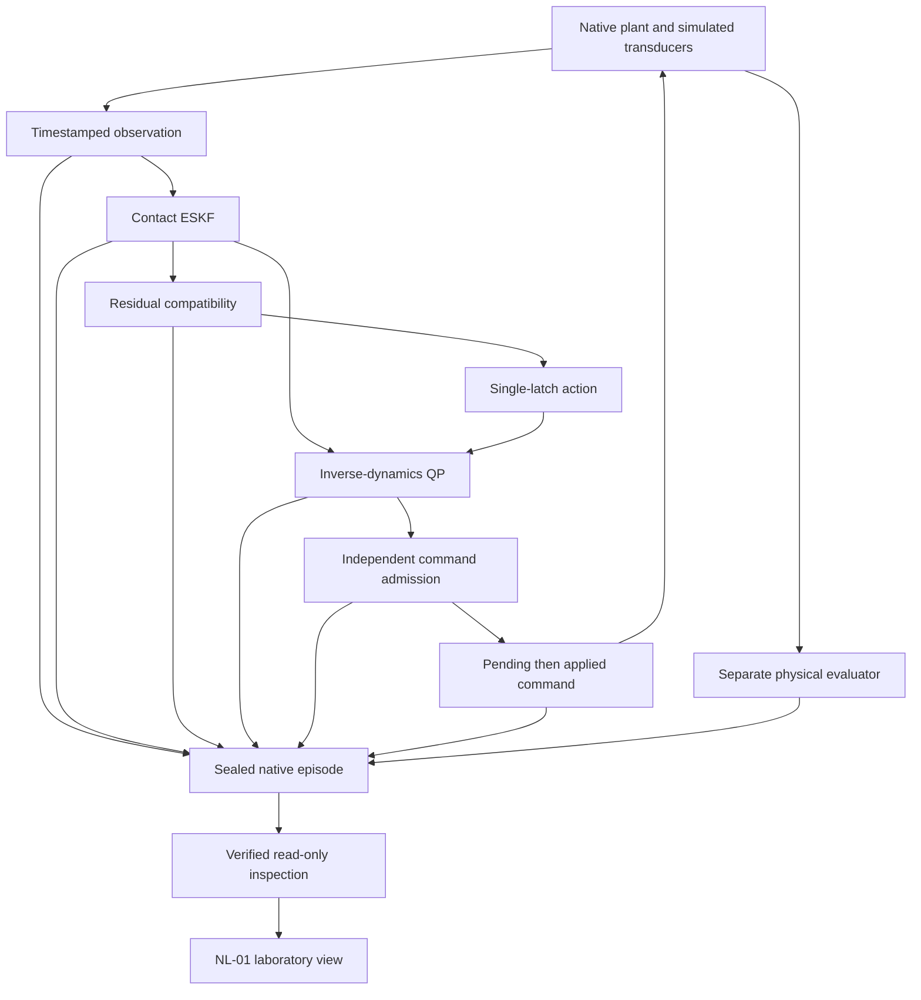

# Ricci scientific inspection contract v1

RB-02 owns physical semantics and the evidence producer. NL-01 owns rendering,
spatial interaction and its service envelope. This contract exposes the existing
Brain 01 computation through a read-only projection. The sealed episode remains
the source record; the projection cannot qualify a controller or authorize a
motor command. It is not a replacement evidence format.

The executable boundary is [`inspection.project`](inspection.py), returning
`ricci.scientific-inspection.v1`. It accepts an episode directory and an
independently supplied manifest digest. It checks the existing file closure,
reviewed producer identity, strict JSON, channel lengths, observation availability
and command delivery. Unknown producer semantics require an adapter revision.
`verify_projection` reconstructs every exported value and refuses any difference.
The two [complete examples](examples/index.json) include 372 and 650 control rows.
They are gzip-compressed JSON views, not executable model objects.

## Supported quantities and authority

| Namespace | Meaning and original source | Important limit |
|---|---|---|
| `observed_simulated_sensors` | Exact `policy.jsonl` observation, including channel validity | Native simulated transducers; no hardware measurement claim |
| `estimated` | ESKF pose, velocity, biases, marginal covariance, contact innovations and reliability | No covariance calibration; full covariance is not retained |
| `inferred_compatibility` | Actual residual features, squared scores, mode and trigger | Scores are not posterior probabilities |
| `decision` | Actual selected action and single-latch time | A selected name need not change a target or applied command |
| `optimization` | Recorded QP status, residuals, iterations, stance and COM target | Status `solved` alone does not establish admitted feasibility |
| `admission` | Existing independent command gate and bounded continuation state | Exhaustion is unqualified censoring, not safe stopping |
| `issued_command`, `applied_command` | Exact motor-order torques and fixture command | Row i applies row i−1's command under the modeled delay |
| `independent_simulator_measurement` | Evaluator-only `truth.json` row | Must never become a policy input |
| `predicted_physical_futures` | `null` | Brain 01 does not implement a counterfactual prediction bank |
| `terminal` | Final measurement, fixed evaluator result and censoring | No Nisayon deployment acceptance or candidate promotion follows |

Each sample binds a one-based policy JSONL line and a zero-based truth index.
The header binds whole-channel hashes, episode manifest, model and source commit.
Fields retain their recorded names and units. Marginal variance is not a
confidence region. A rendered ellipse needs a justified covariance transform;
v1 does not supply one. A renderer must preserve absent observations and
unavailable predictions as missing rather than interpolate them into evidence.

## Multiple clocks, one causal record

Simulation time, acquisition, delivery, state time, covariance time and command
prediction use the episode's modeled seconds. Control samples are 20 ms apart;
this campaign uses 2 ms native physics steps. Acquisition and delivery remain
separate. A sample cannot use an observation delivered after its available time,
subject to the producer's declared `1e-10 s` comparison tolerance.

Host values are `perf_counter` **durations**. Policy duration ends before command
admission and excludes serialization and file flushing. Optimizer duration is
inside policy duration. Adding them double counts work. Host start timestamps,
cross-clock offset, estimator/belief stage durations and stage overlap are not
recorded. `stage_host_start_s` and clock uncertainty are `null`. The laboratory
must not synthesize a wall-clock waterfall from simulation timestamps.

`target_phase_reconstructed_s` deliberately reproduces the producer expression
`task_phase + command_prediction_time - simulation_time`, including floating-point
evaluation order. It is a derived computational quantity, not a measured clock.
Reassociation concealed a one-ULP crossing of the strict phase-6 swing guard in
the first analysis; the corrected analysis and boundary audit preserve it.

Effective actuation requires a comparator. The campaign reports the first
accepted **applied** torque differing by at least 0.1 N m, its control interval
and next ideal-motor physics step. V1 does not turn a decision timestamp into a
hardware response time. Visual interpolation is presentation only.

The diagram states data ownership, not measured stage durations. The inspection
module imports no policy execution or simulator stepping API. The renderer has
no input path into the controller or evaluator through this contract. Its
display choices cannot change the source-bound reconstruction; mutation causes
verification refusal. This is an API boundary, not hostile-code containment.

## Model and geometry identity

[`catalog.model_catalog`](catalog.py) reads the sealed compiled MuJoCo model.
`ricci.model-inspection.v1` identifies each native body, joint, actuator, sensor,
site and geom by `<compressed-model-SHA256>/<kind>/<native-index>`, retaining
native names separately. The examples contain 33 bodies, 32 joints, 29 actuators,
six native sensors and 75 geoms, including the reference task apparatus.

Bodies are native rigid links; sites define additional local frames. Positions
are metres and quaternions are `wxyz`. Joint ranges retain native units determined
by joint type. Transmission type, gearing, contact masks and visual groups remain
explicit. A collision mask alone is not a feasibility certificate. Model-local
coordinates are not animated world poses. The estimator's robot-only state is
not the full plant state vector. Foot wrenches and encoders are transducer
computations, not six additional native MuJoCo sensor objects.

IDs are stable within an exact model only. Cross-version mapping needs a
separately checked correspondence. The proprietary conceptual Ricci mesh must
not inherit G1 masses, contacts, torques or recovery evidence. Visual assets do
not define physical parameters. No automatic retargeting is supported.

## Continuation and changed futures

Current supported operations are full native rerun and recorded-command physics
verification. A changed action requires a new closed-loop run. V1 refuses to
advertise exact controller checkpoint continuation.

| Required restart state | Current retention |
|---|---|
| Native integration state, actuation, solver warm-start acceleration, active constraints | `mjSTATE_INTEGRATION` in `physics.npz` |
| Model parameters outside integration state | Initial compiled model plus recorded environment changes |
| Full estimator covariance, contact anchors, previous observation and filter flags | Only partial summaries; not a restart checkpoint |
| Hypothesis EMA and sustained trigger counter | Not serialized |
| QP warm-start vector, landing anchor, supervisor continuation counter | Not fully serialized |
| Latched action, phase delay, landing confirmations, pending command | Partially recorded; no validated state importer |
| RNG bit-generator state and pending sensor queue | Seed/history support rerun; no exact checkpoint export |
| Task, disturbance and timing state | Config and histories; no composite restart contract |

Saving only the plant state is insufficient. A future checkpoint must bind all
these states, source/model identities and queue ordering, then pass uninterrupted
versus restored continuation checks and changed-action native branching tests.
Neither this catalog nor the projection is such a checkpoint.

## Performance and failure behavior

Projection runs after sealing, outside the control process. The native producer
and its recording path are unchanged. The examples measured approximately
74–246 ms per full projection on this host, including integrity reads. These are
six offline samples, not a latency distribution or real-time guarantee.
Source bytes remained unchanged and altered projections were refused.

Brain 01 still performs synchronous JSON serialization and flushes while running;
it has not earned a hardware real-time or bounded recording-overhead claim.
No live queue, zero-loss streaming or instrumented/uninstrumented controller
equivalence claim is made. Before live transport, use bounded producer buffers,
explicit sequence gaps and backpressure semantics that cannot block motor
feedback. An overflow must produce an incomplete evidence state, never an
apparently complete qualified record. A separate closed-loop instrumentation
ablation and latency measurement are required.

Inputs are bounded to 4,096 control rows and 64 MiB per inspected JSON channel.
Duplicate keys, nonfinite numbers, missing rows, inconsistent command delivery,
future observations and changed source semantics are refused. There is no
network listener, remote actuator route or automatic acceptance path.

## Interoperability decision

Use existing Nisayon strict JSON and native episode verification. NL-01 may wrap
this projection in its capability envelope without changing scientific meaning.
Rerun timelines and Foxglove messages are plausible presentation adapters; adding
their runtime dependencies is unnecessary for a verifiable offline view. ROS 2
and Isaac distinguish simulation and system clocks. OpenTelemetry spans can
describe measured software operations but cannot manufacture missing physical
stage timing. Sources and exact review scope are in [PRIOR_ART.md](PRIOR_ART.md).

An external team can inspect supported Brain 01 records today. Accepting a
different embodiment, controller or producer requires a declared adapter and
validity assessment. There is no generic physical-decision SDK claim. The first
demonstrated utility is exposing a late ineffective action and a numerical
contact-guard problem through inspectable native evidence. External engineering
cost savings and purchasing value remain unmeasured.
