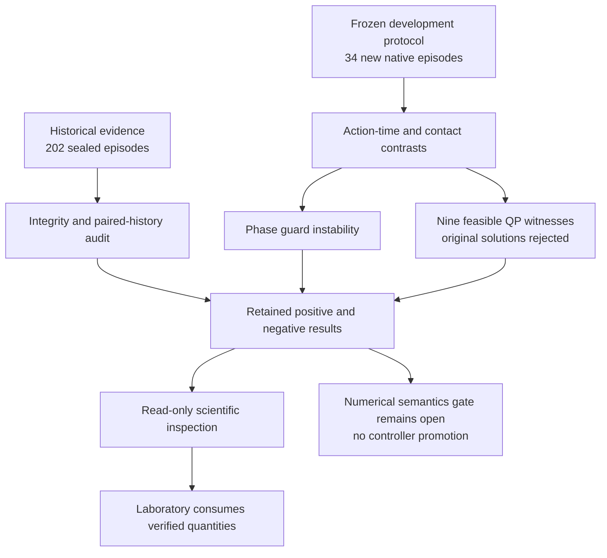

# Ricci: separate decisions from physical interventions

A recovery action can be selected without changing the robot's command. An
optimizer can report success while violating the controller's numerical
constraints. Before asking which information a physical agent needs, those
distinctions have to survive inspection.

This bounded RB-02 investigation keeps Brain 01 unchanged. It audits the 202
historical episodes, executes 34 native MuJoCo episodes, separates action from
scheduled decision time on an exposed compound fault, and investigates three
censored contact configurations. It also supplies a source-bound, read-only
scientific view for the Nisayon Laboratory. It does not promote a controller.

## What the experiment established

- All 202 historical manifests and members verify; the fixed evaluator agrees
  with the retained outcomes. Baseline and candidate remain **17/28**, with zero
  discordant observed completions and five jointly censored pairs. The stricter
  audit checks all **84/84** predecision histories, including information at the
  decision instant. This is a raw-record audit, not 202 new executions.
- Eight nominal reruns complete. Eleven new trajectories reproduce historical
  integration states bit for bit in the pinned environment. Six preregistered
  command replays reproduce physics and sensor packets exactly.
- The 18-cell action/time map has three completions. The exposed candidate
  selects `plant_foot` late but produces the same physical trajectory as the
  no-response arm. Action labels alone would give a misleading explanation.
- Floating-point cancellation crosses a strict task-phase guard in 581 recorded
  control rows. This limits any interpretation of the nonmonotone action/time
  map as a stable physical recovery boundary.
- An independent LP solver finds feasible witnesses for **all nine terminal
  QPs** from the three censored contact cases. Scalar arithmetic checks those
  witnesses under the original tolerances. Numerical rejection therefore does
  not demonstrate infeasibility of the recorded QP, much less of the task.

The [results and mathematical limits](RESULTS.md) retain every cell and negative
finding. The [closest-prior-art review](PRIOR_ART.md) identifies established
alternatives and the unfinished review scope. No new information theorem,
physical safety guarantee, acquisition advantage or complete-cost saving is claimed.



## Scientific interface

The [v1 inspection contract](OBSERVABILITY.md) binds observations, estimates,
uncalibrated residual scores, decisions, optimization diagnostics, command
admission, issued/applied torques and independent outcomes to sealed source rows.
Simulation, sensor acquisition, delivery and host computation remain distinct.
Missing timestamps and unsupported predictions remain absent. The two complete
[example views and native model catalogs](examples/index.json) provide the
contract for NL-01; no renderer or remote motor interface is introduced here.

Seven invalid copies are rejected even after their manifests are recomputed.
The original episodes remain unchanged. This establishes the checked projection
boundary; it does not establish execution authenticity or hostile-code isolation.
Exact controller checkpoint continuation is not implemented. Alternative actions
in this campaign produce complete new closed-loop executions from reset.

## Reproduce

From the repository root, use Brain 01's existing pinned environment. The model
fetch is pinned by its [reference identity](../ricci_brain01/reference.json).
No new dependency is added. Full reproduction needs approximately 2.5 GB of
output allowance, at least 2.5 GiB free before each episode, the reference assets,
and a CPU compatible with the pinned environment. These are execution limits,
not guarantees of cross-platform bitwise determinism.

```sh
uv sync --project experiments/ricci_brain01 --frozen --group dev
export PYTHONPATH=.:src:experiments/ricci_brain01
export OPENBLAS_NUM_THREADS=1
export VECLIB_MAXIMUM_THREADS=1
export RB02_PY=experiments/ricci_brain01/.venv/bin/python

"$RB02_PY" -m pytest --import-mode=importlib -q \
  experiments/ricci_brain01/tests experiments/ricci_brain02/tests

uv run --frozen nisayon run --label rb02-factorial --timeout 1200 -- \
  "$RB02_PY" -m experiments.ricci_brain02.campaign \
  experiments/ricci_brain02/protocol.json \
  --sha256 a8158e4c5dc632bedf65179521f784c7ab04962607598148b8c3711d5ab09c59 \
  --out artifacts/ricci-brain02/reproduction-01

"$RB02_PY" -m experiments.ricci_brain02.verify \
  artifacts/ricci-brain02/reproduction-01 \
  --out artifacts/ricci-brain02/reproduction-verification.json \
  --examples artifacts/ricci-brain02/reproduction-views

"$RB02_PY" -m experiments.ricci_brain02.boundary_audit \
  artifacts/ricci-brain02/reproduction-01 \
  --out artifacts/ricci-brain02/reproduction-phase-audit.json

"$RB02_PY" -m experiments.ricci_brain02.contact_audit \
  artifacts/ricci-brain02/reproduction-01 \
  --out artifacts/ricci-brain02/reproduction-qp-audit

"$RB02_PY" -m experiments.ricci_brain02.witnesses \
  experiments/ricci_brain02/evidence/contact-qp-audit \
  --out artifacts/ricci-brain02/retained-witness-review.json
```

All output destinations must be new. The runner retains partial output and
refuses source drift, unsafe case names and invalid resource limits. The outer
Nisayon timeout bounds the process; internal resource checks occur between
episodes and do not constitute a general resource sandbox.

Historical audit and historical trajectory comparison additionally require the
original `frozen-campaign-06` raw store, which is not distributed here:

```sh
"$RB02_PY" -m experiments.ricci_brain02.evidence "$RB02_HISTORY" \
  work/experiments/ricci-brain-01-2026-11-24 \
  --out artifacts/ricci-brain02/history-review.json
"$RB02_PY" -m experiments.ricci_brain02.analyze \
  artifacts/ricci-brain02/reproduction-01 "$RB02_HISTORY" \
  --out artifacts/ricci-brain02/reproduction-analysis.json
```

`RB02_HISTORY` must identify that actual store; a summary is insufficient.
Published [evidence](evidence/README.md) includes source identities, prospective
freeze, all summarized outcomes, numerical witnesses, checks and measured costs.
The views can be inspected without raw episodes, but their complete reconstruction
and the historical audit require the corresponding raw records. The portable
packet does not pretend otherwise.

## Next justified decision

Freeze explicit discrete task-phase and landing-transition semantics, then test
that single correction with unchanged contact admission, torque limits and task
criteria. Numerical QP solution quality is a separate intervention. Resolve or
bound these issues before interpreting delayed information, adding a predictive
controller, or changing morphology. Any candidate still needs genuinely fresh
confirmation; the existing 32-pair obligation remains unmet here.
