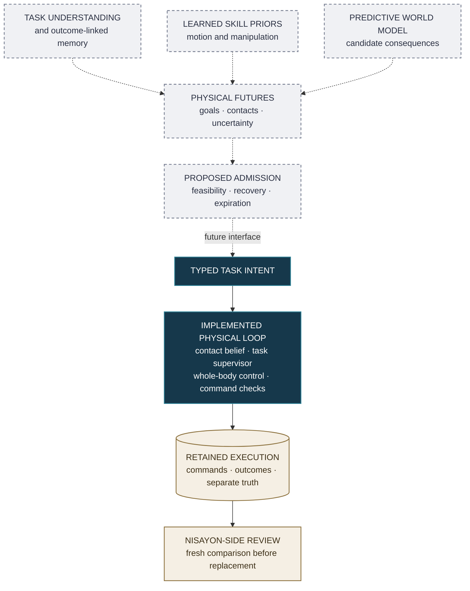

# A general-purpose brain with testable physical authority

Ricci should eventually understand unfamiliar tasks, compose skills, remember
outcomes and adapt its behavior. The architectural difficulty is deciding which
of those predictions may control a physical body, at what time, and with what
remaining chance of recovery. A broad model can propose a good task plan while
being wrong about a foot's support. Those errors need different representations,
different deadlines and different tests.

The implemented milestone provides an inspectable physical loop and an external
evidence path. The extensions below are **proposed**, not implemented capabilities.
The [primary-source review](FRONTIER_REVIEW.md) identifies both useful mechanisms
and directly overlapping work. This is an architectural research position, not a
claim of priority or state-of-the-art performance.

The dashed connections are research proposals. The current evaluator does not
train or alter the controller, and no semantic model, world model or learned
torque generator is installed. The important future boundary is admission:
a proposed skill needs a feasible physical continuation under current sensing
and timing assumptions, plus an explicit outcome if those assumptions fail.

## The core object is an action with a recovery obligation

A task intention should not immediately become a torque sequence. A future skill
proposal should carry a goal predicate, frame/units, preconditions, validity
interval, expected observations, required contacts, permissible force/torque
envelope, interruption semantics and model/data provenance. The physical executor
must either instantiate that proposal inside its current capabilities or return a
typed refusal. A skill's confidence cannot enlarge an actuator limit or erase an
unknown support condition.

The present `TaskIntent` deliberately exposes only `stand` and
`lift_step_place`, with metric step/lift parameters. It establishes the direction
of the interface without claiming that a general skill library exists. Future
learned skills should target this kind of reviewed contract rather than the motor
API. Completed-task memory must refer to an observed outcome record, not merely
the fact that an action was requested.

## Keep several physical futures alive when the evidence requires it

For a history `h`, let `Θ(h)` contain the physical explanations still consistent
with the observations and declared modeling uncertainty. Each explanation includes
state, contact validity, load dynamics and parameter uncertainty. It must be
possible for `Θ(h)` to be incomplete: unknown or degraded sensing is a separate
condition, not an explanation with probability zero.

For each explanation `θ`, a future predictive executor can estimate a set
`A_rec(θ, τ)` of actions that preserve the specified task/constraint outcome when
effective actuation begins after delay `τ`. A shared recovery candidate belongs to

`A_common(h, τ) = intersection over θ in Θ(h) of A_rec(θ, τ)`.

This expression organizes the experiment; it does not make the estimated sets
correct. Sampled rollouts are finite evidence. Robust bounds require explicit
disturbance premises, and a learned value function requires calibration/coverage
tests. Outcome vectors should retain completion, intervention cost, constraint
violations, falls and censoring instead of hiding them inside one convenient score.

Four cases determine the next action:

1. **A shared action works.** Use it; diagnosis has no demonstrated control value
   for that decision, even if classification is easy.
2. **Different explanations require different useful actions.** Information may
   matter. Test the privileged-information gap, observation overlap, decision
   errors and time to effective actuation under the same controller/action set.
3. **Evidence is insufficient or outside the admitted regime.** Abstain from the
   task-specific distinction and request a separately qualified protective action.
   If no such action exists, the system is unresolved. An “unknown” label cannot
   itself keep a humanoid upright.
4. **No tested action works.** Investigate control authority, contact transitions,
   task geometry or mechanical design before increasing inference capacity.

This is a more demanding objective than a low classification error. A useful
diagnosis must change a feasible action in time, and that action must improve an
independently measured outcome. Conversely, perfect information can appear harmful
under a poor selector. The fixed privileged selector and the exhaustive *tested*
action/delay cells must therefore be reported separately; neither establishes the
optimal policy's bound.

## A hierarchy organized by physical timescale

| Function | Intended authority and interface | Admission evidence |
|---|---|---|
| Sensor/clock layer | Timestamp, frame, units, freshness and validity; immutable observation packets | Bias/frame tests, latency/dropout injection, actual acquisition-to-actuation timing |
| Physical belief | Contact/load hypotheses and uncertainty; no task-success authority | Innovation consistency, outlier rejection, calibration where probabilities are used, compound/OOD cases |
| Predictive action selection | Contact forces, support transitions and reachable foot/hand targets under each hypothesis | Torque/contact feasibility, delay sweeps, model mismatch and common-action comparisons |
| Whole-body execution | Bounded motor commands; explicit expiration and infeasibility response | Dynamics residuals, saturation, joint/collision constraints and validated terminal behavior |
| General task/skill layer | Propose typed goals and motion intents, cancel/replan within acknowledged boundaries | Fresh tasks, unseen configurations, memory errors and measured task progress |
| Nisayon evaluation | Reconstruct evidence and evaluate fixed predicates; no authority over live policy inputs | Source/trace binding, independent measurements, held-out comparisons and adversarial invalid packets |

The current 50 Hz Python QP is a deliberate-step reference controller. A later
compiled executor may need a substantially faster servo and a slower predictive
contact planner. Rates must follow measured worst-case costs and plant dynamics;
writing “1 kHz” on an architecture diagram creates no capability. Episode version
2 advances physics under the prior command for a modeled 20 ms computation and
delivery interval. This fixes a host-scheduling confound found in version 1.
Hardware timing qualification would additionally need measured worst-case
scheduling, transport jitter and actuator dynamics.

If the evidence supports moving beyond fixed recovery trajectories, the next
inspectable control change is joint optimization of contact forces and footstep
targets, with a whole-body feasibility check and support uncertainty. Keep force,
friction, joint and torque margins visible. Compare against the existing baseline
before adding learned residuals. Do not assume a known disturbance wrench when
the real controller would have to estimate it.

## Where broad learning can help later

Learned motion representations can reduce the effort needed to express varied
whole-body skills. Semantic and visual memory can retain task progress under
occlusion. Action-conditioned world models can propose useful futures and help
search a large task space. These are distinct roles; none makes generated futures
into independent evidence or semantic confidence into a contact guarantee.

A future learning loop should retain failed and successful closed-loop episodes,
track which configurations entered training, and admit a replacement only on fresh
comparisons with full sensing/computation costs. New sensors are a separate
ablation supplied to both baseline and candidate. New controller authority is
another ablation. Otherwise an apparent “better brain” may simply have received
better measurements or stronger recovery actions.

Active diagnostic actions remain future research. Before considering them, Ricci
needs a demonstrated shared feasible action set, a useful information gap, and a
validated bound on the probing action's physical consequences. Linear bounded-set
diagnosis results cannot supply those premises for nonlinear impacts by analogy.

The near-term research claim should remain small enough to falsify: a particular
belief-aware decision rule improves a particular outcome within a pinned model,
sensor and timing regime. Generality is earned by expanding tasks and mechanisms
while preserving those checks. The tray is one instrument in that program.
