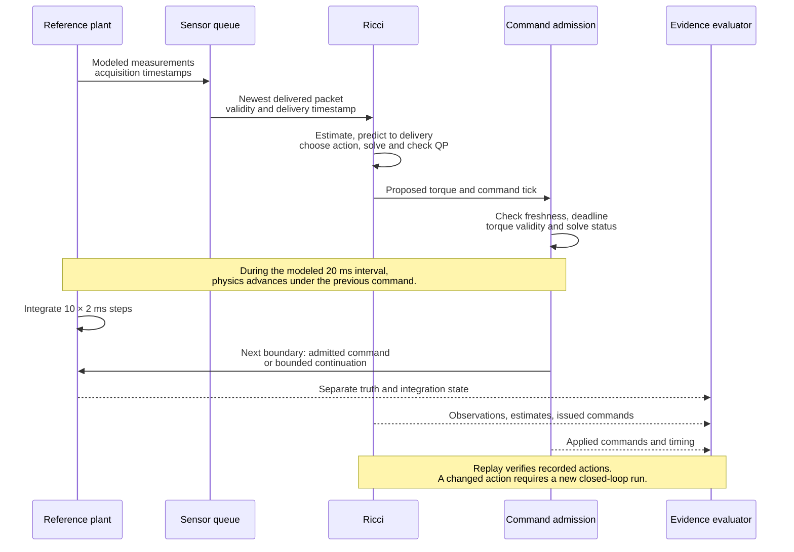

# Ricci Brain 01: an inspectable first experiment

The experiment asks whether contact/load information changes an achievable recovery
before it becomes too late. It implements a local reference simulation and keeps
the long-term general-purpose humanoid objective separate from the tray task.
Measured conclusions belong in [RESULTS.md](RESULTS.md); proposed architecture is
in [ARCHITECTURE_DIRECTION.md](ARCHITECTURE_DIRECTION.md).

The starting research commit was `f7b1ef9e981865ef574cbbfa8f29893d556d8716`.
The [publication boundary](PUBLICATION.md) identifies the exported source and
retained evidence. Historical research hashes are provenance identifiers;
private development ancestors are not part of public Git history. The first campaign at
`355e6ceb5f9747488c954bd2bf32a8777e91e309` is invalid for causal comparison:
host scheduling changed deadline fallbacks before any recovery decision.
[confounded-campaign-01.json](confounded-campaign-01.json) preserves that finding.
Subsequent episodes use a declared timing model and retain their own source hashes.

The authored Motion Study is `nisayon.ricci.authored-motion.v1`: scripted poses,
not a sensor trace or simulator episode. Ricci Rev A is a design dossier, not a
validated inertial model. M04 supplied the research question and verification
requirements. Existing Panda Lift experiments establish manipulator-specific
integration evidence; none qualifies humanoid dynamics. No exhibit, Film, shared
lab renderer, engine interface or sibling session was edited.

The diagnostic mode channel exists only for privileged/fixed-action trials. It
never enters the baseline or candidate observation interface. Evaluator results
are never returned to the policy. “Independent” here means a separate data path
and recomputation, not an independent scientific replication or separate author.

## Embodiment, frames and physical assumptions

MuJoCo Menagerie G1 is pinned to
`eea4c7431b63da8278b0ff31638e0b0e941cec0e`, with its BSD-3-Clause license and
per-file hashes in `experiments/ricci_brain01/reference.json`. The 29-joint robot
has 35 velocity coordinates, a quaternion floating base and 33.341142 kg of
reference link mass. Upstream masses/inertias are retained. No exhibit dimensions
or artwork supply physical parameters.

Units are SI: metres, seconds, kilograms, radians, newtons and newton-metres.
World axes are +X forward, +Y left, +Z up; gravity is `(0,0,-9.81)`.
The estimator rotation maps pelvis coordinates into world coordinates. MuJoCo
quaternions are `(w,x,y,z)`; base linear velocity is world-frame and base angular
velocity is body-frame. The exhibit's display frame (+Y up) is not used.

Upstream position actuators are replaced by ideal, unit-gear torque motors with
the same listed force limits. Motor dynamics, thermal limits, backlash and
hardware transport delay are absent. Joint ranges, rotor armatures and friction
loss remain from the source. Per-joint bounds and compiled contact parameters are
retained in [model-contract.json](model-contract.json).

Default physics uses 2 ms steps, `implicitfast`, Newton contact solving with 80
iterations, tolerance `1e-10`, pyramidal friction and compliant contacts. Each sole
has four 5 mm contact spheres. Sole priority exceeds floor priority, so changing
the sole coefficient changes **effective** contact friction; a regression test
checks this. Default sole friction is 0.6, contact `solref=(0.02,1)`, with the
inherited `solimp`. Stress cases change timestep, iterations and contact time
constant. Mesh collision approximations and compliant penetration are model
assumptions, not physical contact validation.

The task uses one broad bench with start and end positions, a 0.35 kg rigid tray,
and a 0.15–0.40 kg guided payload. The tray starts attached by a left six-axis weld
and a right point fixture. These replace grasp mechanics at two hand/tray collision
pairs; all other reference collision pairs remain. Fingers, grasp acquisition,
contact patch compliance and realistic grasp loss are excluded. Payload collision
is disabled inside its guide. A preloaded 20 N/m spring with 0.12 m rest position
moves the payload along a bounded lateral slider when its equality lock is
released. This is an engineered moving-load disturbance, not a free object sloshing
in a tray. Slip is generated by reducing right-sole friction. No episode event
edits position or velocity to manufacture a lurch.

The nominal prescription settles, lifts 60 mm, shifts weight to the right,
swings the left foot through a 100 mm step, recentres, lowers and releases at
task phase 9.5 s. At landing, task progress waits for three reliable loaded-foot
measurements above 20 N. A bounded 20 mm/s downward target search stops at 40 mm;
the touchdown anchor comes from the estimated state with a 2 mm compression
target to retain light contact during load transfer. Actual contact, penetration
and force remain evaluated independently. The episode ends at 13 s, including a
two-second allowance added during development for this measured transition.
Physical outcome thresholds remain fixed. This deliberate task is much slower and simpler
than general locomotion. The initial pose is a constant public fixture prescription;
the controller is not reset from the episode's measured truth.

## Observations and belief

At every physics step, separate transducer data is forwarded from the current
integration state, avoiding stale post-step sensor timestamps. A causal queue
delivers packets after configured latency. The controller consumes the newest
available packet at 50 Hz; intervening samples are discarded. Packet clocks start
at zero for every episode. Filenames, absolute clocks, seeds, scenario labels,
payload mass and simulator state handles are absent from `Observation`.

The pelvis IMU returns local angular velocity and specific force. Bias is explicit:
gyro `(0.0003,-0.0002,0.0001)` rad/s and acceleration `(0.010,-0.008,0.012)` m/s².
Default independent Gaussian standard deviations are 0.001 rad/s gyro, 0.025 m/s²
acceleration, 0.0001 rad encoder, 0.001 rad/s joint velocity, 0.12 N force and
0.01 Nm moment. Joint velocity is a modeled encoder-derived channel; its independent
noise is a simplification. Foot wrenches sum contact forces/moments in the ankle
link frame about its origin. Wrist sensors report parent/child interaction wrenches
in the palm-site frame. These are modeled load cells, not directly exposed contact
truth arrays. Latency, noise scaling, whole-packet dropout and wrist-only dropout
are explicit scenario parameters. Neither bank scores nor simulated signal noise
are claimed calibrated to hardware.

The baseline is a 21-dimensional multiplicative error-state Kalman filter:
position, velocity, orientation error, gyro/accelerometer biases and two contact
positions. It propagates inertial state/covariance and uses encoder kinematics for
loaded-contact updates. A 20 N acquisition gate, 5 N release hysteresis and innovation rejection prevent an
unreliable foot from imposing a stationary-contact update. Rejected contact states
diffuse; unloading resets their anchor estimates. Generalized position is
extrapolated over packet age with measured velocity, including body-frame angular
velocity and joint motion. Global position and yaw are gauge
choices. Covariance augmentation and contact transitions are simplified, so this
is **not a reproduction of the InEKF papers or a calibrated filter**.

The hypothesis bank uses contact-velocity innovations and changes in wrist
wrenches. Modeling allowances are 0.03 m/s, 0.8 N and 0.08 Nm. It retains nominal,
unreliable-support and moving-load explanations plus ambiguous, compound and
degraded states. Scores are residual compatibility measures, never probabilities.
The intervention threshold of four allowance units for two packets was set after
a development nominal peak of 3.37. Unknown cases take the same selected response
as the baseline; that choice is tested, not assumed universally feasible.

## Control, deadlines and failure behavior

Every arm uses the same inverse-dynamics QP, sensor/filter, command limits, task
schedule and action menu. Its variables are generalized acceleration and forces
at eight sole points. The model equation is

`M(q) qdd + h(q,v) = Sᵀ tau + Jc(q)ᵀ f + passive`.

Floating-base equations are hard equalities. Requested stance-foot acceleration
constraints use `J qdd + Jdot v`; contact Jacobians come from the reference model
and `Jdot v` is finite-differenced. A scheduled contact is admitted only when the
estimator confirms reliable measured support; unloaded and rejected feet cannot
supply virtual support forces. Torque bounds, joint braking
envelopes over 150 ms, unilateral normal force and a friction pyramid are explicit
constraints. The controller assumes coefficient 0.42; it does not read actual
friction. Each modeled contact force is capped at 450 N. Swing forces are zero.
Weighted tracking objectives cover COM, torso, hands, swing feet and posture.
This is not a centroidal MPC and has no online footstep-location optimization.

Every returned QP solution is checked against the original unscaled constraint
matrix. Numerical tolerances are 0.01 N for point-force/friction rows and 0.001
in the stated SI units for the remaining rows. The force tolerance is below the
0.12 N modeled load-cell standard deviation; the acceleration tolerance implies
submicrometre position error over a control period. Status `solved inaccurate`
is usable only when these checks and explicit dynamics/torque checks pass.
Failed, nonfinite and iteration-exhausted solutions remain unqualified.
These are numerical allowances, not relaxed physical evaluation thresholds.
The retained development audits document both an overly restrictive status-only
rule and failed attempts to apply one small tolerance across differently scaled
force and acceleration constraints.

Actions are task tracking, lower the load, plant the swing foot, or combine the
last two. Transitions blend over 350 ms. These actions are admissible proposals,
not certified recoveries. The baseline's shared action is selected on development
cases before held-out evaluation. Candidate decisions select support/load actions
only when the bank distinguishes them. The privileged selector sees mode identity
at a prescribed arrival time; a separate sweep enumerates tested actions and
arrival delays. Neither is an optimal-control oracle.

The first non-track recovery is latched for the episode. The bank continues to
update, but this prototype cannot revise that action after later compound-fault
evidence. That limitation must remain visible when interpreting decision errors;
it is not a general belief-space policy.

The protective supervisor does not inspect task confidence. It rejects invalid
packets, packets older than 40 ms, policy computation over 20 ms, infeasible solves,
nonfinite commands and torque-limit violations. It temporarily continues the last
torque with bounded velocity damping. After three consecutive rejected updates the
simulation terminates as **unqualified/censored**, never as a successful protective
stop. Cutting torque, freezing or releasing a load has not been shown safe.

All arms have the same 20 ms modeled computation/command-delivery interval and
execute the same bank. The plant advances for that interval under the preceding
command. The controller predicts state to delivery using measured velocity;
recovery blending uses elapsed physical time even while task progress waits.
The deadline fixture injects a 30 ms modeled computation miss; stale-packet tests
inject additional delivery delay. Host monotonic-clock costs and wall deadline
misses are logged separately and cannot change the treatment. This is an explicit
simulation timing assumption, not measured hardware scheduling. Motor torque
dynamics are still ideal. The analysis uses the first **applied** command differing
by at least 0.1 Nm from its paired common-policy trace, followed by the next physics
step. It refuses unmatched pre-decision histories, including no-decision pairs.

## Evidence and evaluation boundary

The standalone adapter writes versioned episodes: exact controller observations,
estimates, innovations, covariance diagonals, decisions, commands and timings;
separate configuration/truth; integration states; model-side friction/lock events;
a compressed compiled model; locked dependencies; source snapshots; and SHA-256
file manifests. State/truth prefixes are flushed as the episode runs, including
failed episodes. Source/configuration changes during an episode prevent sealing.

Version 2 replay never imports retained producer source. It verifies file closure/digests,
re-integrates recorded commands and environment changes with current trusted code,
checks the one-period command delay, regenerates noise/delivery queues, compares consumed packets, recomputes truth
measurements and checks the verdict. This is recorded-action replay. Changed actions
require new closed-loop episodes. Hashes show byte identity, not authenticity or
physical truth; an adversarial producer could construct a self-consistent fiction.

The actual native Nisayon contract is tied to LIBERO/LeRobot success-call and
normalized-action semantics, and the first-case schema assumes cube progress.
Mapping humanoid torques into that contract would misstate their meaning. This
adapter therefore remains outside native acceptance and existing UI replay.
It adds no engine compatibility claim. Policy/evaluator separation is tested by
allowlists, forbidden imports/channels and paired resets with changed private
labels/paths. It is an implementation boundary, not an OS security sandbox.

`protocol.json` sets provisional engineering thresholds and their rationale on
development cases. Completion requires sustained tray clearance, real swing and
step progress, released supported set-down, and no declared violation. Falls,
drops, constraint violations, timeouts and censoring remain separate. A stopped
robot without task progress fails completion. `campaign.json` freezes whole
configuration splits, comparisons, delay sweeps, sensitivity tests and uncertainty
analysis. Four held-out configurations per family are a first diagnostic grid;
their conservative paired intervals do not establish population reliability.
